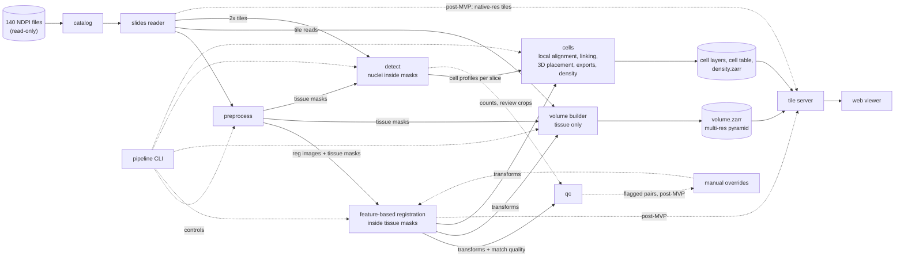
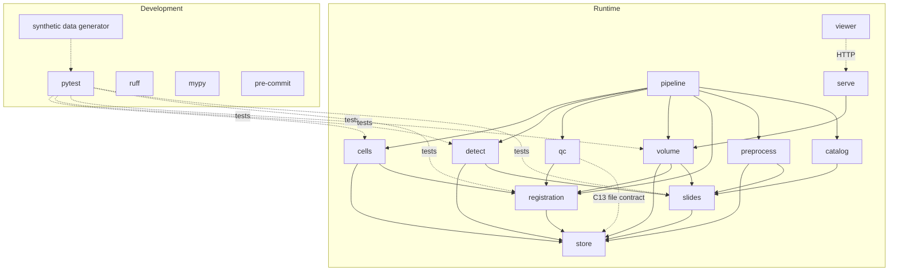

# Architecture

Status: approved design; `slides`, `catalog`, `store`, `volume` (unregistered) and `serve` implemented in M2. Updated 2026-10-19 for tissue-only processing (F12) and feature-based registration (F13), see `docs/decisions/0003-tissue-only-feature-based-registration.md`, and 2026-11-04 for centre-first alignment and best effort for failed pairs, see `docs/decisions/0004-centre-first-best-effort-registration.md`, and 2026-11-06 for cells and structures as 3D objects (components `detect` and `cells`, milestone M7), see `docs/decisions/0005-cells-in-3d.md`. Interface signatures below are the contract; changing them requires an explicit discussion (see CLAUDE.md).

## 1. Overview

A **staged batch pipeline plus a thin tile server and web viewer**, delivered as a single Python package (`brainrec`) with a CLI. Stages communicate only through files on disk, which makes them resumable and independently testable.

Principles:

1. **Transforms are separate from pixels.** Registration runs on low-resolution images and stores small transform files. Full-resolution pixels are only touched when building the volume and when serving tiles.
2. **No full slice is ever loaded at full resolution.** Work happens on pyramid levels or tiles.
3. **The volume is a multi-resolution chunked store (OME-Zarr)**; the viewer requests only the level and region it needs.
4. **Source files are read-only.** All outputs go to a separate work directory.
5. **Two processes only:** the offline pipeline (CLI) and the tile server (which also serves viewer files).
6. **Only tissue matters (F12).** Each slice's tissue mask defines what is processed: registration detects, matches and scores features inside the mask only, and the volume stores only tissue (outside the mask = background, stored as pure white; volume limited to the tissue extent). The viewer shows the background transparent.
7. **Registration is feature-based (F13).** The clearly visible tissue boundaries give the initial alignment; keypoint features inside the tissue, matched between neighbouring slices and fitted robustly (RANSAC), give the transform.
8. **Cells are objects, not pixels (F16 to F19).**
   - Nuclei are detected per section, in the slice frame, inside the tissue mask.
   - Their geometry and measurements are stored as tables, separate from pixels and transforms.
   - Profiles of one cell in consecutive sections are linked into one 3D cell, using a local alignment at cell scale computed from the nuclei.
   - Cells reach 3D only through the registration transforms, and are shown as separate viewer layers over the unchanged image volume.
9. **Nothing is invented between sections.** No interpolated images or cells; only densities (F21) are smoothed over a coarse grid.

## 2. Component responsibilities

| Component | Responsibility | Inputs | Outputs | Depends on |
|---|---|---|---|---|
| `slides` | Open NDPI, expose metadata, return regions at a pyramid level | NDPI path | Metadata, numpy arrays | OpenSlide / tifffile |
| `catalog` | Discover files, parse `N_H`, validate completeness and order, hold project config | Data folder, config | Ordered slice list | `slides` |
| `preprocess` | Create the **tissue mask** (from colour saturation) and then the registration image per slice; the mask defines what counts as tissue for every later stage (debris removed, detached fragments kept) | `SlideReader` | `reg/{id}.tif`, `reg/{id}.json`, `mask/{id}.png` | `slides`, `store` |
| `registration` | Per consecutive pair: boundary-based initial alignment from the masks, ORB keypoints inside the masks, guided matching and robust (RANSAC) similarity fit, coarse-to-fine, boundary fallback; chain to the reference slice. Drift correction post-MVP | Reg images, masks | `transforms/pair_{id}.json`, `transforms/chained_{id}.json` (transform + match quality) | OpenCV, `store` |
| `qc` | Quality metrics inside the tissue only (feature inliers and residual, masked correlation, mask overlap), overlays with tissue outlines, flagging. Manual overrides post-MVP. Detection QC (M7-16): counts and density per slice and type, flags, review crops, accuracy report | Reg images, masks, transforms; cell files | `qc/report.json`, overlay images, `qc/cells_report.json`, review crops | `registration`, `detect` (file contract C13 only) |
| `detect` | Per slice: detect nuclei in overlapping tiles at 2x inside the tissue mask, measure them (centre, radius, outline, shape, staining, nucleolus), classify them by type with a probability (M7) | `SlideReader`, mask, type table | `cells/{id}.npz`, `cells/{id}.json` (C13) | `slides`, `store` |
| `cells` | Per slice range: local alignment at cell scale per pair, linking of profiles into 3D cells, placement in the volume frame, Neuroglancer cell layers per type, cell table and QuPath export, density maps (M7) | Cell files, transforms, masks, config | `cells/pair_{k}.npz`, `cells/layer_<type>/`, `cells/table.csv`, `cells/qupath/{id}.geojson`, `density.zarr` (C15 to C18) | `registration` (transforms), `store` |
| `volume` | Resample slices through transforms tile by tile into the pyramid, **tissue only**: masks applied, background removed, canvas limited to the tissue | Slides, transforms, masks, voxel size | `volume.zarr` | `slides`, `registration`, zarr |
| `serve` | Serve volume chunks, cell layers and density maps over HTTP (later: on-demand native-resolution tiles) | `volume.zarr`, `cells/layer_<type>/`, `density.zarr` | HTTP responses | FastAPI, `volume` |
| `viewer` | 3D and orthogonal views, zoom, level-of-detail streaming; cell layers per type (show, hide, colour), size and confidence sliders, tissue-layer opacity down to transparent | HTTP | Rendered view | Neuroglancer (MVP) |
| `pipeline` | CLI and orchestrator; per-slice status; resume | Config | Manifest | all stages |
| `store` | File layout, formats and manifest shared by all stages | n/a | n/a | none |

## 3. Data flow



## 4. Component dependencies



Rules: dependencies point downward only (no cycles); stages never import each other's internals, only the interfaces below and `store`.

## 5. Interface definitions

Python signatures (type-annotated, shown as pseudocode). These are the contracts. Entries marked "implemented" exist; the M3/M4 entries were fixed in task M3-00 (2026-10-20) together with the cross-cutting contracts in section 5.1.

```
# slides
class SlideReader:                     # implemented (M2)
    @classmethod open(path: Path) -> SlideReader
    levels: list[LevelInfo]            # index, downsample, width, height
    mpp: tuple[float, float]           # microns per pixel at level 0
    level_for_downsample(downsample: float) -> int   # level counts differ per file: never index by position
    read_region(level: int, x: int, y: int, w: int, h: int) -> ndarray  # RGB uint8, (x, y) in level pixels; transparent -> white
    close() -> None

# catalog
class Catalog:                         # implemented (M2)
    @classmethod scan(data_dir: Path, id_range: tuple[int, int] | None = None) -> Catalog
    slices: list[SliceRef]             # id (int N), path, in order; raises on gaps or duplicates
class ProjectConfig:                   # data_dir, work_dir, z_spacing_um, base_downsample, n_levels
    @classmethod load(path: Path) -> ProjectConfig   # unknown settings are rejected (M3-10), see C9
# Voxel size is not on Catalog (as first drafted): x/y come from the slides' mpp, z from ProjectConfig.

# preprocess                         # M3 (contracts C1, C4, C9)
make_mask(rgb: ndarray, um_per_px: float, cfg: ProjectConfig) -> ndarray   # implemented (M3-04)
    # uint8 {0,255}; defines "tissue" (F12): saturation threshold with hysteresis, fragments kept
make_reg_image(rgb: ndarray, mask: ndarray) -> ndarray   # implemented (M3-03)
    # uint8: 255 - luminance, CLAHE, 0 outside the mask
preprocess_slice(slice: SliceRef, work: WorkDir, cfg: ProjectConfig,
                 reader_factory=SlideReader.open) -> RegImage   # implemented (M3-03)
run_preprocess(catalog, work, cfg, manifest, reader_factory=SlideReader.open, overwrite=False) -> StageResult
    # implemented (M3-03); stage shape C7; resume per C6 (refinement below)
    # one read of the 32x level; writes reg/{id}.png, reg/{id}.json, mask/{id}.png

# registration                       # M3, feature-based (F13), tissue only (F12), similarity (C2, C3)
RegImage(slice_id, image, mask, downsample, mpp_um)    # implemented: .coarse() (M3-07), .load(work, id) (M3-03)
Transform2D                          # implemented (M3-05), registration/transform.py; see C2
px_to_um(points, downsample, mpp), um_to_px(...)   # implemented (M3-05): the C1 helpers
# helpers (implemented, M3-07) work in pixel space with plain arguments, so they are testable alone:
initial_from_masks(fixed_mask, moving_mask) -> (matrix_px, iou)   # centroids, area-ratio scale, best angle
align_outlines(fixed_mask, moving_mask, init_px) -> (matrix_px, iou)  # outline ICP, trimmed similarity
detect_features(img: RegImage, max_features, detector="orb") -> Features   # inside the mask only
guided_match(fixed: Features, moving: Features, predict_px, window_px, ratio) -> (src_xy, dst_xy)
fit_similarity(src_xy, dst_xy, ransac_px, weights=None) -> Fit | None    # RANSAC + (weighted) least-squares refit; None if degenerate
register_pair(fixed: RegImage, moving: RegImage, cfg) -> PairResult   # implemented (M3-07); the public contract
    # boundary estimate -> pass 1 at 64x (window 1 mm, twice) -> pass 2 at 32x (window 0.3 mm, twice,
    # with and without centre weights; M3-13); retry with pass-1 window 2.5 mm; candidates, fallback
    # and failure rules per C12 (best centre-weighted correlation wins)
    # PairResult: transform (moving -> fixed), status ("features" | "boundary" | "failed"),
    #             n_matches, n_inliers, rms_um, mask_iou
chain(pairs: dict[int, Transform2D], ids: list[int]) -> dict[int, Transform2D]  # implemented (M3-08); reference = ids[0]
run_register(catalog, work, cfg, manifest, reader_factory=..., overwrite=False) -> StageResult  # implemented (M3-08), C7
    # registers and chains every pair, failed ones with their best-effort transform (C12, M3-13);
    # logs a warning per failed pair; StageExistsError if settings changed
load_chained(work, ids: list[int]) -> dict[int, Transform2D]   # implemented (M3-10), see C5
    # chained transforms of `ids`, checked to form one chain; FileNotFoundError / ValueError
masked_ncc(fixed, fixed_mask, moving, moving_mask, m_px, blur_px=3, edge_weight=None) -> float   # geometry.py (M3-08); reused by QC
    # edge_weight: weights pixels by depth in the overlap (M3-13); depth_weights(mask, edge_weight):
    # edge_weight at the tissue edge rising linearly to 1 at the deepest point (decision 0004)
correct_drift(...)                                       # post-MVP

# qc                                 # M4, inside the tissue only
score_pair(fixed: RegImage, moving: RegImage, result: PairResult, edge_weight) -> PairScore   # implemented (M4-01); edge_weight added in M3-13
    # PairScore(n_inliers, rms_um, ncc, dice): registration's inliers and residual (µm), masked_ncc
    # where both tissues overlap, centre-weighted like registration (decision 0004), Dice of the fixed and warped moving masks; mask_dice(fixed, moving, m_px)
render_overlay(fixed: RegImage, moving: RegImage, t: Transform2D, out: Path) -> Path  # implemented (M4-02)
    # PNG at registration level in the fixed frame: fixed green, warped moving magenta, grey where
    # they agree, background black, tissue outlines in the same colours; overlay_rgb(...) -> array
build_report(work, ids, pairs: dict[int, tuple[PairResult, PairScore]], cfg) -> dict  # implemented (M4-03), C10
    # pairs keyed by moving id; ValueError if a consecutive pair is missing, of another neighbour or
    # outside the range; flagged = is_flagged(score, qc_min_ncc, qc_min_dice): a score below its
    # threshold (None = not checked). write_report(work, report) -> qc/report.json, atomic
run_qc(catalog, work, cfg, manifest, reader_factory=SlideReader.open, overwrite=False) -> StageResult
    # implemented (M4-04), C7: score_pair + render_overlay per consecutive pair, then the report;
    # resumes per pair (see C6); FileNotFoundError naming unregistered pairs
apply_override(...)                                      # post-MVP
cells_report(work, ids, cfg) -> dict                     # M7-16: counts and density per slice and type,
    # flags (outliers, blur, folds), review crops; evaluate(labels, cells) -> scores (M7-02, M7-10)

# detect                             # M7; file contracts fixed in M7-00 (C13, C14); signatures may be refined by the implementing task
# implemented (M7-05), refining the planned detect_nuclei(rgb, mask, um_per_px, cfg) per tile:
load_detector(method) -> Detector(name, version, segment)   # "instanseg" or "stardist";
    # segment(rgb, um_per_px) -> (labels, confidence per label or None); model loaded on first use
detect_slice(reader, mask, mask_downsample, cfg, detector) -> Nuclei
    # whole slice: tiles over the mask (detect/tiles.py: plan_tiles, Tile.owns, in_mask), a nucleus
    # belongs to the tile holding its centre, objects cut by a window edge are left to the
    # neighbour, centres on tissue only; measurements (detect/measure.py: measure_nuclei,
    # refine_patch on level-0 patches, has_nucleolus, sharpness). Nuclei = the C13 columns
    # without the class columns, plus tile_sharpness, n_blurred_tiles, n_refined
classify(profiles: Profiles, model) -> Profiles          # class id, all class probabilities, confidence (decision 0006); "rules-v1" until M7-11
# implemented (M7-02): detect/labels.py - Crop, Labels, CLASSES, candidate_centres, assign_split,
#   crops_geojson, save_crops/load_crops, read_qupath(geojson, slice_id, mpp, crops, classes),
#   load_labels(dir, crops, classes, mpp); detect/evaluate.py - Detections,
#   match(truth_xy, det_xy, det_r, tol_um=3, rel=0.5) and
#   evaluate(crops, labels, detections, classes, tol_um, rel, border_um=3) -> scores per split
run_detect(catalog, work, cfg, manifest, reader_factory=SlideReader.open, overwrite=False) -> StageResult
    # C7; resumes per slice (like preprocess); tiles at 2x with overlap, a profile belongs to the tile
    # holding its centre; nothing outside the mask; writes cells/{id}.npz and cells/{id}.json

# cells                              # M7; file contracts fixed in M7-00 (C15 to C18)
align_local(fixed: Profiles, moving: Profiles, t_pair: Transform2D, cfg) -> LocalField
    # cell-scale displacement (µm) on a grid inside the overlap, on top of the pair transform;
    # from the nuclei (feature-based, robust fit per window); confidence per grid node
link_profiles(fixed, moving, field: LocalField, cfg) -> Links      # one-to-one, within a tolerance
build_cells(profiles: dict[int, Profiles], links: dict[int, Links]) -> Cells3D
    # chains of linked profiles; representative = the largest profile
place_cells(cells: Cells3D, chained: dict[int, Transform2D], spec) -> Placed  # volume frame, µm
write_cell_layers(placed, types, out_dir) -> list[Path]  # Neuroglancer precomputed ellipsoid
    # annotations, one sharded layer per type (C17); read_cell_layer(path) for tests
export_table(placed, out: Path), export_qupath(profiles, slice_id, out: Path)   # C18
density_map(placed, spec, cfg) -> Path                   # density.zarr, one channel per type (C18)
run_cells(catalog, work, cfg, manifest, overwrite=False) -> StageResult
    # C7 shape without slide reads; local alignment and links resume per pair (like register),
    # placement, layers, exports and density are rebuilt per range

# store                              # implemented (M2)
WorkDir(root).manifest, .volume        # the only place that knows file names
    .reg_image(id), .reg_meta(id), .mask(id)                 # implemented (M3-01), C4
    .pair_transform(k), .chained_transform(id)               # implemented (M3-01), C5
    .qc_report, .qc_overlay(k); .reg_dir, .mask_dir, .transforms_dir, .qc_dir   # (M3-01), C10
    .cell_profiles(id), .cell_meta(id), .cell_pair(k), .cell_layer(type), .cell_table,
    .qupath(id), .density, .labels_dir                       # implemented (M7-04), C13 to C18
# store/cells.py (M7-04): Profiles (C13), encode_outlines, save_profiles(work, id, profiles, meta),
#   load_profiles(work, id) -> (Profiles, meta); json written last; validates shapes and classes
    # ids must be positive integers; anything else raises ValueError
Manifest(path).get(key), .set(key, value)   # JSON, atomic write

# volume                             # implemented: centred mode (M2), registered tissue-only mode (M3-09)
VolumeSpec(z_spacing_um, base_downsample=4, n_levels=5, chunk_xy=512, shard_xy=4096, mask_margin_um=50)
build_volume(catalog, out: Path, spec: VolumeSpec, manifest: Manifest | None = None,
             reader_factory=SlideReader.open, overwrite: bool = False,
             transforms: dict[int, Transform2D] | None = None,   # slice -> reference (µm), C8
             masks: dict[int, Path] | None = None) -> Path         # tissue mask PNG per slice, C8
    # Both None: centred mode (M2). Both given: registered, tissue only (C11):
    #   - canvas = extent of all transformed masks enlarged by mask_margin_um, aligned to the grid
    #   - each output tile = one shard, resampled (bilinear) from the slide level of the same
    #     resolution; tiles without tissue are neither read nor stored
    #   - outside the enlarged mask: 255 (fill, not stored); tissue never pure white (254)
    #   - the mask's pyramid level is found by matching its size to a level of the slide
    # attrs["brainrec"]: mode, slice_ids, reference_slice, canvas_origin_um, mask_margin_um,
    #   transform_sha256, mask_sha256, slice_to_reference_um
    # Raises VolumeExistsError if `out` exists from other inputs and overwrite is False; ValueError
    # if only one of transforms/masks is given or a slice lacks one.
# volume/warp.py (M3-09): enlarge_mask, outline_corners, tissue_extent_um, source_box, warp_tile,
#   warp_mask_tile, finish_tile, canvas_tiles (pure geometry, tested without slides)

# serve                              # implemented (M2)
create_app(root: Path) -> FastAPI      # static files of the work dir, CORS + range requests
neuroglancer_state(volume_url, ome) -> dict   # RGB layer; OME axis c mapped to channel dim "c^"
    # implemented (M3-12): shader draws pure white (background, C11) transparent, every other voxel
    # in its RGB colour; panel backgrounds black (crossSection/projectionBackgroundColor);
    # displayDimensions x, y, z, so the "xy" panel shows the section plane (axes are stored z, y, x)
    # M7-08 (Proposed): optional arguments cell_layers and density_layers; existing calls keep working.
    # One annotation layer per type (colour, size and confidence sliders), an opacity control for the
    # tissue layer down to fully transparent, density layers with a colour map
launch_local_viewer(state, port=0) -> neuroglancer.Viewer   # served from 127.0.0.1; caller keeps it alive (weak refs)
GET /volume.zarr/{path}                # Zarr metadata and shard files
GET /tile/{z}/{level}/{x}/{y}          # post-MVP, native-resolution tile

# pipeline (CLI)                     # interim commands until `brainrec run` (M2-08, M3-10)
brainrec --config C preprocess --slices A-B [--overwrite]
brainrec --config C register --slices A-B [--overwrite]   # chained to slice A
brainrec --config C volume --slices A-B [--overwrite] [--unregistered]
    # registered, tissue-only (C8, C11) from load_chained and the masks; --unregistered = M2 mode
brainrec --config C qc --slices A-B [--overwrite]         # implemented (M4-04): table per pair,
    # thresholds, flagged pairs; exit status 0 also with flagged pairs
brainrec --config C detect --slices A-B [--overwrite]     # M7-06, interim: cell profiles per slice
brainrec --config C cells --slices A-B [--overwrite]      # M7-07: link, place, layers, table, density
brainrec --config C serve [--port 8000] [--layout xy] [--gpu-memory-mb 512]   # viewer on port+1
    # --slices: A-B or N. User errors (config, slice range, missing step, other settings without
    # --overwrite, drive not connected) end with one line `error: ...`, exit status 1; a failed pair
    # is not an error: `register` names it in a warning line and exits 0 (M3-13);
    # other exceptions are bugs and keep their traceback.
brainrec run [--stage S] [--slices A-B]                # M5; stages preprocess, register, qc, volume, detect, cells
brainrec status                                        # M5
```

### 5.1 Cross-cutting contracts (fixed in M3-00, 2026-10-20)

Every M3 to M5 task follows these. Changing one is an interface change (CLAUDE.md). Evidence: the real-data spike (`docs/REQUIREMENTS.md` section 7) and owner decisions 9 to 15.

**C1 Coordinates.**
- Each slice has its own frame in **micrometres**. The origin is the top-left **corner** of level-0 pixel (0, 0); x points right, y points down.
- Pixel coordinates follow OpenCV: integer (x, y) is the **centre** of column x, row y.
- A level with downsample d maps to µm as X = (x + 0.5)·d·mpp_x and Y = (y + 0.5)·d·mpp_y.
- All pixel↔µm conversion goes through one helper in `registration/transform.py`.
- *Why:* mixing corner and centre conventions between 32x and 4x would shift slices by about 3.5 base pixels.

**C2 Transform.**
- `Transform2D` holds a 2x3 matrix A in µm mapping the **slice frame → reference frame**: p' = A·[p, 1].
- Family `similarity`: A = [[s·cosθ, −s·sinθ, tx], [s·sinθ, s·cosθ, ty]], with s > 0. θ is in radians in y-down coordinates (positive = clockwise on screen). `rigid` is the special case s = 1.
- **Operations:**
  - `identity()`, `similarity(angle_rad, scale, tx_um, ty_um)`, `from_matrix(A, family)`, which validates the family;
  - `matrix`, `inverse()`, and `a.compose(b)` = a∘b (b applied first);
  - `apply(points_um)`, `angle_deg`, `scale`;
  - `to_pixels(src_downsample, dst_downsample, mpp)`, giving the 3x3 matrix from source-level pixels to destination-level pixels, and its inverse `from_pixels(matrix_px, src_downsample, dst_downsample, mpp)`, which converts OpenCV's pixel-space result to µm;
- **File format:** `save()`/`load()` use JSON `{"schema": "brainrec.transform/1", "family": "similarity", "matrix_um": [[...], [...]]}`.
- `register_pair(fixed, moving)` returns the transform **moving → fixed**. OpenCV's RANSAC result maps moving keypoints onto fixed keypoints in pixels and is converted with C1.
- **Chain:** T(k → ref) = T(ref+1 → ref) ∘ … ∘ T(k → k−1).

**C3 Transform family.**
- **Similarity** (rotation, uniform scale, translation), owner decision 11.
- No reflection: no mirrored slices were found (decision 12).
- Affine and non-rigid come after the MVP. The `family` field lets them be added without changing the file format.
- *Known limit:* scale errors can accumulate along the chain; drift correction is post-MVP.

**C4 Preprocessing files.**
- **Read:** one read of the 32x level per slice (`reg_downsample`).
- **`mask/{id}.png`:** uint8 {0, 255}, 255 = tissue. Rule:
  1. Otsu on blurred **chroma** (max − min of R, G, B; chosen in M3-04 instead of HSV saturation, which explodes on near-black pixels and turned the black scanner edge of slice 10 into "tissue"), never below 15 (Otsu always splits, even an image of pure glass), with hysteresis: pixels at ≥ `mask_hysteresis` × threshold count as tissue if they connect to pixels at or above the threshold. This keeps pale tissue.
  2. Close (about 100 µm), then open (about 35 µm), then fill holes.
  3. Keep **every** component of at least `mask_min_component_mm2`, so detached fragments are kept (decision 14); debris specks are smaller than 0.2 mm².
- **`reg/{id}.png`:** uint8, 255 minus luminance, with the background set to 0 **before** CLAHE (clip 2.0, 8x8 tiles) and again after, so glass and debris cannot influence the contrast inside the tissue (refined in M3-07, where a debris-invariance test caught it). The 64x image for pass 1 is derived in memory by 2x area downsampling and not stored.
- **`reg/{id}.json`:** `{"schema": "brainrec.regimage/1", "slice_id", "source", "downsample", "mpp_um": [x, y], "width", "height"}`.
- PNG, not TIFF: lossless and written by OpenCV, with no extra dependency in this path.

**C5 Pairs and reference.**
- A pair is keyed by its moving slice k; fixed = the previous slice in catalog order.
- `transforms/pair_{k}.json` holds the `PairResult` (k → k−1).
- `transforms/chained_{k}.json` holds the transform k → reference.
- Reference = the first slice of the register run's range. It is not recorded: the chained files are rebuilt on every run (C6, M3-08 refinement), so runs over other ranges leave transforms to other references side by side.
- *Refinement (M3-10):* consumers therefore read them through `load_chained(work, ids)`, which requires chained[k] = chained[prev] ∘ pair[k] for every slice after the first. That holds within one run and fails across runs, so transforms to different references are never mixed in one volume.

**C6 Manifest.**
- Keys `preprocess`, `register`, `qc`, `volume`, each `{signature, done: [ids]}`.
- A signature contains the stage's parameters, its id list and a hash of the upstream stage's signature. Changed inputs therefore invalidate downstream work; they are never silently reused.
- *Refinement (M3-03):* for **per-slice** stages (`preprocess`), the signature holds only the parameters (and an algorithm version), and each done slice records a fingerprint of its source file (name, size, modification time) under `sources`. Extending a range keeps finished slices; a changed source is redone; changed parameters raise `StageExistsError` unless `overwrite`. Stages whose result depends on the whole set of slices (`register`, `volume`) keep the id list in their signature.
- *Refinement (M3-08):* `register` resumes **per pair**. A pair is redone when the registration settings change (then `StageExistsError` unless `overwrite`), or when its inputs change: a hash of the preprocess signature and both slices' source fingerprints. The chained transforms are rebuilt from the pair files on every run (cheap), so extending the range or choosing another reference slice never redoes finished pairs.
- *Refinement (M4-04):* `qc` resumes **per pair**. A pair is redone when its pair file or one of its two slices' registration image, mask or metadata changed (SHA-256 of the files); its scores are kept in the manifest (`scores`). The signature holds only `reg_edge_weight` and a version: the thresholds `qc_min_ncc` and `qc_min_dice` only decide the flags, which are re-evaluated on every run.
- `StageResult(done, skipped)`, `StageExistsError`, `fingerprint()` and `write_atomic()` (temporary file + rename) live in `store/stage.py`.

**C7 Stage shape.**
- `run_<stage>(catalog, work: WorkDir, cfg: ProjectConfig, manifest: Manifest, reader_factory=SlideReader.open, overwrite=False) -> StageResult(done, skipped)`.
- Idempotent per item; raises on error.

**C8 Volume inputs.**
- `build_volume(..., transforms: dict[int, Transform2D] | None, masks: dict[int, Path] | None)`, keyed by slice id. `None` means M2 mode.
- Volume attributes add `reference_slice`, `canvas_origin_um`, `mask_margin_um`, and a per-slice hash of transform and mask.

**C9 Configuration** (flat fields with defaults, so existing configs keep working). Unknown fields are rejected (M3-10, owner decision 2026-10-20), so a misspelled setting is an error naming it instead of a silent default:

| Field | Default | Source |
|---|---|---|
| `reg_downsample` | 32 | spike |
| `reg_coarse_factor` | 2 (pass 1 at 64x) | decision 13 |
| `reg_detector` | `"orb"` | decision 12 |
| `reg_max_features` | 50000 | spike |
| `reg_ratio_test` | 0.8 | spike |
| `reg_window_um` | [1000, 300] | spike; pass 1 narrowed from 2500 in M3-08 (see C12) |
| `reg_ransac_px` | 4.0 | spike |
| `reg_min_inliers` | 40 | spike: lowest good pair had 62 |
| `reg_max_rms_um` | 25.0 | spike: 16 to 19 µm observed |
| `boundary_min_iou` | 0.80 | spike: 0.83 to 0.98 observed |
| `reg_ncc_tolerance` | 0.01 | M3-08: feature fit may correlate at most this much worse than the outline estimate |
| `reg_edge_weight` | 0.2 (Proposed) | M3-13, decision 0004: weight of the tissue edge relative to the centre (1) in fits and correlations |
| `reg_retry_window_um` | 2500 | M3-13: pass-1 window of the second attempt; the spike's window |
| `mask_hysteresis` | 0.75 | to be validated in M3-04 |
| `mask_min_component_mm2` | 0.25 | spike: fragments 0.6 to 2.8 mm², specks below 0.2 |
| `volume_mask_margin_um` | 50 | decision 9; `VolumeSpec.mask_margin_um` (M3-09) |
| `qc_min_dice` | 0.93 (approved for now, 2026-11-07) | M4-05: real pairs 0.904 to 0.981; flags the damaged pairs 4→5 and 5→6. Dice hardly reacts to misalignment (a 400 µm shift lowers it by 0.01 to 0.03); it mainly shows torn or missing margins and rotations of about 5° |
| `qc_min_ncc` | 0.40 (approved for now, 2026-11-07) | M4-05: real pairs 0.346 to 0.754; flags 4→5 and 5→6 (gap 0.377 to 0.451). Catches a 400 µm shift in the weaker pairs 1 to 5 and, with Dice, a 5° rotation in every pair; errors of 100 to 200 µm stay below what an absolute threshold can see |

**C10 QC report.** `qc/report.json`: `{"schema": "brainrec.qc/1", "thresholds", "pairs": [{"fixed", "moving", "status", "n_inliers", "rms_um", "ncc", "dice", "flagged", "overlay"}]}`. `flagged`: status `failed` (M3-13), or a score below its threshold.

**C11 Tissue-only volume.**
- A voxel is tissue if it lies inside its slice's mask, warped by the slice's transform and enlarged by `volume_mask_margin_um`.
- All other voxels are exactly (255, 255, 255), the fill value, so all-background chunks are not stored.
- Tissue voxels that are exactly pure white are stored as 254.
- The canvas is the bounding box of all warped, enlarged masks, aligned to the pyramid grid.
- The viewer shows pure white as transparent (decision 10).

**C12 Acceptance and failure rules per pair.**
- **`features`:** pass-2 inliers ≥ `reg_min_inliers`, rms ≤ `reg_max_rms_um`, **and** mask IoU of the result ≥ `boundary_min_iou`. The last condition was added in M3-07: without it, an unrelated pair was accepted with 47 consistent but spurious matches (scale 0.39, IoU 0.09). Real pairs 1 to 10 all pass (lowest IoU 0.825).
  - **and** (added in M3-08) the masked correlation of the result is at least that of the outline estimate minus `reg_ncc_tolerance`. On real pair 4→5 the method once drifted to a precise fit of one region of the unevenly deformed section (−12.7°, correlation 0.246 against 0.284 for the outline estimate); the IoU check alone let it pass (0.811). Together with the narrower pass-1 window (1 mm instead of 2.5 mm, pass 1 run twice) the pair now registers at +3.3°, in line with the spike.
  - **Centre first (M3-13, decision 0004):** the correlations are weighted by depth in the tissue (`reg_edge_weight` at the edge, 1 at the centre). Pass 2 runs with and without centre-weighted refits; of the fits that pass, the one with the higher weighted correlation is kept. If none passes, matching is repeated once with a pass-1 window of `reg_retry_window_um`.
- **`boundary`:** otherwise the outline alignment (iterative closest point on the two tissue outlines, similarity, starting from the boundary estimate) and the outline estimate join the failed feature fits as candidates; the one with the highest centre-weighted correlation is used, with status `boundary` if its mask IoU ≥ `boundary_min_iou`. (Until M3-13 the outline alignment was taken whenever its IoU passed; on real damaged pairs it is 0.9 to 1.3 mm off in the interior.)
- **`failed`:** the chosen candidate's IoU is below `boundary_min_iou`. It is still used as a best effort (M3-13): `register` chains every pair, warns about each failed pair and exits 0; the pair file keeps status `failed`. Nothing is accepted silently: QC always flags failed pairs.
- QC separately flags pairs whose scores are below `qc_min_ncc` or `qc_min_dice` (C10).

### 5.2 Cell contracts (fixed in M7-00, approved by the owner 2026-11-08)

Every M7 task follows these. Changing one is an interface change (CLAUDE.md). Evidence: spike M7-01, appearance groups M7-18, label tools M7-02 and M7-19, decisions 0005 and 0006. Values marked *(tunable)* are config defaults (C9), measured again in the named task.

**C13 Cell profile file (per slice, slice frame C1).**
- **Detection:**
  - InstanSeg `brightfield_nuclei` at the **2x level** (0.44 µm/px), in tiles of 1024 × 1024 px with an overlap of 40 µm *(tunable)*;
  - a profile belongs to the tile that contains its centre, so none is cut or counted twice;
  - no centre lies outside the tissue mask (F12); profiles smaller than 8 µm² are dropped.
  - StarDist stays the second candidate (M7-10); the detector name and version are recorded.
- **Level-0 patch:** for profiles of 8 µm diameter or more *(tunable)*, a 1x patch is read for the nucleolus and an exact outline and size (M7-01: nucleoli are 2 to 4 px at 2x).
  - Outline (M7-05): near the 2x border, a pixel belongs to the nucleus if its gray level is closer to the nucleus interior than to the ring around it, smoothed over 0.3 µm. The 2x outline is kept if the contrast is below 6 gray levels or the area changes by more than −40% / +60%.
  - Nucleolus (M7-05, Proposed until expert labels): one compact interior spot (0.6 to 5 µm², at least 1 µm inside the border) that is at least 60 gray levels and 4.5 median absolute deviations darker than the nucleus, with at most two such spots (more = clumped chromatin). Calibrated by eye on 343 real nuclei; strict, so it misses some nucleoli.
- **Sharpness:** variance of the Laplacian per tile at 2x over tissue away from the glass edge, times 0.18 (the level-0 value is 0.18 × the 2x value: 60 real windows, quartiles 0.17 and 0.19, M7-05). Tiles below `detect_min_sharpness` (default 100) are flagged, and their profiles get `blurred = 1`.
- **Features (M7-05):** the 9 features are measured at 2x for every profile, so their scale differs from the level-0 values of M7-18; only `diameter_um` comes from the level-0 patch when there is one. Changes against M7-18:
  - `cell_body` is the upper quartile of the ring 0.5 to 3 µm around the nucleus (a cell body lies on one side);
  - `vessel_um`: lumens are bright gaps (gray > 0.85 × 255) of at least 15 µm² inside the tissue, the distance capped at 20 µm (half the overlap, so tiles do not change it);
  - background levels come from tissue pixels only.
- **`cells/{id}.npz`**, one row per profile. Arrays (float32 unless noted):

  | Field | Meaning |
  |---|---|
  | `x_um`, `y_um` | centre (float64), slice frame |
  | `r_um`, `area_um2` | equivalent-area radius, area |
  | `outline_offsets` (int64), `outline_xy` (int16) | ragged outline: vertices relative to the centre in units of 0.1 µm, at most 32 vertices per profile |
  | `diameter_um`, `elongation`, `solidity`, `darkness`, `texture`, `nucleolus`, `cell_body`, `halo`, `vessel_um` | the 9 appearance features of M7-18 (vessel and cell-body features improved in M7-05d) |
  | `nucleolus_seen` (uint8) | nucleolus visible (from the 1x patch; 0 when no patch) |
  | `det_conf` | detection confidence; NaN when the detector gives none (InstanSeg) |
  | `blurred` (uint8) | in a tile below the sharpness limit |
  | `class_id` (uint8) | C14 id, never empty (decision 0006) |
  | `class_prob` (n × n_classes) | probability of every class, in C14 order |
  | `confidence` | top class probability |

- **`cells/{id}.json`:**
  - fields: `{"schema": "brainrec.cells/1", "slice_id", "source", "detector", "detector_version", "downsample": 2, "mpp_um", "classifier", "class_names", "n_profiles", "n_blurred_tiles", "tile_sharpness": [...]}`;
  - `classifier` is `"rules-v1"` (the appearance-group rules of M7-19) until M7-11 trains one on expert labels;
  - written last and atomically, as C4.

**C14 Type table (config `cell_types`).**
- **Ids are stable and never reused.** There is no "unclassified" (decision 0006). Id 0 is reserved and never written.
- **Colours:** colour-blind safe (Okabe-Ito).
- **Proportions:** spheres by default (Q26); `proportions` allows a fixed axis ratio per class.
- **Radius limits:** guards against implausible profiles; drops are logged.

  | id | name | colour | proportions | radius µm |
  |---|---|---|---|---|
  | 1 | Neuron | `#E69F00` | [1, 1, 1] | 2 to 15 |
  | 2 | Astrocyte-like | `#56B4E9` | [1, 1, 1] | 2 to 8 |
  | 3 | Oligodendrocyte-like | `#009E73` | [1, 1, 1] | 1.5 to 6 |
  | 4 | Microglia-like | `#F0E442` | [1, 1, 1] | 1.5 to 8 |
  | 5 | Vessel-wall | `#D55E00` | [1, 1, 1] | 1.5 to 10 |
  | 6 | Other | `#999999` | [1, 1, 1] | 1.5 to 15 |

- **Later:** suspicious classes (M9) get new ids from 7.
- **Labels:** the label files (M7-02) use the names; ids are looked up here.

**C15 Local alignment and links (per pair, keyed by the moving slice k, as C5).**
- **`cells/pair_{k}.npz`** holds:
  - `grid_x_um`, `grid_y_um` (node positions in k−1's frame, spacing `align_grid_um` = 100 *(tunable)*);
  - `dx_um`, `dy_um` (displacement added after the pair transform k → k−1);
  - `node_conf` (0 to 1; nodes without support are filled from their neighbours and get 0);
  - `links` (m × 2 int32: profile indices in k and k−1);
  - `link_dist_um`.
  - `pair_{k}.json` records `{"schema": "brainrec.cellpair/1", "method", "n_links", "share_linked", "median_link_um"}`.
- **Method:** the method of the field is chosen in M7-12. M7-01 showed that one correlation per window is not enough: it needs larger context, a smooth field and a robust fit to the nuclei.
- **Linking rule:**
  - after local alignment, profiles in k and k−1 are linked if their centres are closer than max(`link_tolerance_um` = 1.5, 0.5 × the smaller radius);
  - one-to-one, closest first;
  - no link across classes 1 (Neuron) and 3 (Oligodendrocyte-like) unless both confidences are below 0.5;
  - chains longer than `link_max_sections` = 8 *(tunable)* are split at their weakest link and flagged.
- **Independent of the section thickness.** With gaps, few links are found and every profile stays its own cell.

**C16 3D cell and placement.**
- **Cell:** a chain of one or more linked profiles. The representative profile is the largest (closest to the equator).
- **Class:** the class of the chain is the argmax of the summed class probabilities of its profiles; the confidence is the mean of their probabilities for that class.
- **Position:**
  - x, y is the representative centre through the chained transform of its slice (C2, C5), so the blob sits on its nucleus in the volume;
  - z = (index of that slice in the range + 0.5) × `z_spacing_um`, the centre of its plane in the volume;
  - volume coordinates are reference µm minus `canvas_origin_um` (C8, C11).
- **Radius:** the representative `r_um` × the transform's scale, as a sphere in µm × the class proportions (C14).
- **3D size estimate:** once `section_thickness_um` is set, an additional measurement fitted from the chain's radii over z.
- **Cell id:** uint64 = slice id × 2³² + profile index of the representative. Stable while detection is unchanged.

**C17 Cell layers (Neuroglancer precomputed annotations; prototype tested with 4.19 million cells in M7-01).**
- **Annotations:**
  - `annotation_type` `ELLIPSOID`;
  - dimensions x, y, z in µm (`[1e-6, "m"]`), the volume's coordinates (C16);
  - geometry = centre (3 × float32) + radii (3 × float32).
- **Layers:** one layer per class, `cells/layer_<name>/` (name in lower case, for example `layer_neuron`).
- **Properties,** largest type first so no padding is needed between them:

  | Property | Type |
  |---|---|
  | `confidence` | float32 |
  | `det_conf` | float32 |
  | `radius_um` | float32 |
  | `slice` | uint16 |
  | `n_profiles` | uint16 |
  | `nucleolus` | uint8 enum no/yes |
  | `blurred` | uint8 enum no/yes |

  Padded to 4 bytes.
- **Indexes:**
  - by-id index: sharded (`neuroglancer_uint64_sharded_v1`, identity hash, shard_bits 0, minishard_bits 12, raw encodings), one file `by_id/0.shard`;
  - spatial index: one sharded level per `spatial<i>/0.shard` (minishard_bits 6, keys = compressed Morton code). The grid is [2^i, 2^i, 1]; each chunk holds at most `limit` = 4000 annotations in random order, and the finest level takes the rest.
- **File count:** at most about 20 files per layer, plus `info`.
- **Viewer:** the layer shader gets a colour picker and a `min_confidence` slider; the tissue fades with the image layer's own opacity (M7-01).

**C18 Cell table, QuPath export and density maps.**
- **`cells/table.csv`:** one row per 3D cell, with:
  - `cell_id`, `class`, `confidence`, the probability of every class;
  - `x_um`, `y_um`, `z_um` (volume), `radius_um`, `n_profiles`;
  - `slice`, `x_slice_um`, `y_slice_um`, `x_px0`, `y_px0` (level 0 of the source slide);
  - the 9 features, `nucleolus_seen`, `blurred`, `det_conf`.
- **`cells/qupath/{id}.geojson`:** profiles of one slice as QuPath detections (outline polygon, classification, measurements) in level-0 pixels. Written for the slices requested (`--qupath`); GeoJSON is large.
- **`density.zarr`:**
  - OME-Zarr 0.5, axes c (class), z, y, x;
  - x and y on a grid of `density_grid_um` = 50 µm; z per section;
  - float32 values, Gaussian smoothed over σ = 1 cell in x and y;
  - attribute `unit` = `"profiles/mm2"` while `section_thickness_um` is null, else `"cells/mm3"` (linked cells; Abercrombie correction where profiles are counted).
- **Label files** (M7-02, M7-19): `labels/crops.json` (`brainrec.labelcrops/1`), `labels/qupath/<slide>.geojson`, `labels/draft/<slide>.geojson` (drafts, never ground truth), `labels/annotations/<slide>.geojson` (expert exports).

**Extensions of C6 and C9 (fixed with C13 to C18):**
- **C6:**
  - manifest key `detect`: per slice, like `preprocess`. The signature holds the detection fields of C9, the detector and model versions and the classifier; each done slice has its source fingerprint.
  - manifest key `cells`: per pair for `pair_{k}` (key: hashes of both cell files, the pair transform and the alignment settings, like `register`), and per range for placement, layers, table, QuPath and density (signature with the range).
- **C9:** new fields with their defaults:

  | Field | Default |
  |---|---|
  | `section_thickness_um` | null (unknown) |
  | `detect_downsample` | 2 |
  | `detect_method` | `"instanseg"` |
  | `detect_tile_px` | 1024 |
  | `detect_overlap_um` | 40 |
  | `detect_min_area_um2` | 8 |
  | `detect_patch_min_diameter_um` | 8 |
  | `detect_min_sharpness` | 100 |
  | `cell_types` | the C14 table |
  | `align_grid_um` | 100 |
  | `link_tolerance_um` | 1.5 |
  | `link_max_sections` | 8 |
  | `density_grid_um` | 50 |

  They are added to `ProjectConfig` by the task that first uses them (M7-04 or M7-05).

## 6. Technology decisions

| Concern | Choice | Rationale | Trade-off |
|---|---|---|---|
| Language | Python 3.12+ | Best ecosystem for whole-slide images, registration and Zarr | Slower than C++; heavy loops run in native libraries |
| NDPI reading | OpenSlide (`openslide-python` + `openslide-bin`), tifffile as fallback | Lazy tile access to NDPI; `openslide-bin` bundles the native library in the venv | |
| Storage | OME-Zarr 0.5 on Zarr v3, sharded (512 px chunks in 4096 px shards), zstd lossless | Chunked, multi-resolution, resumable; shards keep the file count low on the exFAT drive (512 KB blocks, a `._` file per file) | Lossless only: Neuroglancer's Zarr reader has no JPEG codec (see docs/decisions/0001) |
| Image ops | numpy, scikit-image, OpenCV | Standard and fast | |
| Registration | OpenCV: ORB features inside the tissue masks, guided two-pass matching (windows around the boundary estimate, then around the first fit), RANSAC similarity fit (`estimateAffinePartial2D`); coarse-to-fine 64x then 32x; tissue-boundary initialisation and fallback. SimpleITK only for an optional intensity refinement | Owner requirement (F13); feature matching is rotation-invariant (no angle sweep) and robust to outliers; OpenCV is already a dependency | At about 7 µm/px matches come from larger structures (vessels, layers, the edge); feature-poor pairs fall back to boundary alignment. Cell-scale alignment (a few µm) is a separate local step for linking cells (C15) |
| Parallelism | `concurrent.futures`; Dask only if needed | Simplicity | |
| Server | FastAPI + uvicorn | Lightweight, testable | |
| Viewer | Neuroglancer (MVP), served locally by the `neuroglancer` Python package | Solves 3D streaming and orthogonal views, saving weeks; local serving avoids a public page reading from localhost | Less control over UX; replaceable, isolated to `serve/` |
| Config | YAML + pydantic | Validated and versionable | |
| Cell detection (M7) | InstanSeg `brightfield_nuclei` (`instanseg-torch`, PyTorch on the Apple GPU) at 2x, chosen in M7-01 against a colour-separation baseline, StarDist and Cellpose; StarDist stays available as an optional extra (`.[stardist]`) for the comparison in M7-10 | Best speed for its accuracy in M7-01 (about 1 s/mm² for the model); finds pale and touching nuclei | PyTorch adds about 1 GB; no confidence per nucleus; the model normalises each tile on its own |
| Cell types (M7-11) | Classifier on the measurements of each profile (scikit-learn, Proposed) trained on owner labels | Small, explainable, fast | New dependency (permission needed); limited by what the stain shows |
| Cell layers (M7-07) | Neuroglancer precomputed annotations (ellipsoids), sharded, own numpy writer | Native 3D blobs with properties, shaders and level of detail in the existing viewer | The format must be written by us; viewer speed with millions of cells is a risk (R13) |
| Cell exports (M7-14) | CSV (standard library) and GeoJSON for QuPath | Readable by pathologists' tools without our code | |
| Packaging | `pyproject.toml` (uv or pip) | Reproducible | |
| Testing | pytest, synthetic slice generator | Independent tests without the real data | |

## 7. Project structure

```
Brain 3D Reconstruction/
├── pyproject.toml
├── README.md, CLAUDE.md
├── config/project.example.yaml   (copy to config/project.yaml, git-ignored)
├── requirements-lock.txt         (exact versions, from pip freeze)
├── src/brainrec/
│   ├── slides/  catalog/  preprocess/  registration/
│   ├── qc/  volume/  serve/  store/  pipeline/
│   ├── detect/  cells/                               (M7)
├── viewer/
├── tests/ (unit/, integration/, synthetic/)
├── scripts/
└── docs/ (REQUIREMENTS.md, ARCHITECTURE.md, decisions/)

Work directory (outside repo): /Volumes/My Passport/3D Brain Reconstruction/
    manifest.json  volume.zarr/
    reg/{id}.png  reg/{id}.json  mask/{id}.png
    transforms/pair_{k}.json  transforms/chained_{k}.json
    qc/report.json  qc/overlay_{k}.png
    cells/{id}.npz  cells/{id}.json  cells/pair_{k}.npz          (M7, C13, C15)
    cells/layer_<type>/  cells/table.csv  cells/qupath/{id}.geojson   (M7, C17, C18)
    density.zarr  qc/cells_report.json                           (M7, C18)
    labels/crops.json  labels/qupath/<slide>.geojson  labels/annotations/<slide>.geojson   (M7-02)
```

## 8. Risks and limitations

- **Storage:** about 423 GB free on My Passport (402 GB of it already holds the sources). Raw RGB is about 43 GB per slice at native resolution, about 6 TB for 140, so native resolution cannot be precomputed and must be served on demand (post-MVP). Measured in M2 (lossless zstd): the 4x base level is about 1.45 GB of data per slice, about 2 GB with the pyramid, so **about 280 GB for all 140 slices**. That fits, with limited margin. The 2x floor (about 4x larger) would not fit losslessly.
- **exFAT drive:** 512 KB allocation blocks, and macOS writes a `._` file per written file (for the `com.apple.provenance` attribute). Many small files waste space (measured 3x) and make directory listings take minutes. Mitigated by sharding; any future output format must also keep the file count low.
- **Drive disconnects:** the drive dropped out once during an M2 build. Builds resume per slice; a disconnect costs at most one slice.
- **Tissue mask errors (F12):** the mask now decides what is kept. Too tight cuts tissue away; too loose keeps glass, debris, labels or bubbles. Mitigated by a safety margin (about 50 µm, proposed), dropping small components, and mask outlines on the contact sheet and QC overlays for owner review.
- **Coarse tissue edge:** the mask comes from the 32x image (about 7 µm/px), so at 0.88 µm/px the tissue edge follows the mask's steps, softened by the margin. A finer edge is a later improvement.
- **Feature matching on histology (F13):** at the registration resolution single cells are not resolved, and only some nuclei recur in the next section (2026-11-05 check, `docs/REQUIREMENTS.md` section 7); matches must come from larger structures (vessels, layers, the tissue edge). Repetitive texture can produce false matches; RANSAC and the inlier count guard against them, with boundary alignment as fallback. Measured in the real-data spike (risk R10).
- **Drift:** errors accumulate across 140 chained pairs; mitigated by drift correction and QC; unsolved in general.
- **Non-rigid distortion:** can deform real anatomy; kept behind a flag.
- **Damaged sections** (tears, folds) will need manual overrides.
- **Anisotropy:** Z spacing is much larger than in-plane pixel size, so side views look like stacked slices.
- **Viewer:** Neuroglancer needs a compatible Zarr layout and CORS; its UX may not suit.
- **I/O:** the external drive is the speed limit; limit passes over each source slice.
- **Environment:** OpenSlide needs a native install; nothing is installed until approved.
- **Cells (M7, decision 0005):**
  - **Accuracy on this stain (R11):** pale neuron nuclei, touching nuclei, folds and blur.
  - **Run time (R12):** detection reads every slide at 2x, roughly 1 to 4 days for 140 slices, resumable per slice.
  - **Viewer speed (R13):** millions of blobs.
  - **Labelling time (R14).**
  - **Unknown thickness and spacing (R8, R15):** they decide z proportions, 3D sizes and densities, but not detection or linking.
  - **Alignment at cell scale (R16):** the registration leaves 20 to 80 µm local offsets, so linking needs a local alignment of 1 to 2 µm.
  - **Profile size (R17):** a 2D profile underestimates the cell; mitigated by linking (largest profile) and the nucleolus flag.
  - **Dependency weight (R18).**
