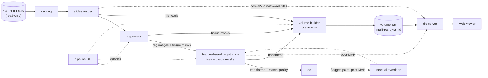
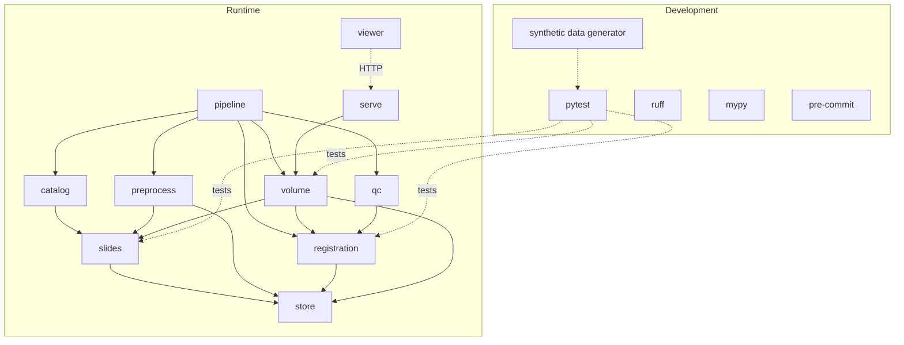

# Architecture

Status: approved design; `slides`, `catalog`, `store`, `volume` (unregistered) and `serve` implemented in M2. Updated 2026-10-19 for tissue-only processing (F12) and feature-based registration (F13), see `docs/decisions/0003-tissue-only-feature-based-registration.md`. Interface signatures below are the contract; changing them requires an explicit discussion (see CLAUDE.md).

## 1. Overview

A **staged batch pipeline plus a thin tile server and web viewer**, delivered as a single Python package (`brainrec`) with a CLI. Stages communicate only through files on disk, which makes them resumable and independently testable.

Principles:

1. **Transforms are separate from pixels.** Registration runs on low-resolution images and stores small transform files. Full-resolution pixels are only touched when building the volume and when serving tiles.
2. **No full slice is ever loaded at full resolution.** Work happens on pyramid levels or tiles.
3. **The volume is a multi-resolution chunked store (OME-Zarr)**; the viewer requests only the level and region it needs.
4. **Source files are read-only.** All outputs go to a separate work directory.
5. **Two processes only:** the offline pipeline (CLI) and the tile server (which also serves viewer files).
6. **Only tissue matters (F12).** Each slice's tissue mask defines what is processed: registration detects, matches and scores features inside the mask only, and the volume stores only tissue (outside the mask = background, stored as pure white; volume limited to the tissue extent). The viewer shows the background transparent.
7. **Registration is feature-based (F13).** The clearly visible tissue boundaries give the initial alignment; keypoint features inside the tissue, matched between neighbouring slices and fitted robustly (RANSAC), give the transform.

## 2. Component responsibilities

| Component | Responsibility | Inputs | Outputs | Depends on |
|---|---|---|---|---|
| `slides` | Open NDPI, expose metadata, return regions at a pyramid level | NDPI path | Metadata, numpy arrays | OpenSlide / tifffile |
| `catalog` | Discover files, parse `N_H`, validate completeness and order, hold project config | Data folder, config | Ordered slice list | `slides` |
| `preprocess` | Create the **tissue mask** (from colour saturation) and then the registration image per slice; the mask defines what counts as tissue for every later stage (debris removed, detached fragments kept) | `SlideReader` | `reg/{id}.tif`, `reg/{id}.json`, `mask/{id}.png` | `slides`, `store` |
| `registration` | Per consecutive pair: boundary-based initial alignment from the masks, ORB keypoints inside the masks, guided matching and robust (RANSAC) similarity fit, coarse-to-fine, boundary fallback; chain to the reference slice. Drift correction post-MVP | Reg images, masks | `transforms/pair_{id}.json`, `transforms/chained_{id}.json` (transform + match quality) | OpenCV, `store` |
| `qc` | Quality metrics inside the tissue only (feature inliers and residual, masked correlation, mask overlap), overlays with tissue outlines, flagging. Manual overrides post-MVP | Reg images, masks, transforms | `qc/report.json`, overlay images | `registration` |
| `volume` | Resample slices through transforms tile by tile into the pyramid, **tissue only**: masks applied, background removed, canvas limited to the tissue | Slides, transforms, masks, voxel size | `volume.zarr` | `slides`, `registration`, zarr |
| `serve` | Serve volume chunks over HTTP (later: on-demand native-resolution tiles) | `volume.zarr` | HTTP responses | FastAPI, `volume` |
| `viewer` | 3D and orthogonal views, zoom, level-of-detail streaming | HTTP | Rendered view | Neuroglancer (MVP) |
| `pipeline` | CLI and orchestrator; per-slice status; resume | Config | Manifest | all stages |
| `store` | File layout, formats and manifest shared by all stages | n/a | n/a | none |

## 3. Data flow



## 4. Component dependencies



Rules: dependencies point downward only (no cycles); stages never import each other's internals, only the interfaces below and `store`.

## 5. Interface definitions

Python signatures (type-annotated, shown as pseudocode). These are the contracts. Entries marked "implemented" exist; the M3/M4 entries were fixed in task M3-00 (2026-10-20) together with the cross-cutting contracts in section 5.1.

```
# slides
class SlideReader:                     # implemented (M2)
    @classmethod open(path: Path) -> SlideReader
    levels: list[LevelInfo]            # index, downsample, width, height
    mpp: tuple[float, float]           # microns per pixel at level 0
    level_for_downsample(downsample: float) -> int   # level counts differ per file: never index by position
    read_region(level: int, x: int, y: int, w: int, h: int) -> ndarray  # RGB uint8, (x, y) in level pixels; transparent -> white
    close() -> None

# catalog
class Catalog:                         # implemented (M2)
    @classmethod scan(data_dir: Path, id_range: tuple[int, int] | None = None) -> Catalog
    slices: list[SliceRef]             # id (int N), path, in order; raises on gaps or duplicates
class ProjectConfig:                   # data_dir, work_dir, z_spacing_um, base_downsample, n_levels
    @classmethod load(path: Path) -> ProjectConfig
# Voxel size is not on Catalog (as first drafted): x/y come from the slides' mpp, z from ProjectConfig.

# preprocess                         # M3 (contracts C1, C4, C9)
make_mask(rgb: ndarray, um_per_px: float, cfg: ProjectConfig) -> ndarray   # implemented (M3-04)
    # uint8 {0,255}; defines "tissue" (F12): saturation threshold with hysteresis, fragments kept
make_reg_image(rgb: ndarray, mask: ndarray) -> ndarray   # implemented (M3-03)
    # uint8: 255 - luminance, CLAHE, 0 outside the mask
preprocess_slice(slice: SliceRef, work: WorkDir, cfg: ProjectConfig,
                 reader_factory=SlideReader.open) -> RegImage   # implemented (M3-03)
run_preprocess(catalog, work, cfg, manifest, reader_factory=SlideReader.open, overwrite=False) -> StageResult
    # implemented (M3-03); stage shape C7; resume per C6 (refinement below)
    # one read of the 32x level; writes reg/{id}.png, reg/{id}.json, mask/{id}.png

# registration                       # M3, feature-based (F13), tissue only (F12), similarity (C2, C3)
RegImage(slice_id, image, mask, downsample, mpp_um)    # implemented: .coarse() (M3-07), .load(work, id) (M3-03)
Transform2D                          # implemented (M3-05), registration/transform.py; see C2
px_to_um(points, downsample, mpp), um_to_px(...)   # implemented (M3-05): the C1 helpers
# helpers (implemented, M3-07) work in pixel space with plain arguments, so they are testable alone:
initial_from_masks(fixed_mask, moving_mask) -> (matrix_px, iou)   # centroids, area-ratio scale, best angle
align_outlines(fixed_mask, moving_mask, init_px) -> (matrix_px, iou)  # outline ICP, trimmed similarity
detect_features(img: RegImage, max_features, detector="orb") -> Features   # inside the mask only
guided_match(fixed: Features, moving: Features, predict_px, window_px, ratio) -> (src_xy, dst_xy)
fit_similarity(src_xy, dst_xy, ransac_px) -> Fit | None    # RANSAC + least-squares refit; None if degenerate
register_pair(fixed: RegImage, moving: RegImage, cfg) -> PairResult   # implemented (M3-07); the public contract
    # boundary estimate -> pass 1 at 64x (window 1 mm, twice) -> pass 2 at 32x (window 0.3 mm, twice);
    # boundary fallback and failure rules per C12
    # PairResult: transform (moving -> fixed), status ("features" | "boundary" | "failed"),
    #             n_matches, n_inliers, rms_um, mask_iou
chain(pairs: dict[int, Transform2D], ids: list[int]) -> dict[int, Transform2D]  # implemented (M3-08); reference = ids[0]
run_register(catalog, work, cfg, manifest, reader_factory=..., overwrite=False) -> StageResult  # implemented (M3-08), C7
    # raises RegistrationFailedError at a failed pair (C12); StageExistsError if settings changed
masked_ncc(fixed, fixed_mask, moving, moving_mask, m_px) -> float   # geometry.py (M3-08); reused by QC
correct_drift(...)                                       # post-MVP

# qc                                 # M4, inside the tissue only
score_pair(fixed: RegImage, moving: RegImage, result: PairResult) -> PairScore   # inliers, rms_um, masked NCC, mask Dice
render_overlay(fixed: RegImage, moving: RegImage, t: Transform2D, out: Path) -> Path  # green/magenta + tissue outlines
apply_override(...)                                      # post-MVP

# store                              # implemented (M2)
WorkDir(root).manifest, .volume        # the only place that knows file names
    .reg_image(id), .reg_meta(id), .mask(id)                 # implemented (M3-01), C4
    .pair_transform(k), .chained_transform(id)               # implemented (M3-01), C5
    .qc_report, .qc_overlay(k); .reg_dir, .mask_dir, .transforms_dir, .qc_dir   # (M3-01), C10
    # ids must be positive integers; anything else raises ValueError
Manifest(path).get(key), .set(key, value)   # JSON, atomic write

# volume                             # implemented: centred mode (M2), registered tissue-only mode (M3-09)
VolumeSpec(z_spacing_um, base_downsample=4, n_levels=5, chunk_xy=512, shard_xy=4096, mask_margin_um=50)
build_volume(catalog, out: Path, spec: VolumeSpec, manifest: Manifest | None = None,
             reader_factory=SlideReader.open, overwrite: bool = False,
             transforms: dict[int, Transform2D] | None = None,   # slice -> reference (µm), C8
             masks: dict[int, Path] | None = None) -> Path         # tissue mask PNG per slice, C8
    # Both None: centred mode (M2). Both given: registered, tissue only (C11):
    #   - canvas = extent of all transformed masks enlarged by mask_margin_um, aligned to the grid
    #   - each output tile = one shard, resampled (bilinear) from the slide level of the same
    #     resolution; tiles without tissue are neither read nor stored
    #   - outside the enlarged mask: 255 (fill, not stored); tissue never pure white (254)
    #   - the mask's pyramid level is found by matching its size to a level of the slide
    # attrs["brainrec"]: mode, slice_ids, reference_slice, canvas_origin_um, mask_margin_um,
    #   transform_sha256, mask_sha256, slice_to_reference_um
    # Raises VolumeExistsError if `out` exists from other inputs and overwrite is False; ValueError
    # if only one of transforms/masks is given or a slice lacks one.
# volume/warp.py (M3-09): enlarge_mask, outline_corners, tissue_extent_um, source_box, warp_tile,
#   warp_mask_tile, finish_tile, canvas_tiles (pure geometry, tested without slides)

# serve                              # implemented (M2)
create_app(root: Path) -> FastAPI      # static files of the work dir, CORS + range requests
neuroglancer_state(volume_url, ome) -> dict   # RGB layer; OME axis c mapped to channel dim "c^"
                                              # M3-12: shader shows pure white (background) as transparent
launch_local_viewer(state, port=0) -> neuroglancer.Viewer   # served from 127.0.0.1; caller keeps it alive (weak refs)
GET /volume.zarr/{path}                # Zarr metadata and shard files
GET /tile/{z}/{level}/{x}/{y}          # post-MVP, native-resolution tile

# pipeline (CLI)
brainrec --config C volume --slices A-B [--overwrite]   # interim (M2)
brainrec --config C serve [--port 8000]                # interim (M2); viewer on port+1
brainrec --config C preprocess --slices A-B             # interim (M3-10)
brainrec --config C register --slices A-B               # interim (M3-10)
brainrec run [--stage S] [--slices A-B]                # M5
brainrec status                                        # M5
brainrec qc                                            # M4
```

### 5.1 Cross-cutting contracts (fixed in M3-00, 2026-10-20)

Every M3 to M5 task follows these. Changing one is an interface change (CLAUDE.md). Evidence: the real-data spike (`docs/REQUIREMENTS.md` section 7) and owner decisions 9 to 15.

**C1 Coordinates.**
- Each slice has its own frame in **micrometres**. The origin is the top-left **corner** of level-0 pixel (0, 0); x points right, y points down.
- Pixel coordinates follow OpenCV: integer (x, y) is the **centre** of column x, row y.
- A level with downsample d maps to µm as X = (x + 0.5)·d·mpp_x and Y = (y + 0.5)·d·mpp_y.
- All pixel↔µm conversion goes through one helper in `registration/transform.py`.
- *Why:* mixing corner and centre conventions between 32x and 4x would shift slices by about 3.5 base pixels.

**C2 Transform.**
- `Transform2D` holds a 2x3 matrix A in µm mapping the **slice frame → reference frame**: p' = A·[p, 1].
- Family `similarity`: A = [[s·cosθ, −s·sinθ, tx], [s·sinθ, s·cosθ, ty]], with s > 0. θ is in radians in y-down coordinates (positive = clockwise on screen). `rigid` is the special case s = 1.
- **Operations:**
  - `identity()`, `similarity(angle_rad, scale, tx_um, ty_um)`, `from_matrix(A, family)`, which validates the family;
  - `matrix`, `inverse()`, and `a.compose(b)` = a∘b (b applied first);
  - `apply(points_um)`, `angle_deg`, `scale`;
  - `to_pixels(src_downsample, dst_downsample, mpp)`, giving the 3x3 matrix from source-level pixels to destination-level pixels, and its inverse `from_pixels(matrix_px, src_downsample, dst_downsample, mpp)`, which converts OpenCV's pixel-space result to µm;
- **File format:** `save()`/`load()` use JSON `{"schema": "brainrec.transform/1", "family": "similarity", "matrix_um": [[...], [...]]}`.
- `register_pair(fixed, moving)` returns the transform **moving → fixed**. OpenCV's RANSAC result maps moving keypoints onto fixed keypoints in pixels and is converted with C1.
- **Chain:** T(k → ref) = T(ref+1 → ref) ∘ … ∘ T(k → k−1).

**C3 Transform family.**
- **Similarity** (rotation, uniform scale, translation), owner decision 11.
- No reflection: no mirrored slices were found (decision 12).
- Affine and non-rigid come after the MVP. The `family` field lets them be added without changing the file format.
- *Known limit:* scale errors can accumulate along the chain; drift correction is post-MVP.

**C4 Preprocessing files.**
- **Read:** one read of the 32x level per slice (`reg_downsample`).
- **`mask/{id}.png`:** uint8 {0, 255}, 255 = tissue. Rule:
  1. Otsu on blurred **chroma** (max − min of R, G, B; chosen in M3-04 instead of HSV saturation, which explodes on near-black pixels and turned the black scanner edge of slice 10 into "tissue"), never below 15 (Otsu always splits, even an image of pure glass), with hysteresis: pixels at ≥ `mask_hysteresis` × threshold count as tissue if they connect to pixels at or above the threshold. This keeps pale tissue.
  2. Close (about 100 µm), then open (about 35 µm), then fill holes.
  3. Keep **every** component of at least `mask_min_component_mm2`, so detached fragments are kept (decision 14); debris specks are smaller than 0.2 mm².
- **`reg/{id}.png`:** uint8, 255 minus luminance, with the background set to 0 **before** CLAHE (clip 2.0, 8x8 tiles) and again after, so glass and debris cannot influence the contrast inside the tissue (refined in M3-07, where a debris-invariance test caught it). The 64x image for pass 1 is derived in memory by 2x area downsampling and not stored.
- **`reg/{id}.json`:** `{"schema": "brainrec.regimage/1", "slice_id", "source", "downsample", "mpp_um": [x, y], "width", "height"}`.
- PNG, not TIFF: lossless and written by OpenCV, with no extra dependency in this path.

**C5 Pairs and reference.**
- A pair is keyed by its moving slice k; fixed = the previous slice in catalog order.
- `transforms/pair_{k}.json` holds the `PairResult` (k → k−1).
- `transforms/chained_{k}.json` holds the transform k → reference.
- Reference = the first slice of the run range. It is part of the manifest signature.

**C6 Manifest.**
- Keys `preprocess`, `register`, `qc`, `volume`, each `{signature, done: [ids]}`.
- A signature contains the stage's parameters, its id list and a hash of the upstream stage's signature. Changed inputs therefore invalidate downstream work; they are never silently reused.
- *Refinement (M3-03):* for **per-slice** stages (`preprocess`), the signature holds only the parameters (and an algorithm version), and each done slice records a fingerprint of its source file (name, size, modification time) under `sources`. Extending a range keeps finished slices; a changed source is redone; changed parameters raise `StageExistsError` unless `overwrite`. Stages whose result depends on the whole set of slices (`register`, `volume`) keep the id list in their signature.
- *Refinement (M3-08):* `register` resumes **per pair**. A pair is redone when the registration settings change (then `StageExistsError` unless `overwrite`), or when its inputs change: a hash of the preprocess signature and both slices' source fingerprints. The chained transforms are rebuilt from the pair files on every run (cheap), so extending the range or choosing another reference slice never redoes finished pairs.
- `StageResult(done, skipped)`, `StageExistsError`, `fingerprint()` and `write_atomic()` (temporary file + rename) live in `store/stage.py`.

**C7 Stage shape.**
- `run_<stage>(catalog, work: WorkDir, cfg: ProjectConfig, manifest: Manifest, reader_factory=SlideReader.open, overwrite=False) -> StageResult(done, skipped)`.
- Idempotent per item; raises on error.

**C8 Volume inputs.**
- `build_volume(..., transforms: dict[int, Transform2D] | None, masks: dict[int, Path] | None)`, keyed by slice id. `None` means M2 mode.
- Volume attributes add `reference_slice`, `canvas_origin_um`, `mask_margin_um`, and a per-slice hash of transform and mask.

**C9 Configuration** (flat fields with defaults, so existing configs keep working):

| Field | Default | Source |
|---|---|---|
| `reg_downsample` | 32 | spike |
| `reg_coarse_factor` | 2 (pass 1 at 64x) | decision 13 |
| `reg_detector` | `"orb"` | decision 12 |
| `reg_max_features` | 50000 | spike |
| `reg_ratio_test` | 0.8 | spike |
| `reg_window_um` | [1000, 300] | spike; pass 1 narrowed from 2500 in M3-08 (see C12) |
| `reg_ransac_px` | 4.0 | spike |
| `reg_min_inliers` | 40 | spike: lowest good pair had 62 |
| `reg_max_rms_um` | 25.0 | spike: 16 to 19 µm observed |
| `boundary_min_iou` | 0.80 | spike: 0.83 to 0.98 observed |
| `reg_ncc_tolerance` | 0.01 | M3-08: feature fit may correlate at most this much worse than the outline estimate |
| `mask_hysteresis` | 0.75 | to be validated in M3-04 |
| `mask_min_component_mm2` | 0.25 | spike: fragments 0.6 to 2.8 mm², specks below 0.2 |
| `volume_mask_margin_um` | 50 | decision 9; `VolumeSpec.mask_margin_um` (M3-09) |
| `qc_min_dice` | 0.90 | spike: flags the damaged pairs 3→4, 4→5, 5→6 |
| `qc_min_ncc` | none until M4-05 | calibrated on real data |

**C10 QC report.** `qc/report.json`: `{"schema": "brainrec.qc/1", "thresholds", "pairs": [{"fixed", "moving", "status", "n_inliers", "rms_um", "ncc", "dice", "flagged", "overlay"}]}`.

**C11 Tissue-only volume.**
- A voxel is tissue if it lies inside its slice's mask, warped by the slice's transform and enlarged by `volume_mask_margin_um`.
- All other voxels are exactly (255, 255, 255), the fill value, so all-background chunks are not stored.
- Tissue voxels that are exactly pure white are stored as 254.
- The canvas is the bounding box of all warped, enlarged masks, aligned to the pyramid grid.
- The viewer shows pure white as transparent (decision 10).

**C12 Acceptance and failure rules per pair.**
- **`features`:** pass-2 inliers ≥ `reg_min_inliers`, rms ≤ `reg_max_rms_um`, **and** mask IoU of the result ≥ `boundary_min_iou`. The last condition was added in M3-07: without it, an unrelated pair was accepted with 47 consistent but spurious matches (scale 0.39, IoU 0.09). Real pairs 1 to 10 all pass (lowest IoU 0.825).
  - **and** (added in M3-08) the masked correlation of the result is at least that of the outline estimate minus `reg_ncc_tolerance`. On real pair 4→5 the method once drifted to a precise fit of one region of the unevenly deformed section (−12.7°, correlation 0.246 against 0.284 for the outline estimate); the IoU check alone let it pass (0.811). Together with the narrower pass-1 window (1 mm instead of 2.5 mm, pass 1 run twice) the pair now registers at +3.3°, in line with the spike.
- **`boundary`:** otherwise, outline alignment (iterative closest point on the two tissue outlines, similarity, starting from the boundary estimate) is used if its mask IoU ≥ `boundary_min_iou`.
- **`failed`:** neither passes. `register` stops at the failed pair and reports it; no chained transform is written past it. A wrong transform is never accepted silently.
- QC separately flags pairs whose mask Dice is below `qc_min_dice`.

## 6. Technology decisions

| Concern | Choice | Rationale | Trade-off |
|---|---|---|---|
| Language | Python 3.12+ | Best ecosystem for whole-slide images, registration and Zarr | Slower than C++; heavy loops run in native libraries |
| NDPI reading | OpenSlide (`openslide-python` + `openslide-bin`), tifffile as fallback | Lazy tile access to NDPI; `openslide-bin` bundles the native library in the venv | |
| Storage | OME-Zarr 0.5 on Zarr v3, sharded (512 px chunks in 4096 px shards), zstd lossless | Chunked, multi-resolution, resumable; shards keep the file count low on the exFAT drive (512 KB blocks, a `._` file per file) | Lossless only: Neuroglancer's Zarr reader has no JPEG codec (see docs/decisions/0001) |
| Image ops | numpy, scikit-image, OpenCV | Standard and fast | |
| Registration | OpenCV: ORB features inside the tissue masks, guided two-pass matching (windows around the boundary estimate, then around the first fit), RANSAC similarity fit (`estimateAffinePartial2D`); coarse-to-fine 64x then 32x; tissue-boundary initialisation and fallback. SimpleITK only for an optional intensity refinement | Owner requirement (F13); feature matching is rotation-invariant (no angle sweep) and robust to outliers; OpenCV is already a dependency | Consecutive sections do not share the same cells, so matches must come from larger structures at about 7 µm/px; feature-poor pairs fall back to boundary alignment |
| Parallelism | `concurrent.futures`; Dask only if needed | Simplicity | |
| Server | FastAPI + uvicorn | Lightweight, testable | |
| Viewer | Neuroglancer (MVP), served locally by the `neuroglancer` Python package | Solves 3D streaming and orthogonal views, saving weeks; local serving avoids a public page reading from localhost | Less control over UX; replaceable, isolated to `serve/` |
| Config | YAML + pydantic | Validated and versionable | |
| Packaging | `pyproject.toml` (uv or pip) | Reproducible | |
| Testing | pytest, synthetic slice generator | Independent tests without the real data | |

## 7. Project structure

```
Brain 3D Reconstruction/
├── pyproject.toml
├── README.md, CLAUDE.md
├── config/project.example.yaml   (copy to config/project.yaml, git-ignored)
├── requirements-lock.txt         (exact versions, from pip freeze)
├── src/brainrec/
│   ├── slides/  catalog/  preprocess/  registration/
│   ├── qc/  volume/  serve/  store/  pipeline/
├── viewer/
├── tests/ (unit/, integration/, synthetic/)
├── scripts/
└── docs/ (REQUIREMENTS.md, ARCHITECTURE.md, decisions/)

Work directory (outside repo): /Volumes/My Passport/3D Brain Reconstruction/
    manifest.json  volume.zarr/
    reg/{id}.png  reg/{id}.json  mask/{id}.png
    transforms/pair_{k}.json  transforms/chained_{k}.json
    qc/report.json  qc/overlay_{k}.png
```

## 8. Risks and limitations

- **Storage:** about 423 GB free on My Passport (402 GB of it already holds the sources). Raw RGB is about 43 GB per slice at native resolution, about 6 TB for 140, so native resolution cannot be precomputed and must be served on demand (post-MVP). Measured in M2 (lossless zstd): the 4x base level is about 1.45 GB of data per slice, about 2 GB with the pyramid, so **about 280 GB for all 140 slices**. That fits, with limited margin. The 2x floor (about 4x larger) would not fit losslessly.
- **exFAT drive:** 512 KB allocation blocks, and macOS writes a `._` file per written file (for the `com.apple.provenance` attribute). Many small files waste space (measured 3x) and make directory listings take minutes. Mitigated by sharding; any future output format must also keep the file count low.
- **Drive disconnects:** the drive dropped out once during an M2 build. Builds resume per slice; a disconnect costs at most one slice.
- **Tissue mask errors (F12):** the mask now decides what is kept. Too tight cuts tissue away; too loose keeps glass, debris, labels or bubbles. Mitigated by a safety margin (about 50 µm, proposed), dropping small components, and mask outlines on the contact sheet and QC overlays for owner review.
- **Coarse tissue edge:** the mask comes from the 32x image (about 7 µm/px), so at 0.88 µm/px the tissue edge follows the mask's steps, softened by the margin. A finer edge is a later improvement.
- **Feature matching on histology (F13):** consecutive sections do not contain the same cells; matches must come from larger structures (vessels, layers, the tissue edge). Repetitive texture can produce false matches; RANSAC and the inlier count guard against them, with boundary alignment as fallback. Measured in the real-data spike (risk R10).
- **Drift:** errors accumulate across 140 chained pairs; mitigated by drift correction and QC; unsolved in general.
- **Non-rigid distortion:** can deform real anatomy; kept behind a flag.
- **Damaged sections** (tears, folds) will need manual overrides.
- **Anisotropy:** Z spacing is much larger than in-plane pixel size, so side views look like stacked slices.
- **Viewer:** Neuroglancer needs a compatible Zarr layout and CORS; its UX may not suit.
- **I/O:** the external drive is the speed limit; limit passes over each source slice.
- **Environment:** OpenSlide needs a native install; nothing is installed until approved.
