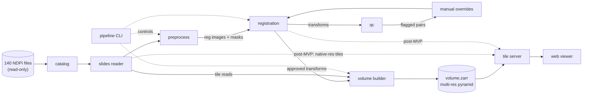
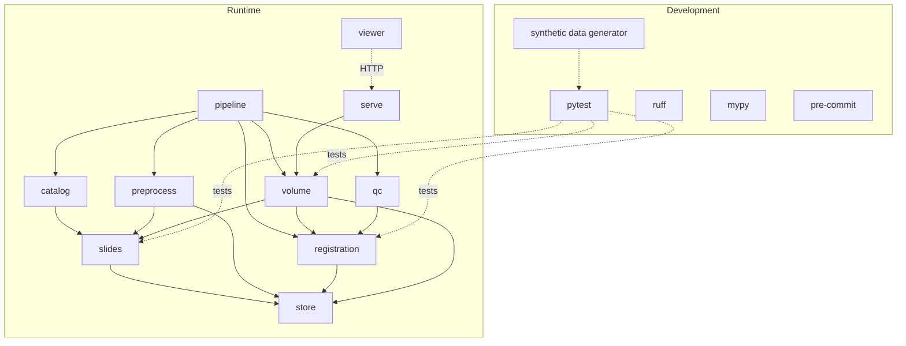

# Architecture

Status: approved design. No implementation exists yet. Interface signatures below are the contract; changing them requires an explicit discussion (see CLAUDE.md).

## 1. Overview

A **staged batch pipeline plus a thin tile server and web viewer**, delivered as a single Python package (`brainrec`) with a CLI. Stages communicate only through files on disk, which makes them resumable and independently testable.

Principles:

1. **Transforms are separate from pixels.** Registration runs on low-resolution images and stores small transform files. Full-resolution pixels are only touched when building the volume and when serving tiles.
2. **No full slice is ever loaded at full resolution.** Work happens on pyramid levels or tiles.
3. **The volume is a multi-resolution chunked store (OME-Zarr)**; the viewer requests only the level and region it needs.
4. **Source files are read-only.** All outputs go to a separate work directory.
5. **Two processes only:** the offline pipeline (CLI) and the tile server (which also serves viewer files).

## 2. Component responsibilities

| Component | Responsibility | Inputs | Outputs | Depends on |
|---|---|---|---|---|
| `slides` | Open NDPI, expose metadata, return regions at a pyramid level | NDPI path | Metadata, numpy arrays | OpenSlide / tifffile |
| `catalog` | Discover files, parse `N_H`, validate completeness and order, hold project config | Data folder, config | Ordered slice list | `slides` |
| `preprocess` | Create the low-res registration image and tissue mask per slice | `SlideReader` | `reg/{id}.tif`, `mask/{id}.png` | `slides`, `store` |
| `registration` | Estimate a transform per consecutive pair; chain; correct drift | Reg images, masks | `transforms/{id}.json` (+ displacement field if non-rigid) | SimpleITK, `store` |
| `qc` | Quality metrics, overlays, flagging, manual overrides | Reg images, transforms | `qc/report.json`, overlay images | `registration` |
| `volume` | Resample slices through transforms tile by tile into the pyramid | Slides, transforms, voxel size | `volume.zarr` | `slides`, `registration`, zarr |
| `serve` | Serve volume chunks over HTTP (later: on-demand native-resolution tiles) | `volume.zarr` | HTTP responses | FastAPI, `volume` |
| `viewer` | 3D and orthogonal views, zoom, level-of-detail streaming | HTTP | Rendered view | Neuroglancer (MVP) |
| `pipeline` | CLI and orchestrator; per-slice status; resume | Config | Manifest | all stages |
| `store` | File layout, formats and manifest shared by all stages | n/a | n/a | none |

## 3. Data flow



## 4. Component dependencies



Rules: dependencies point downward only (no cycles); stages never import each other's internals, only the interfaces below and `store`.

## 5. Interface definitions

Python signatures (type-annotated, shown as pseudocode). These are the contracts; they are not implemented yet.

```
# slides
class SlideReader:                     # implemented (M2)
    @classmethod open(path: Path) -> SlideReader
    levels: list[LevelInfo]            # index, downsample, width, height
    mpp: tuple[float, float]           # microns per pixel at level 0
    level_for_downsample(downsample: float) -> int   # level counts differ per file: never index by position
    read_region(level: int, x: int, y: int, w: int, h: int) -> ndarray  # RGB uint8, (x, y) in level pixels; transparent -> white
    close() -> None

# catalog
class Catalog:                         # implemented (M2)
    @classmethod scan(data_dir: Path, id_range: tuple[int, int] | None = None) -> Catalog
    slices: list[SliceRef]             # id (int N), path, in order; raises on gaps or duplicates
class ProjectConfig:                   # data_dir, work_dir, z_spacing_um, base_downsample, n_levels
    @classmethod load(path: Path) -> ProjectConfig
# Voxel size is not on Catalog (as first drafted): x/y come from the slides' mpp, z from ProjectConfig.

# preprocess
make_reg_image(slice: SliceRef, out_dir: Path) -> Path
make_mask(reg_image: Path, out_dir: Path) -> Path

# registration
register_pair(fixed: Path, moving: Path, fixed_mask: Path | None, moving_mask: Path | None) -> Transform
chain(transforms: list[Transform]) -> list[Transform]       # slice-to-reference
correct_drift(chained: list[Transform]) -> list[Transform]
Transform.save(path), Transform.load(path), Transform.apply_to_point(...)

# qc
score_pair(fixed: Path, moving: Path, t: Transform) -> PairScore
render_overlay(fixed, moving, t, out: Path) -> Path
apply_override(slice_id: int, t: Transform, store: Store) -> None

# store                              # implemented (M2)
WorkDir(root).manifest, .volume        # the only place that knows file names
Manifest(path).get(key), .set(key, value)   # JSON, atomic write

# volume                             # implemented (M2), without transforms
VolumeSpec(z_spacing_um, base_downsample=4, n_levels=5, chunk_xy=512, shard_xy=4096)
build_volume(catalog, out: Path, spec: VolumeSpec, manifest: Manifest | None = None,
             reader_factory=SlideReader.open, overwrite: bool = False) -> Path
    # M3 adds: transforms: list[Transform] | None = None  (None = slices centred, as in M2)
    # Raises VolumeExistsError if `out` exists with other settings and overwrite is False.

# serve                              # implemented (M2)
create_app(root: Path) -> FastAPI      # static files of the work dir, CORS + range requests
neuroglancer_state(volume_url, ome) -> dict   # RGB layer; OME axis c mapped to channel dim "c^"
launch_local_viewer(state, port=0) -> neuroglancer.Viewer   # served from 127.0.0.1; caller keeps it alive (weak refs)
GET /volume.zarr/{path}                # Zarr metadata and shard files
GET /tile/{z}/{level}/{x}/{y}          # post-MVP, native-resolution tile

# pipeline (CLI)
brainrec --config C volume --slices A-B [--overwrite]   # interim (M2)
brainrec --config C serve [--port 8000]                # interim (M2); viewer on port+1
brainrec run [--stage S] [--slices A-B]                # M5
brainrec status                                        # M5
brainrec qc                                            # M4
```

## 6. Technology decisions

| Concern | Choice | Rationale | Trade-off |
|---|---|---|---|
| Language | Python 3.12+ | Best ecosystem for whole-slide images, registration and Zarr | Slower than C++; heavy loops run in native libraries |
| NDPI reading | OpenSlide (`openslide-python` + `openslide-bin`), tifffile as fallback | Lazy tile access to NDPI; `openslide-bin` bundles the native library in the venv | |
| Storage | OME-Zarr 0.5 on Zarr v3, sharded (512 px chunks in 4096 px shards), zstd lossless | Chunked, multi-resolution, resumable; shards keep the file count low on the exFAT drive (512 KB blocks, a `._` file per file) | Lossless only: Neuroglancer's Zarr reader has no JPEG codec (see docs/decisions/0001) |
| Image ops | numpy, scikit-image, OpenCV | Standard and fast | |
| Registration | SimpleITK (elastix later if needed) | Mature multi-resolution rigid and B-spline, serialisable transforms | Steeper learning curve |
| Parallelism | `concurrent.futures`; Dask only if needed | Simplicity | |
| Server | FastAPI + uvicorn | Lightweight, testable | |
| Viewer | Neuroglancer (MVP), served locally by the `neuroglancer` Python package | Solves 3D streaming and orthogonal views, saving weeks; local serving avoids a public page reading from localhost | Less control over UX; replaceable, isolated to `serve/` |
| Config | YAML + pydantic | Validated and versionable | |
| Packaging | `pyproject.toml` (uv or pip) | Reproducible | |
| Testing | pytest, synthetic slice generator | Independent tests without the real data | |

## 7. Project structure

```
Brain 3D Reconstruction/
├── pyproject.toml
├── README.md, CLAUDE.md
├── config/project.example.yaml   (copy to config/project.yaml, git-ignored)
├── requirements-lock.txt         (exact versions, from pip freeze)
├── src/brainrec/
│   ├── slides/  catalog/  preprocess/  registration/
│   ├── qc/  volume/  serve/  store/  pipeline/
├── viewer/
├── tests/ (unit/, integration/, synthetic/)
├── scripts/
└── docs/ (REQUIREMENTS.md, ARCHITECTURE.md, decisions/)

Work directory (outside repo): /Volumes/My Passport/3D Brain Reconstruction/
    reg/ mask/ transforms/ qc/ volume.zarr/ manifest.json
```

## 8. Risks and limitations

- **Storage:** about 423 GB free on My Passport (402 GB of it already holds the sources). Raw RGB is about 43 GB per slice at native resolution, about 6 TB for 140, so native resolution cannot be precomputed and must be served on demand (post-MVP). Measured in M2 (lossless zstd): the 4x base level is about 1.45 GB of data per slice, about 2 GB with the pyramid, so **about 280 GB for all 140 slices**. That fits, with limited margin. The 2x floor (about 4x larger) would not fit losslessly.
- **exFAT drive:** 512 KB allocation blocks, and macOS writes a `._` file per written file (for the `com.apple.provenance` attribute). Many small files waste space (measured 3x) and make directory listings take minutes. Mitigated by sharding; any future output format must also keep the file count low.
- **Drive disconnects:** the drive dropped out once during an M2 build. Builds resume per slice; a disconnect costs at most one slice.
- **Drift:** errors accumulate across 140 chained pairs; mitigated by drift correction and QC; unsolved in general.
- **Non-rigid distortion:** can deform real anatomy; kept behind a flag.
- **Damaged sections** (tears, folds) will need manual overrides.
- **Anisotropy:** Z spacing is much larger than in-plane pixel size, so side views look like stacked slices.
- **Viewer:** Neuroglancer needs a compatible Zarr layout and CORS; its UX may not suit.
- **I/O:** the external drive is the speed limit; limit passes over each source slice.
- **Environment:** OpenSlide needs a native install; nothing is installed until approved.
