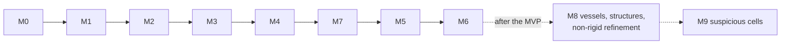

# MVP definition

Status: **approved** (2026-10-19); extended on 2026-11-06 by cells in 3D (milestone M7, `docs/decisions/0005-cells-in-3d.md`, approved by the owner). Detailed tasks: [tasks/BACKLOG.md](../tasks/BACKLOG.md).

## 1. Goal

Prove the whole chain on real data at reduced resolution: **10 consecutive NDPI slices in; a registered 3D volume and its cells out, explored in the browser.**
- The cells are detected, typed and linked across sections, and shown as 3D blobs per type.
- The tissue layer can be faded to transparent, so only the cells remain.
- A cell table and density maps come with them.

Full scale (140 slices) is a matter of run time once the chain works; the chain itself is the risk.

## 2. In scope

| Component | MVP scope |
|---|---|
| `slides` | Read NDPI metadata and pyramid levels; read regions at a level chosen by downsample factor (OpenSlide). |
| `catalog` | Scan the data folder, order by `N_H`, check gaps and duplicates, select a slice range; YAML project config. |
| `store` | Work-directory layout and a JSON manifest for resuming. |
| `preprocess` | A **tissue mask** per slice (from colour saturation; debris removed, detached fragments kept) that defines what counts as tissue for all later stages, and a grayscale registration image (about 7 µm/px, 32x). |
| `registration` | **Feature-based, tissue only (F12, F13):** boundary-based initial alignment from the masks; ORB features inside the tissue, matched between neighbours with guided two-pass matching, coarse-to-fine (64x, then 32x); robust (RANSAC) fit of a **similarity** transform (rotation, uniform scale, translation); boundary alignment as fallback; chained to slice 1. Transforms and match quality saved as small JSON files. |
| `qc` | Per pair, inside the tissue only: feature inliers and residual, masked correlation, mask overlap; an overlay with tissue outlines; flagging below a threshold. No manual override. |
| `volume` | Resample slices through their transforms into an OME-Zarr 0.5 pyramid (base 4x = 0.88 µm/px, 5 levels, sharded, lossless), **tissue only**: background outside the masks removed, volume limited to the tissue extent. |
| `serve` | Static, CORS-enabled hosting of the work directory; local Neuroglancer viewer link. |
| `viewer` | Neuroglancer: orthogonal views, 3D view, zoom; the background outside the tissue is shown transparent. |
| `detect` | **Cells (F16):** nuclei detected per slice at 2x inside the mask, in overlapping tiles; centre, radius, outline, shape, staining and nucleolus measured; type and probability from a classifier trained on labelled crops (types Proposed: neuron, glia, vessel-wall cell, unclassified). |
| `cells` | **Cells in 3D (F17 to F21):** local alignment at cell scale between neighbours from the nuclei; profiles linked across sections into 3D cells; placed through the chained transforms; one sharded Neuroglancer ellipsoid layer per type; cell table (CSV) and QuPath export; density maps per type. |
| `qc` (cells) | Detection QC: counts and density per slice and type, flags, review crops; accuracy against labelled test crops. |
| `viewer` (cells) | Cell layers per type (show, hide, colour), size and confidence sliders, tissue-layer opacity down to transparent, density layers, 3D panel. |
| `pipeline` | `brainrec run`, `brainrec status`, `brainrec qc`, with per-slice resume; `run` includes `detect` and `cells`. |
| tests | Synthetic slices with known placement and known rigid transforms; synthetic nuclei and synthetic 3D cells cut into sections; unit tests per component; one end-to-end test. |

## 3. Out of scope (postponed)

All 140 slices; vessels and other structures in 3D and landmark-based non-rigid refinement (M8); suspicious cells (M9); a separate mesh per cell; images or cells interpolated between sections; non-rigid registration of the volume; global drift correction; manual overrides; custom viewer; on-demand native-resolution (220 nm) tiles and the `/tile` endpoint; multi-process parallelism and Dask; stain normalisation; automatic handling of tears and folds; packaging, installers, authentication; lossy storage formats.

## 4. End-to-end workflow

```
brainrec --config config/project.yaml run --slices 1-10
  catalog    -> ordered list of 10 slices
  preprocess -> reg image + tissue mask per slice (32x)
  register   -> per consecutive pair: boundary alignment, ORB features inside the tissue,
                guided matching (64x, then 32x) + RANSAC similarity fit; chained to slice 1
  qc         -> score (inside tissue) + overlay with tissue outlines per pair, flags
  volume     -> volume.zarr (OME-Zarr 0.5, 4x base, 5 levels), tissue only
  detect     -> per slice: nuclei at 2x inside the mask, measured and typed (cells/{id}.npz)
  cells      -> local alignment + links per pair; 3D cells; one layer per type;
                cells/table.csv, QuPath files, density.zarr
brainrec --config config/project.yaml serve   -> local Neuroglancer link, open in Chrome
```

## 5. Risks to test early

| # | Risk | Tested in | Status |
|---|---|---|---|
| R1 | NDPI read speed from My Passport | M1 | **Resolved:** coarse levels in under 1.5 s |
| R2 | Which pyramid levels exist | M1 | **Resolved:** 1, 2, 4, 8 ... always present; level count varies (9 to 11) |
| R3 | OpenSlide reads these NDPI files | M1 | **Resolved:** yes, all 140 |
| R4 | Volume size and storage | M1, M2 | **Resolved:** about 2 GB/slice lossless, about 280 GB for 140 slices; exFAT needs sharding |
| R5 | Rigid registration aligns real adjacent slices | M3 | **Resolved for slices 1 to 10 (M3-11, owner review 2026-11-03):** rigid is not enough (spike: residual up to 242 µm); the similarity fit (with uniform scale) aligns all 9 pairs (residual 16 to 19 µm) and tissue stays in place through z. Damaged margins need non-rigid (post-MVP) |
| R6 | Neuroglancer opens and streams the OME-Zarr | M2 | **Resolved:** works in Chrome with hardware acceleration on |
| R7 | Slice orientation (flips) | M3 | **Resolved for slices 1 to 10 (spike, confirmed in M3-11):** no mirrored slices |
| R8 | Z spacing and section thickness unknown | n/a | Open: placeholder 5 µm in config; thickness to be supplied by the owner (Q1). Owner: all sections scanned, so spacing = thickness (Q2) |
| R9 | Tissue masks decide what is kept: no tissue cut off, no glass or debris kept (F12) | M3 | **Resolved for slices 1 to 10 (M3-04, M3-11):** the registered volume shows only tissue, detached fragments included, no glass, labels or debris and nothing cut off (owner review 2026-11-03) |
| R10 | Real neighbouring sections yield enough reliable feature matches (F13) | M3 | **Resolved for slices 1 to 10 with guided matching (M3-11):** all 9 pairs `features`, 53 to 925 inliers; global matching alone is not enough (spike) |
| R11 | Detection and typing accuracy on this stain (pale neuron nuclei, touching nuclei, folds, blur) | M7-01, M7-10, M7-11 | Open |
| R12 | Detection run time (2x read of every slide; 1 to 4 days for 140 slices) | M7-01, M7-09 | Open |
| R13 | Viewer speed with millions of blobs | M7-01, M7-08 | Open |
| R14 | Labelling time for ground truth (about 1500 cells) | M7-02 | Open (Q16) |
| R15 | Are the scanned sections adjacent? Decides how many profiles link into one cell | M7-01, M7-12 | Open: owner says yes; first check found only 10 to 17% recurring nuclei after a rough local alignment |
| R16 | Local alignment at cell scale (1 to 2 µm) on top of 20 to 80 µm registration offsets | M7-01, M7-12 | Open |
| R17 | 2D profiles underestimate cell size | M7-05, M7-13 | Mitigated by design: largest linked profile, nucleolus flag |
| R18 | New dependencies (PyTorch, scikit-learn) | M7-01 | Open: needs permission (Q19) |

## 6. Acceptance criteria

The MVP is accepted when all hold, each checked by a command or test that was actually executed, with the result reported:

| ID | Criterion | How verified |
|---|---|---|
| AC1 | `brainrec run --slices 1-10` completes on the real data from a clean work directory; a second run skips finished work. | Run log; second run reads no slice pixels |
| AC2 | Source NDPI files are unchanged. | Fingerprint (size, mtime, SHA-256) before and after |
| AC3 | All outputs are inside `/Volumes/My Passport/3D Brain Reconstruction/`; total size reported. | `du`, listing |
| AC4 | On synthetic data with known shifts, rotations (including about 45° and 170°) and uniform scale changes (up to ±10%), the feature-based registration recovers them within 1 px (at registration resolution), 0.5° and 0.3% scale, using only features inside the tissue: synthetic debris on the background does not change the result. | pytest |
| AC5 | On real slices 1 to 10, each consecutive overlay shows matching tissue outlines and internal structures (judged by the project owner); every pair has a score computed inside the tissue, and pairs below the threshold are flagged. | QC report + review |
| AC6 | The volume opens in Neuroglancer in Chrome, with orthogonal and 3D views; zooming loads finer levels without errors. | Project owner, in the browser |
| AC7 | At the base level (0.88 µm/px), tissue structure is visible down to cell scale; the achievable resolution is stated plainly. | Project owner, in the browser |
| AC8 | Documentation matches the implementation; measured numbers replace estimates. | Review |
| AC9 | **Tissue only:** outside the tissue masks every voxel is background (and not stored); the volume's extent is the tissue's, not the scanned glass; no tissue is cut off at the edges (a background rim of up to about 50 µm is accepted); in the viewer the background is transparent. | pytest (synthetic masks) + owner review on slices 1 to 10 |
| AC10 | **Accuracy** on held-out labelled test crops: detection F1 ≥ 0.90 and median radius error ≤ 15% (Proposed, Q18); per-type targets set after the spike; confusion table reported. | Evaluation report (M7-10, M7-11) |
| AC11 | **Cells in the viewer** (slices 1 to 10): blobs sit on their nuclei in 2D; each type can be shown, hidden and recoloured; the tissue layer fades to fully transparent, leaving only the cells; the 3D panel shows the blobs; pan and zoom stay usable with all cells loaded. | Project owner, in the browser |
| AC12 | **Placement (synthetic):** blobs lie within 0.88 µm of the transformed true centres, radii within 10%, no centre outside the mask, no duplicates at tile borders. | pytest |
| AC13 | **Linking (synthetic):** spheres cut by several consecutive sections, with known local deformation, give one 3D cell each (at least 95% linked correctly, at most 2% false merges; Proposed), centre within 1 µm, radius within 10% of the largest profile. On real slices 1 to 10 the share of linked profiles per pair is reported, and linked chains on review crops pass the owner's check. | pytest + report + owner review |
| AC14 | **Cell table and density maps:** every 3D cell is in the CSV with position, type, size, measurements and source position; a slice's QuPath export opens on the original slide with the detections in place; density maps per type open in the viewer (per mm² of section until the thickness is known). | pytest + owner in QuPath and the browser |

## 7. Milestones

| # | Milestone | Gate | Status |
|---|---|---|---|
| M0 | Environment and project setup | `pytest`, `ruff`, `mypy` run clean | Done (CI still to do) |
| M1 | Data characterisation | Owner chose the base level (4x) | Done |
| M2 | Unregistered vertical slice (10 slices, no registration) | Volume opens in Neuroglancer (R6) | Done |
| M3 | Registration (feature-based, tissue only) | Synthetic tests pass (AC4, AC9 part); real result reviewed (R5, R7, R9, R10) | Done (2026-11-03) |
| M4 | Quality control | Owner can see which pairs are doubtful (AC5) | In progress |
| M7 | Cells in 3D (decision 0005) | AC10 to AC14 | To do |
| M5 | Integration: `brainrec run` end to end | AC1, AC2, AC3, AC6 | To do |
| M6 | MVP review | All AC met; owner sign-off | To do |



M4 can start as soon as the transform model of M3 exists (task M3-05); it does not need real registration results until its integration task. M7 comes before M5, so that `brainrec run` covers the cell stages from the start. M8 and M9 are planned in detail when they are reached.
