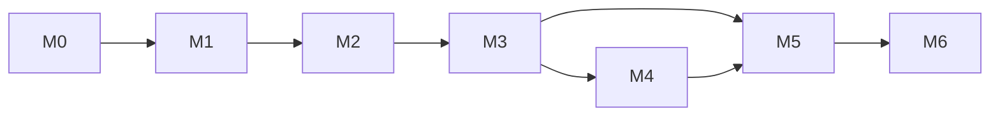

# MVP definition

Status: **approved** (2026-10-19). Detailed tasks: [tasks/BACKLOG.md](../tasks/BACKLOG.md).

## 1. Goal

Prove the whole chain on real data at reduced resolution: **10 consecutive NDPI slices in, a registered 3D volume out, explored in the browser.** Full scale (140 slices) is a matter of run time once the chain works; the chain itself is the risk.

## 2. In scope

| Component | MVP scope |
|---|---|
| `slides` | Read NDPI metadata and pyramid levels; read regions at a level chosen by downsample factor (OpenSlide). |
| `catalog` | Scan the data folder, order by `N_H`, check gaps and duplicates, select a slice range; YAML project config. |
| `store` | Work-directory layout and a JSON manifest for resuming. |
| `preprocess` | One low-resolution grayscale registration image per slice (about 7 µm/px, 32x) and a threshold-based tissue mask. |
| `registration` | Rigid only (rotation and translation), pair to pair, chained to slice 1. Transforms saved as small JSON files. |
| `qc` | One numeric score per pair, an overlay image per pair, and flagging below a threshold. No manual override. |
| `volume` | Resample slices through their transforms into an OME-Zarr 0.5 pyramid (base 4x = 0.88 µm/px, 5 levels, sharded, lossless). |
| `serve` | Static, CORS-enabled hosting of the work directory; local Neuroglancer viewer link. |
| `viewer` | Neuroglancer: orthogonal views, 3D view, zoom. |
| `pipeline` | `brainrec run`, `brainrec status`, `brainrec qc`, with per-slice resume. |
| tests | Synthetic slices with known placement and known rigid transforms; unit tests per component; one end-to-end test. |

## 3. Out of scope (postponed)

All 140 slices; non-rigid registration; global drift correction; manual overrides; custom viewer; on-demand native-resolution (220 nm) tiles and the `/tile` endpoint; multi-process parallelism and Dask; stain normalisation; automatic handling of tears and folds; packaging, installers, authentication; lossy storage formats.

## 4. End-to-end workflow

```
brainrec --config config/project.yaml run --slices 1-10
  catalog    -> ordered list of 10 slices
  preprocess -> reg image + mask per slice (32x)
  register   -> rigid transform per consecutive pair, chained to slice 1
  qc         -> score + overlay per pair, flags
  volume     -> volume.zarr (OME-Zarr 0.5, 4x base, 5 levels)
brainrec --config config/project.yaml serve   -> local Neuroglancer link, open in Chrome
```

## 5. Risks to test early

| # | Risk | Tested in | Status |
|---|---|---|---|
| R1 | NDPI read speed from My Passport | M1 | **Resolved:** coarse levels in under 1.5 s |
| R2 | Which pyramid levels exist | M1 | **Resolved:** 1, 2, 4, 8 ... always present; level count varies (9 to 11) |
| R3 | OpenSlide reads these NDPI files | M1 | **Resolved:** yes, all 140 |
| R4 | Volume size and storage | M1, M2 | **Resolved:** about 2 GB/slice lossless, about 280 GB for 140 slices; exFAT needs sharding |
| R5 | Rigid registration aligns real adjacent slices | M3 | Open |
| R6 | Neuroglancer opens and streams the OME-Zarr | M2 | **Resolved:** works in Chrome with hardware acceleration on |
| R7 | Slice orientation (flips) | M3 | Open |
| R8 | Z spacing unknown | n/a | Open: placeholder 5 µm in config |

## 6. Acceptance criteria

The MVP is accepted when all hold, each checked by a command or test that was actually executed, with the result reported:

| ID | Criterion | How verified |
|---|---|---|
| AC1 | `brainrec run --slices 1-10` completes on the real data from a clean work directory; a second run skips finished work. | Run log; second run reads no slice pixels |
| AC2 | Source NDPI files are unchanged. | Fingerprint (size, mtime, SHA-256) before and after |
| AC3 | All outputs are inside `/Volumes/My Passport/3D Brain Reconstruction/`; total size reported. | `du`, listing |
| AC4 | On synthetic data with known shifts and rotations, registration recovers them within 1 px (at registration resolution) and 0.5°. | pytest |
| AC5 | On real slices 1 to 10, each consecutive overlay shows matching tissue outlines (judged by the project owner); every pair has a score, and pairs below the threshold are flagged. | QC report + review |
| AC6 | The volume opens in Neuroglancer in Chrome, with orthogonal and 3D views; zooming loads finer levels without errors. | Project owner, in the browser |
| AC7 | At the base level (0.88 µm/px), tissue structure is visible down to cell scale; the achievable resolution is stated plainly. | Project owner, in the browser |
| AC8 | Documentation matches the implementation; measured numbers replace estimates. | Review |

## 7. Milestones

| # | Milestone | Gate | Status |
|---|---|---|---|
| M0 | Environment and project setup | `pytest`, `ruff`, `mypy` run clean | Done (CI still to do) |
| M1 | Data characterisation | Owner chose the base level (4x) | Done |
| M2 | Unregistered vertical slice (10 slices, no registration) | Volume opens in Neuroglancer (R6) | Done |
| M3 | Registration | Synthetic tests pass (AC4); real overlays reviewed (R5, R7) | To do |
| M4 | Quality control | Owner can see which pairs are doubtful (AC5) | To do |
| M5 | Integration: `brainrec run` end to end | AC1, AC2, AC3, AC6 | To do |
| M6 | MVP review | All AC met; owner sign-off | To do |



M4 can start as soon as the transform model of M3 exists (task M3-05); it does not need real registration results until its integration task.
