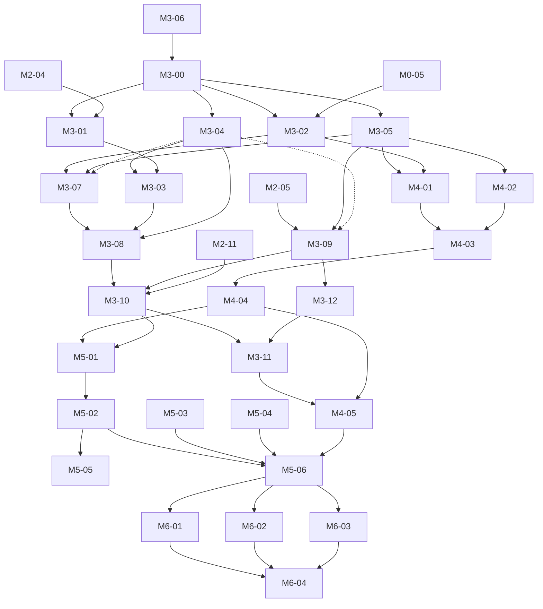

# MVP backlog (Work Breakdown Structure)

Scope and acceptance criteria (AC1 to AC9): [docs/MVP.md](../docs/MVP.md). Architecture and interfaces: [docs/ARCHITECTURE.md](../docs/ARCHITECTURE.md).

Hierarchy: **Milestone → Component → Task → Subtask.** One task = one focused coding session with a verifiable result. Tasks are done one at a time (CLAUDE.md); "independent" below means the order among them is free.

**Status:** Done · In progress · To do · Blocked. **Complexity:** Low · Medium · High (High tasks are split into subtasks, each about Low/Medium).

Conventions that apply to every task (not repeated below):
- Tests run in the session and reported with their real output; `ruff check` and `mypy` clean.
- Only the files listed under "Files" change, plus docs when an interface or behaviour changes.
- Any interface change is explained (consequences) before it is made.
- Tests never read the 140 real files; the only real-data test is the optional sample-slide test.

---

## Summary

| ID | Task | Component | Cx | Status | Depends on |
|---|---|---|---|---|---|
| M0-01 | Repository and GitHub remote | project | Low | Done | none |
| M0-02 | Python environment and OpenSlide | project | Low | Done | none |
| M0-03 | Package skeleton and `pyproject.toml` | project | Low | Done | M0-02 |
| M0-04 | Lint, type-check and lock file | project | Low | Done | M0-03 |
| M0-05 | Fake slide test helper | tests | Low | Done | M0-03 |
| M0-06 | Continuous integration (GitHub Actions) | project | Low | To do | M0-04 |
| M1-01 | Characterisation script | scripts | Low | Done | M0-02 |
| M1-02 | Header survey script (all slides) | scripts | Low | To do | M0-02 |
| M1-03 | Record measured facts | docs | Low | Done | M1-01 |
| M2-01 | `SlideReader` | slides | Low | Done | M0-03 |
| M2-02 | `Catalog.scan` | catalog | Low | Done | M0-03 |
| M2-03 | `ProjectConfig` | catalog | Low | Done | M0-03 |
| M2-04 | `WorkDir` and `Manifest` | store | Low | Done | M0-03 |
| M2-05 | Unregistered volume builder | volume | High | Done | M2-01, M2-02, M2-04, M0-05 |
| M2-06 | Static data server | serve | Low | Done | M0-03 |
| M2-07 | Neuroglancer state and local viewer | serve | Medium | Done | M2-06 |
| M2-08 | Interim CLI (`volume`, `serve`) | pipeline | Low | Done | M2-03, M2-05, M2-07 |
| M2-09 | Real build, slices 1 to 10 | integration | Low | Done | M2-08 |
| M2-10 | Visual check in Neuroglancer | integration | Low | Done | M2-09 |
| M2-11 | Close M2 test gaps (config, CLI) | tests | Low | To do | M2-08 |
| M3-06 | **Real-data spike: orientation, tissue masks, feature matching (first M3 task)** | integration | Medium | Done | none |
| M3-00 | Registration contracts (C1 to C12) | docs | Low | Done (approved 2026-10-20) | M3-06 |
| M3-01 | Work-dir layout for reg, mask, transforms, qc | store | Low | To do | M2-04, M3-00 |
| M3-02 | Synthetic tissue and similarity-transform generator | tests | Medium | To do | M0-05, M3-00 |
| M3-03 | Registration image and preprocessing stage | preprocess | Medium | To do | M3-01, M3-04 |
| M3-04 | Tissue mask (defines "tissue", F12) | preprocess | Medium | To do | M3-00 |
| M3-05 | `Transform2D` (similarity) model | registration | Medium | To do | M3-00 |
| M3-07 | Feature-based pairwise registration (guided ORB, similarity, tissue only) | registration | High | To do | M3-02, M3-05 (M3-04 soft) |
| M3-08 | Chain and register a slice range | registration | Low | To do | M3-07, M3-01, M3-03, M3-04 |
| M3-09 | Volume builder with transforms, tissue only | volume | High | To do | M3-05, M2-05 (M3-04 soft) |
| M3-10 | Interim CLI: `preprocess`, `register` | pipeline | Low | To do | M3-08, M3-09, M2-11 |
| M3-12 | Transparent background in the viewer | serve | Low | To do | M3-09 |
| M3-11 | Real registration, slices 1 to 10 | integration | Medium | To do | M3-10, M3-12, M2-10, M3-06 |
| M4-01 | Pair score | qc | Medium | To do | M3-05, M3-02 |
| M4-02 | Overlay image | qc | Low | To do | M3-05 |
| M4-03 | QC report and flags | qc | Low | To do | M4-01, M4-02, M3-01 |
| M4-04 | `brainrec qc` command | pipeline | Low | To do | M4-03 |
| M4-05 | Real QC review, slices 1 to 10 | integration | Medium | To do | M4-04, M3-11 |
| M5-01 | Stage runner with resume | pipeline | Medium | To do | M3-10, M4-04 |
| M5-02 | `brainrec run` and `brainrec status` | pipeline | Medium | To do | M5-01 |
| M5-03 | Disk-space preflight | pipeline | Low | To do | M2-04 |
| M5-04 | Source fingerprint (before/after) | scripts | Low | To do | M2-02 |
| M5-05 | End-to-end synthetic integration test | tests | Medium | To do | M5-02 |
| M5-06 | End-to-end real run and resume check | integration | Medium | To do | M5-02, M5-03, M5-04 |
| M6-01 | Documentation consistency pass | docs | Low | To do | M5-06 |
| M6-02 | Acceptance report | docs | Low | To do | M5-06 |
| M6-03 | Scale-up plan (planning only) | docs | Low | To do | M5-06 |
| M6-04 | Owner sign-off | review | Low | To do | M6-01, M6-02, M6-03 |

---

## Independent and sequential work

**Independent (order is free; each can be picked up whenever its listed dependency is done):**
- Any time: M0-06 (CI), M1-02 (header survey), M2-11 (test gaps), M5-03 (disk preflight), M5-04 (source fingerprint).
- After M3-00: M3-01 (layout), M3-02 (synthetic generator) and M3-05 (transform model) do not depend on each other; M3-04 (mask) → M3-03 (registration image) can follow independently of M3-07.
- After M3-05: M3-09 (volume with transforms), M4-01 and M4-02 (QC score and overlay) can be built and tested on synthetic data while M3-07 is in progress.
- M3-12 (transparent background) needs only M3-09.

**Sequential (critical path):**
M3-06 (spike) → M3-00 (contracts) → M3-05 → M3-07 → M3-08 → M3-10 → M3-11 → M4-05 → M5-01 → M5-02 → M5-06 → M6-01/02/03 → M6-04.
M2-10 (owner's visual check, done) had to pass before M3-11, because M3-11 relies on the viewer to judge registration. M2-11 must precede M3-10, because it creates `tests/unit/test_cli.py`, which M3-10 extends. Details and session estimates: `tasks/IMPLEMENTATION_PLAN.md`.

---

## M0 Environment and project setup

### Component: project

#### M0-01 Repository and GitHub remote · Low · Done
- **Objective:** Version control with a private GitHub remote.
- **Inputs:** project folder. **Outputs:** git repo on `main`, remote `Mohammad-Aminazadeh/brain-3d-reconstruction` (private), `.gitignore` excluding data, venv, local config.
- **Depends on:** none. **Files:** `.gitignore`.
- **Acceptance:** `git remote -v` shows the remote; no `.ndpi`, `.zarr` or `.venv` tracked.
- **Tests:** `git ls-files` contains no data files.

#### M0-02 Python environment and OpenSlide · Low · Done
- **Objective:** Reproducible environment on macOS (Apple Silicon).
- **Inputs:** Python 3.13. **Outputs:** `.venv` with dependencies; OpenSlide via `openslide-bin`.
- **Depends on:** none. **Files:** none in the repo.
- **Acceptance:** `import openslide` works without environment variables; the sample slide opens (139776 x 102144, 9 levels).
- **Tests:** `tests/integration/test_reader_sample.py` (added in M2-01).

#### M0-03 Package skeleton and `pyproject.toml` · Low · Done
- **Objective:** Installable `brainrec` package with one sub-package per component.
- **Outputs:** `src/brainrec/{slides,catalog,preprocess,registration,qc,volume,serve,store,pipeline}/`, `tests/`, `config/`, `scripts/`, `docs/decisions/`; `brainrec` console script.
- **Depends on:** M0-02. **Files:** `pyproject.toml`, package `__init__.py` files.
- **Acceptance:** `pip install -e ".[dev]"` succeeds; `pytest` runs.
- **Tests:** `tests/unit/test_import.py`.

#### M0-04 Lint, type-check and lock file · Low · Done
- **Objective:** Enforce conventions and pin exact versions.
- **Outputs:** ruff and mypy configuration in `pyproject.toml`; `requirements-lock.txt`.
- **Depends on:** M0-03. **Files:** `pyproject.toml`, `requirements-lock.txt`.
- **Acceptance:** `ruff check src tests scripts` and `mypy` report no issues.
- **Tests:** the two commands themselves.

#### M0-06 Continuous integration (GitHub Actions) · Low · To do
- **Objective:** Run ruff, mypy and pytest on every push, so "tests pass" is checkable by anyone.
- **Inputs:** `requirements-lock.txt`. **Outputs:** `.github/workflows/ci.yml` (Ubuntu, Python 3.13).
- **Depends on:** M0-04. **Files:** `.github/workflows/ci.yml`, README badge line.
- **Acceptance:** the workflow runs green on GitHub; the sample-slide test is skipped there (no data in CI).
- **Tests:** the workflow run.

### Component: tests

#### M0-05 Fake slide test helper · Low · Done
- **Objective:** In-memory stand-in for `SlideReader` so components are testable without NDPI files.
- **Outputs:** `tests/synthetic/fake_slide.py` (`FakeSlide`: gray rectangle, black marker, levels 1/2/4/8; `FakeFactory`: counts reads).
- **Depends on:** M0-03. **Files:** `tests/synthetic/fake_slide.py`.
- **Acceptance:** used by the volume tests; satisfies the `SliceSource` protocol (mypy).
- **Tests:** exercised by `tests/unit/test_volume.py`.

---

## M1 Data characterisation

### Component: scripts

#### M1-01 Characterisation script · Low · Done
- **Objective:** Measure levels, pixel size, read speed and compressibility of real slides (read-only).
- **Inputs:** NDPI paths. **Outputs:** `scripts/characterize.py`; numbers in `docs/REQUIREMENTS.md` section 7.
- **Depends on:** M0-02. **Files:** `scripts/characterize.py`.
- **Acceptance:** runs on the sample and on slides from My Passport without writing anything.
- **Tests:** manual run (script, not library code).

#### M1-02 Header survey script (all slides) · Low · To do
- **Objective:** Make the all-140 header survey (run ad hoc in M1) reproducible.
- **Inputs:** data folder. **Outputs:** `scripts/survey_headers.py` printing count, gaps, size range, pixel sizes, level counts and downsample patterns.
- **Depends on:** M0-02. **Files:** `scripts/survey_headers.py`.
- **Acceptance:** reproduces the M1 numbers (140 files, width 71680 to 157696, 9/10/11 levels, 0.2205 µm/px).
- **Tests:** manual run against My Passport; output pasted into the task report.

### Component: docs

#### M1-03 Record measured facts · Low · Done
- **Objective:** Replace estimates with measurements.
- **Outputs:** `docs/REQUIREMENTS.md` section 7. **Depends on:** M1-01.
- **Acceptance:** owner chose the 4x base level from these numbers.
- **Tests:** none (documentation).

---

## M2 Unregistered vertical slice

Goal: data path and viewer proven with the least code: 10 slices stacked as they are.

### Component: slides

#### M2-01 `SlideReader` · Low · Done
- **Objective:** Read-only NDPI access in level-local coordinates.
- **Inputs:** NDPI path. **Outputs:** `levels`, `mpp`, `level_for_downsample()`, `read_region()` (RGB uint8, transparent to white), `close()`.
- **Depends on:** M0-03. **Files:** `src/brainrec/slides/reader.py`.
- **Acceptance:** levels selected by downsample factor, never by index.
- **Tests:** `tests/integration/test_reader_sample.py` (skipped when the sample is absent).

### Component: catalog

#### M2-02 `Catalog.scan` · Low · Done
- **Objective:** Discover and order slices by `N_H`; select a range.
- **Outputs:** `Catalog`, `SliceRef`. **Depends on:** M0-03. **Files:** `src/brainrec/catalog/scan.py`.
- **Acceptance:** numeric order; errors on gaps in the range, duplicates, empty folder.
- **Tests:** `tests/unit/test_catalog.py` (5 tests).

#### M2-03 `ProjectConfig` · Low · Done
- **Objective:** Validated YAML configuration.
- **Outputs:** `ProjectConfig.load()`; `config/project.example.yaml`. **Depends on:** M0-03.
- **Files:** `src/brainrec/catalog/config.py`, `config/project.example.yaml`.
- **Acceptance:** loads the example; `z_spacing_um` marked as placeholder.
- **Tests:** missing, see M2-11.

### Component: store

#### M2-04 `WorkDir` and `Manifest` · Low · Done
- **Objective:** One place for work-dir file names; JSON progress record with atomic writes.
- **Depends on:** M0-03. **Files:** `src/brainrec/store/{layout,manifest}.py`.
- **Acceptance:** manifest survives reopen; parent folders created.
- **Tests:** `tests/unit/test_manifest.py`.

### Component: volume

#### M2-05 Unregistered volume builder · High · Done
- **Objective:** Stack slices, centred, into a sharded OME-Zarr 0.5 pyramid, resumable per slice.
- **Inputs:** `Catalog`, `VolumeSpec`, `Manifest`, reader factory. **Outputs:** `volume.zarr` (axes c, z, y, x; uint8; 5 levels from the slides' own pyramid).
- **Depends on:** M2-01, M2-02, M2-04, M0-05. **Files:** `src/brainrec/volume/builder.py`.
- **Subtasks:**
  - M2-05a Header pass: dimensions per level, single pixel size enforced, canvas, aligned offsets.
  - M2-05b Array creation: Zarr v3, 512 chunks in 4096 shards, zstd, white fill; OME 0.5 metadata.
  - M2-05c Band writing aligned to the shard grid (each shard written once).
  - M2-05d Resume via manifest signature; refuse to overwrite a different volume unless `overwrite=True`.
- **Acceptance:** pixels placed exactly; all levels aligned; resume reads nothing on a finished build; existing volume protected.
- **Tests:** `tests/unit/test_volume.py` (12 tests: bands, placement, full content, level alignment, metadata, sharding, resume, interruption, overwrite guard, pixel-size check).

### Component: serve

#### M2-06 Static data server · Low · Done
- **Objective:** Serve the work directory with CORS and range requests.
- **Depends on:** M0-03. **Files:** `src/brainrec/serve/app.py`.
- **Acceptance:** cross-origin GET and range GET work.
- **Tests:** `tests/unit/test_serve.py` (CORS, range).

#### M2-07 Neuroglancer state and local viewer · Medium · Done
- **Objective:** Show the RGB volume in a locally served Neuroglancer.
- **Inputs:** volume URL, OME metadata. **Outputs:** viewer state (channel axis `c` mapped to `c^`, scales in metres); local viewer URL; public fallback link.
- **Depends on:** M2-06. **Files:** `src/brainrec/serve/app.py`; `docs/decisions/0002-local-viewer.md`.
- **Acceptance:** state has the expected source, dimensions and shader; rendering confirmed in M2-10.
- **Tests:** `tests/unit/test_serve.py` (state mapping, URL round trip, local viewer page answers 200).

### Component: pipeline

#### M2-08 Interim CLI (`volume`, `serve`) · Low · Done
- **Objective:** Run M2 from the command line until `brainrec run` exists (M5).
- **Depends on:** M2-03, M2-05, M2-07. **Files:** `src/brainrec/pipeline/cli.py`.
- **Acceptance:** `brainrec --config C volume --slices 1-10 [--overwrite]`; `brainrec --config C serve`.
- **Tests:** missing, see M2-11.

### Component: integration

#### M2-09 Real build, slices 1 to 10 · Low · Done
- **Objective:** Build the unregistered volume from My Passport.
- **Outputs:** `/Volumes/My Passport/3D Brain Reconstruction/volume.zarr`; build time and size recorded in docs.
- **Depends on:** M2-08.
- **Acceptance:** exit code 0; manifest lists 10 done slices; size measured.
- **Tests:** run log.
- **Result (2026-10-19):** exit 0, 10 slices in 11.5 min (about 1.1 min/slice), 960 files, 19.5 GB on disk (no block waste). Server smoke test: data and viewer pages answer 200; shard range reads answer 206.

#### M2-10 Visual check in Neuroglancer · Low · Done
- **Objective:** Confirm R6: the volume opens and streams in the browser (MVP gate for M2).
- **Inputs:** `brainrec serve` link. **Outputs:** owner's confirmation, or a bug report with a screenshot.
- **Depends on:** M2-09.
- **Acceptance:** RGB colours correct; 4-panel view; zoom loads finer levels; no errors in the Neuroglancer status bar.
- **Tests:** manual (owner, Chrome).
- **First attempt (2026-10-19):** colours correct, 4-panel view shown, no status-bar errors. But loading was slow, not every area sharpened, then all panels went black and Chrome reported "WebGL not supported".
  - Evidence: three Chrome crash dumps of the **GPU process** (Chrome 154, Apple GPU, ANGLE Metal backend) at 20:29, 20:30 and 20:31; Chrome disables WebGL after repeated GPU-process crashes until it is restarted. No server errors (8,422 requests, 7,847 at full resolution). System memory normal.
  - My Passport serves about 27 random 430 KB chunks/s (median 0.5 s at 16 in parallel), so full-resolution areas fill in slowly.
  - Change: viewer now opens in a single `xy` panel with `gpuMemoryLimit` 512 MB, `systemMemoryLimit` 1 GB and 8 concurrent downloads (`brainrec serve --layout 4panel --gpu-memory-mb N` to override).
- **Second attempt (2026-10-19):** after a full Chrome restart, with hardware acceleration switched on, everything worked in the `xy` layout. The owner reports that Chrome's hardware acceleration had been **off** during the first attempt, so WebGL was probably running in software; that is the most likely cause of the slowness and the GPU-process crashes. 4-panel retest (same 512 MB limit): works. Owner noted that 3D zoom centres on the current position and only the area shown by the 2D panels becomes sharp in 3D; both are Neuroglancer behaviour (documented under README, Viewer controls).

### Component: tests

#### M2-11 Close M2 test gaps (config, CLI) · Low · To do
- **Objective:** Cover the two untested pieces of M2.
- **Depends on:** M2-08. **Files:** `tests/unit/test_config.py`, `tests/unit/test_cli.py`.
- **Acceptance:** config: loads valid YAML, rejects a missing field; CLI: `--slices 3-7` parses to (3, 7), `--slices 5` to (5, 5), and `volume` on an existing different volume exits with an error message instead of a traceback.
- **Tests:** the two new files.

---

## M3 Registration

Goal: slice-to-slice alignment with a **similarity** transform (rotation, uniform scale, translation), proven on synthetic data (AC4), then applied to slices 1 to 10. All tasks follow the contracts C1 to C12 in `docs/ARCHITECTURE.md` section 5.1. Transforms are expressed in **micrometres in each slice's level-0 frame**, so they apply unchanged at every pyramid level.

Two owner requirements shape this milestone (`docs/decisions/0003-tissue-only-feature-based-registration.md`):
- **Tissue only (F12):** the tissue mask defines what is processed. Registration and QC work inside the masks; the volume stores only tissue and is limited to the tissue extent.
- **Feature-based (F13):** boundary-based initial alignment from the masks, ORB features inside the tissue, guided two-pass matching (64x, then 32x), RANSAC similarity fit, boundary fallback (spike decisions, 2026-10-20).

### Component: integration (first)

#### M3-06 Real-data spike: orientation, tissue masks, feature matching · Medium · Done
- **Objective:** Before writing registration code, check on real slices: are some slices mirrored (R7)? Do simple masks capture the tissue without glass or debris (R9)? Do neighbouring sections give enough reliable SIFT/ORB matches inside the tissue, and is a rigid fit enough (R10, R5)?
- **Inputs:** 32x level of slices 1 to 10, read directly with `SlideReader`. **Outputs:** contact sheet with mask outlines; for 4 pairs: match and inlier counts (SIFT vs ORB), residual, rigid vs similarity fit (scale), boundary-only result, mirrored-candidate result, overlay and match picture; findings in `docs/REQUIREMENTS.md` section 7. Details in `tasks/IMPLEMENTATION_PLAN.md` section 6.
- **Depends on:** none (first task of M3). **Files:** `scripts/spike_registration.py`, `docs/REQUIREMENTS.md`.
- **Acceptance:** owner has reviewed contact sheet, overlays and match pictures; decisions recorded: mirror needed, rigid or similarity, detector, mask method adequate, 32x adequate, initial inlier and residual thresholds.
- **Tests:** manual review (throwaway script, writes only to the work dir `spike/`).
- **Result (2026-10-19):** all 9 pairs of slices 1 to 10 (more than the planned 4), plus a guided-matching variant and a 16x/32x/64x comparison on two pairs. Findings and proposed decisions in `docs/REQUIREMENTS.md` section 7 ("Spike results"); decisions are fixed in M3-00.
- **Owner decisions (2026-10-20):** similarity instead of rigid; guided two-pass ORB matching; coarse-to-fine 64x then 32x; no mirror handling; detached fragments kept as tissue; damaged margins accepted for the MVP (`docs/REQUIREMENTS.md`, confirmed decisions 11 to 15).

### Component: docs

#### M3-00 Registration contracts · Low · Done (approved 2026-10-20)
- **Objective:** Fix the cross-cutting contracts C1 to C12 (`tasks/IMPLEMENTATION_PLAN.md` section 5) with the spike's facts, before any M3 library code.
- **Inputs:** spike findings (M3-06). **Outputs:** `docs/ARCHITECTURE.md` section 5 (proposed M3/M4 entries become contracts: coordinates, transform direction and family, file formats, manifest schema, stage shape, config fields, tissue-only semantics, failure rules); spike decisions recorded in `docs/decisions/0003-tissue-only-feature-based-registration.md`.
- **Depends on:** M3-06. **Files:** `docs/ARCHITECTURE.md`, `docs/decisions/0003-tissue-only-feature-based-registration.md`, `tasks/IMPLEMENTATION_PLAN.md`.
- **Acceptance:** owner approves; every M3 and M4 task card refers only to defined contracts.
- **Tests:** none (documentation); review.
- **Result (2026-10-20):** contracts C1 to C12 in `docs/ARCHITECTURE.md` section 5.1; M3/M4 interfaces in section 5 updated (`Transform2D` similarity, `preprocess_slice`, guided matching, failure rules); task cards M3-02 to M3-09 aligned; mask before registration image (the registration image is blanked outside the mask).

### Component: store

#### M3-01 Work-dir layout for reg, mask, transforms, qc · Low · To do
- **Objective:** Define every MVP output path in one place before the stages that write them.
- **Outputs:** `WorkDir.reg_image(id)`, `.reg_meta(id)`, `.mask(id)`, `.pair_transform(id)`, `.chained_transform(id)`, `.qc_report`, `.qc_overlay(id)`.
- **Depends on:** M2-04, M3-00. **Files:** `src/brainrec/store/layout.py`, `docs/ARCHITECTURE.md` (layout section).
- **Acceptance:** all paths under `root`; names stable and documented.
- **Tests:** `tests/unit/test_layout.py` (paths, no collisions between ids).

### Component: tests

#### M3-02 Synthetic tissue and similarity-transform generator · Medium · To do
- **Objective:** Ground truth for registration, mask and QC tests.
- **Outputs:** `tests/synthetic/tissue.py`:
  - `make_tissue(shape, seed)` returns an RGB image and its ground-truth mask: an irregular, pale-stained tissue blob with internal structures that give detectable features (vessel-like curves, blobs of varying size, texture), **one or two detached fragments** (decision 14), and on the glass **debris specks** below 0.2 mm² that must be excluded;
  - `apply_similarity(img, mask, angle_deg, scale, tx, ty)` returns the moved image, moved mask and true `Transform2D`;
  - `perturb(img, seed)` adds section-to-section differences (noise, slight intensity change, a few structures added or removed, a fold-like streak);
  - a `FakeSlide` variant built from a given image.
- **Depends on:** M0-05, M3-00. **Files:** `tests/synthetic/tissue.py`, `tests/synthetic/fake_slide.py` (additive).
- **Acceptance:** deterministic for a seed; applying a transform and its inverse returns the original within interpolation error; ORB finds at least 100 keypoints inside the tissue of a 1000 x 800 image.
- **Tests:** `tests/unit/test_synthetic.py`.

### Component: preprocess

#### M3-03 Registration image and preprocessing stage · Medium · To do
- **Objective:** One read of the 32x level per slice produces the mask and the registration image (contract C4).
- **Inputs:** `SliceRef`, reader factory, `ProjectConfig`. **Outputs:** `make_reg_image(rgb, mask)` (255 minus luminance, CLAHE, 0 outside the mask); `preprocess_slice(...)` writing `reg/{id}.png`, `reg/{id}.json` and `mask/{id}.png`; `run_preprocess(...)` in the stage shape C7 with manifest resume.
- **Depends on:** M3-01, M3-04 (the registration image is blanked outside the mask). **Files:** `src/brainrec/preprocess/regimage.py`, `src/brainrec/preprocess/stage.py`; `src/brainrec/slides/` (receives the `SliceSource` protocol, moved from `volume`; `volume` re-exports it).
- **Subtasks:** M3-03a move `SliceSource` to `slides` (interface location change, no behaviour change); M3-03b `make_reg_image()`; M3-03c `preprocess_slice()` and `run_preprocess()`.
- **Acceptance:** reads one whole 32x level (no level-0 access); output sizes equal the level size; metadata per C4; zero outside the mask; second run skips done slices.
- **Tests:** `tests/unit/test_preprocess.py` with `FakeSlide` (size, inversion, zero background, metadata, reads only the requested level, resume).

#### M3-04 Tissue mask · Medium · To do
- **Objective:** Define what counts as tissue for every later stage (F12): registration, QC and the volume ignore everything outside the mask.
- **Inputs:** RGB image at 32x and its µm per pixel. **Outputs:** `make_mask(rgb, um_per_px, cfg)`: uint8 {0, 255}, same shape (contract C4).
- **Method:** Otsu on blurred HSV saturation with hysteresis (`mask_hysteresis`, pale tissue connected to stained tissue is kept), close about 100 µm, open about 35 µm, fill holes, keep **every** component of at least `mask_min_component_mm2` (detached fragments kept, decision 14; debris specks dropped).
- **Depends on:** M3-00. **Files:** `src/brainrec/preprocess/mask.py`, `src/brainrec/catalog/config.py` (mask fields of C9).
- **Acceptance:** on synthetic data: Dice at least 0.95, tissue recall at least 0.99, fragments kept, specks excluded, holes filled. On real slices 1 to 10 (contact sheet, owner check): the pale fragments at the left of slices 6 to 10 are inside the mask; scan-edge streaks are not.
- **Tests:** `tests/unit/test_mask.py` (Dice, recall, fragments kept, specks dropped, holes filled, hysteresis keeps a pale region attached to stained tissue but not an isolated pale patch).

### Component: registration

#### M3-05 `Transform2D` (similarity) model · Medium · To do
- **Objective:** The transform type every later stage uses (contracts C1 to C3).
- **Outputs:** `Transform2D` holding a 2x3 matrix in µm (slice → reference), family `similarity` (or `rigid`); `identity()`, `similarity()`, `from_matrix()`, `matrix`, `inverse()`, `compose()`, `apply(points)`, `angle_deg`, `scale`, `to_pixels(src_downsample, dst_downsample, mpp)`, `save()`/`load()` (`brainrec.transform/1`); the pixel↔µm helpers of C1.
- **Depends on:** M3-00 (conventions C1 to C3). **Files:** `src/brainrec/registration/transform.py`, `docs/ARCHITECTURE.md` (interface).
- **Acceptance:** level-independent: the same transform gives consistent pixel matrices at 4x, 32x and 64x; `from_matrix` rejects a non-similarity matrix and reflections.
- **Tests:** `tests/unit/test_transform.py` (identity, inverse round trip, composition order, JSON round trip, pixel conversion at three levels including the half-pixel convention, family validation).

#### M3-07 Feature-based pairwise registration (guided ORB, similarity, tissue only) · High · To do
- **Objective:** Estimate the similarity transform aligning slice k to slice k-1 by detecting features in both images and matching them (F13), using only the tissue (F12), as validated in the spike.
- **Inputs:** two `RegImage`s (image, mask, metadata). **Outputs:** `PairResult` (contract C2/C12): `Transform2D` (moving → fixed, µm), status (`features`, `boundary` or `failed`), matches, inliers, residual (µm), mask IoU.
- **Depends on:** M3-02, M3-05; M3-04 soft (tests use synthetic ground-truth masks; the mask contract C4 is fixed). **Files:** `src/brainrec/registration/{boundary,features,pairwise}.py`, `src/brainrec/catalog/config.py` (registration fields of C9).
- **Subtasks:**
  - M3-07a **Boundary-based initial alignment** from the masks: centroid and principal axes; both 180° candidates, the better mask IoU wins. Test: translation within 2 px; rotations of 45° and 170° within 10°.
  - M3-07b **ORB features inside the tissue** (mask as detection region, up to `reg_max_features`). Test: keypoints only inside the mask; debris yields none.
  - M3-07c **Guided matching and RANSAC similarity fit, coarse-to-fine:** pass 1 at 64x within `reg_window_um[0]` of the boundary estimate, pass 2 at 32x within `reg_window_um[1]` of the pass-1 fit; ratio test among the candidates inside the window; `estimateAffinePartial2D` with `reg_ransac_px`. Test: **AC4** (1 px, 0.5°, 0.3% scale) on 5 seeded synthetic pairs with `perturb` and scale changes up to ±10%; 30% injected false matches do not change the result.
  - M3-07d **Boundary fallback** (C12): iterative closest point on the two tissue outlines with a similarity fit, starting from M3-07a, when pass 2 misses `reg_min_inliers` or `reg_max_rms_um`. Test: a texture-free pair aligns within 3 px and is reported as `boundary`.
  - M3-07e **Result conversion** to micrometres per C1/C2 (direction moving → fixed) and status per C12. Test: consistent with M3-05 at 32x and 64x; an unrelated pair is reported `failed`.
  - M3-07g Intensity refinement inside the masks (SimpleITK), **only if** M3-07c misses AC4. Test: AC4.
  - (M3-07f, mirrored candidate, dropped: no mirrored slices, decision 12.)
- **Acceptance:** AC4 passes; an unrelated pair is reported as failed (no silent wrong transform); results identical with and without background debris; about 5 s per pair at 32x on the real data (spike timing).
- **Tests:** `tests/unit/test_boundary.py`, `tests/unit/test_features.py`, `tests/unit/test_pairwise.py`.

#### M3-08 Chain and register a slice range · Low · To do
- **Objective:** Pairwise transforms for consecutive slices, composed to the reference slice's frame (C5), as the `register` stage (C7).
- **Inputs:** catalog range, work dir. **Outputs:** `transforms/pair_{id}.json` (transform + match quality: method, matches, inliers, residual), `transforms/chained_{id}.json` (slice 1 = identity).
- **Depends on:** M3-07, M3-01, M3-03, M3-04. **Files:** `src/brainrec/registration/chain.py`.
- **Acceptance:** chained = composition of pairs in the documented order (C2); per-pair resume via manifest (C6); a `failed` pair stops the run and is reported, with no chained transform written past it (C12).
- **Tests:** `tests/unit/test_chain.py` (known synthetic chain of 4 transforms; resume skips done pairs).

### Component: volume

#### M3-09 Volume builder with transforms, tissue only · High · To do
- **Objective:** Resample slices through their chained transforms into the pyramid, keeping only tissue (F12).
- **Inputs:** `Catalog`, chained transforms, tissue masks, `VolumeSpec`. **Outputs:** `volume.zarr` as in M2, registered, tissue only.
- **Interface change:** `build_volume(..., transforms: dict[int, Transform2D] | None = None, masks: dict[int, Path] | None = None)`; `None` keeps M2 behaviour (centred, whole scan). Consequence: the manifest signature includes hashes of the transforms and masks, so changes trigger the overwrite guard.
- **Depends on:** M3-05, M2-05 (mask files from M3-04 for real runs; tests use synthetic masks). **Files:** `src/brainrec/volume/builder.py`, `src/brainrec/volume/warp.py` (new), `docs/ARCHITECTURE.md`.
- **Subtasks:**
  - M3-09a Canvas from the bounding box of all **transformed tissue masks** (µm) plus the safety margin, not of the scanned area; aligned offsets. Test: known transforms and masks give the expected canvas; glass-only areas outside it.
  - M3-09b Output tiles equal to shards (4096 x 4096): for each tile, the inverse-mapped source bounding box, clipped to the slice. Test: rotated tile maps to the expected source box; memory bounded (box at most about 5800 px square).
  - M3-09c Warp one tile: read the source box, `cv2.warpAffine` (bilinear, white border), write the tile. Test: integer translation reproduces pixels exactly; 90 degree rotation moves the marker to the expected place.
  - M3-09d Apply per level using the same `Transform2D`. Test: the marker is at the same physical position at all 5 levels.
  - M3-09e Signature and resume with transforms and masks. Test: unchanged inputs resume; changed ones are refused without overwrite.
  - M3-09f **Tissue masking:** warp each mask with the slice's transform to the tile, enlarge by `volume_mask_margin_um` (50 µm, approved), set voxels outside to the fill value (255, 255, 255) before writing, so all-background chunks are not stored. Tissue voxels that are exactly (255, 255, 255) are stored as (254, 254, 254), so pure white means background unambiguously (C11; needed for the transparent display, M3-12). Test: no non-background voxel outside the enlarged mask; every tissue voxel kept and never pure white; background-only tiles write no chunk.
- **Acceptance:** with synthetic slices moved by known transforms, the inverse transforms put all markers on one (x, y) across z within 1 px at the base level; AC9 holds on synthetic data (tissue only, nothing cut off).
- **Tests:** `tests/unit/test_volume_warp.py`; existing `tests/unit/test_volume.py` still passes unchanged.

### Component: pipeline

#### M3-10 Interim CLI: `preprocess`, `register` · Low · To do
- **Objective:** Run M3 stages on real data before the M5 runner exists.
- **Outputs:** `brainrec preprocess --slices A-B`, `brainrec register --slices A-B`; `brainrec volume` uses chained transforms when they exist (`--unregistered` to force M2 mode).
- **Depends on:** M3-08, M3-09, M2-11 (creates `tests/unit/test_cli.py`). **Files:** `src/brainrec/pipeline/cli.py`, README usage.
- **Acceptance:** each command runs on a synthetic temp work dir.
- **Tests:** `tests/unit/test_cli.py` (extended).

### Component: serve

#### M3-12 Transparent background in the viewer · Low · To do
- **Objective:** Show everything outside the tissue as transparent, so empty space contrasts with the tissue (owner decision, 2026-10-19).
- **Inputs:** a volume in which background voxels are exactly (255, 255, 255) and tissue voxels never are (C11, M3-09f). **Outputs:** Neuroglancer shader: transparent where all three channels are 255, RGB colour elsewhere; dark panel background for contrast.
- **Depends on:** M3-09. **Files:** `src/brainrec/serve/app.py`, `tests/unit/test_serve.py`, README (viewer controls).
- **Acceptance:** in the registered volume, glass areas are transparent in the 2D and 3D panels; tissue colours unchanged.
- **Tests:** state contains the transparent branch; Neuroglancer's own parser accepts the state; owner check in M3-11.

### Component: integration

#### M3-11 Real registration, slices 1 to 10 · Medium · To do
- **Objective:** Resolve risk R5 on real data.
- **Inputs:** My Passport slices 1 to 10. **Outputs:** transforms, registered volume, metric per pair, run times.
- **Depends on:** M3-10, M3-12, M2-10, M3-06.
- **Acceptance:** in Neuroglancer, scrolling through z shows tissue staying in place (owner's judgement); any pair that fails is listed with its match quality; the volume shows only tissue (no debris, no tissue cut off at the edges; a rim of up to about 50 µm is accepted), with the background transparent; volume size compared with the unregistered M2 volume.
- **Tests:** run log; owner review.

---

## M4 Quality control

### Component: qc

#### M4-01 Pair score · Medium · To do
- **Objective:** Numbers per pair that separate good from bad alignment, computed inside the tissue only (F12).
- **Inputs:** two registration images, masks, `PairResult`. **Outputs:** `PairScore(n_inliers, rms_um, ncc, dice)`: feature inliers and residual from registration, normalised cross-correlation inside the mask overlap, and Dice of the warped masks.
- **Depends on:** M3-05, M3-02. **Files:** `src/brainrec/qc/metrics.py`.
- **Acceptance:** identical images score 1.0; a 10-pixel misalignment scores clearly lower; unrelated images score lowest.
- **Tests:** `tests/unit/test_qc_metrics.py`.

#### M4-02 Overlay image · Low · To do
- **Objective:** Visual check per pair.
- **Outputs:** `qc/overlay_{id}.png`: fixed slice in green, warped moving slice in magenta (aligned tissue looks gray/white), both tissue outlines drawn, inlier feature positions marked.
- **Depends on:** M3-05. **Files:** `src/brainrec/qc/overlay.py`.
- **Acceptance:** correct size; channels assigned as documented.
- **Tests:** `tests/unit/test_qc_overlay.py`.

#### M4-03 QC report and flags · Low · To do
- **Objective:** One report listing every pair, its scores and a flag.
- **Inputs:** scores; thresholds `qc_min_ncc`, `qc_min_dice` in `ProjectConfig`. **Outputs:** `qc/report.json`.
- **Depends on:** M4-01, M4-02, M3-01. **Files:** `src/brainrec/qc/report.py`, `src/brainrec/catalog/config.py` (two fields).
- **Acceptance:** every consecutive pair present; flag set exactly when a score is below its threshold.
- **Tests:** `tests/unit/test_qc_report.py`.

### Component: pipeline

#### M4-04 `brainrec qc` command · Low · To do
- **Objective:** Produce scores, overlays and report for a slice range; print a summary table.
- **Depends on:** M4-03. **Files:** `src/brainrec/pipeline/cli.py`.
- **Acceptance:** runs on a synthetic temp work dir; exit code 0; summary lists flagged pairs.
- **Tests:** `tests/unit/test_cli.py` (extended).

### Component: integration

#### M4-05 Real QC review, slices 1 to 10 · Medium · To do
- **Objective:** AC5 on real data; calibrate thresholds.
- **Outputs:** QC report for 9 pairs; chosen thresholds in the example config; owner's verdict per flagged pair.
- **Depends on:** M4-04, M3-11.
- **Acceptance:** owner confirms the overlays of unflagged pairs look aligned.
- **Tests:** owner review.

---

## M5 Integration

### Component: pipeline

#### M5-01 Stage runner with resume · Medium · To do
- **Objective:** Run stages in order (preprocess → register → qc → volume), each resumable, from one call.
- **Outputs:** `pipeline/runner.py`: `Stage` protocol (`name`, `run(range, ctx)`, `status(range, ctx)`); `run_pipeline(range, stages, ctx)`; injected reader factory for tests.
- **Depends on:** M3-10, M4-04. **Files:** `src/brainrec/pipeline/runner.py`, `src/brainrec/pipeline/stages.py`.
- **Subtasks:** M5-01a stage protocol and context; M5-01b wrap the four stages; M5-01c runner with stop-on-error and status.
- **Acceptance:** a failure in one stage stops later stages and leaves earlier results valid.
- **Tests:** `tests/unit/test_runner.py` (order, skip done, stop on error, using fakes).

#### M5-02 `brainrec run` and `brainrec status` · Medium · To do
- **Objective:** The MVP command line.
- **Outputs:** `run --slices A-B [--stage S] [--overwrite]`, `status`, `qc`, `serve`. The interim `preprocess`, `register` and `volume` commands are removed (documented in README and ARCHITECTURE).
- **Depends on:** M5-01. **Files:** `src/brainrec/pipeline/cli.py`, README, `docs/ARCHITECTURE.md`.
- **Acceptance:** `status` shows per-stage progress per slice.
- **Tests:** `tests/unit/test_cli.py` (rewritten for the final commands).

#### M5-03 Disk-space preflight · Low · To do
- **Objective:** Refuse to start a volume build that cannot fit (CLAUDE.md data-safety rule).
- **Outputs:** `estimate_volume_bytes(spec, dims)` (about 2 GB per slice at 4x, from M2 measurements) and a check against free space with a 10% margin.
- **Depends on:** M2-04. **Files:** `src/brainrec/store/space.py`.
- **Acceptance:** clear error message with needed and free space.
- **Tests:** `tests/unit/test_space.py` (free space mocked).

### Component: scripts

#### M5-04 Source fingerprint (before/after) · Low · To do
- **Objective:** Evidence for AC2 (sources unchanged).
- **Outputs:** `scripts/fingerprint.py`: size and mtime for all slides, SHA-256 for a given range; `compare` mode.
- **Depends on:** M2-02. **Files:** `scripts/fingerprint.py`.
- **Acceptance:** `compare` reports zero differences after a run.
- **Tests:** `tests/unit/test_fingerprint.py` (temp files; detects a changed byte).

### Component: tests

#### M5-05 End-to-end synthetic integration test · Medium · To do
- **Objective:** The whole pipeline in one automated test.
- **Inputs:** 4 synthetic slides moved by known rigid transforms. **Outputs:** `tests/integration/test_end_to_end.py`.
- **Depends on:** M5-02.
- **Acceptance:** after `run`, markers align across z within 1 px at the base level; QC flags none; second run reads no pixels.
- **Tests:** the test itself.

### Component: integration

#### M5-06 End-to-end real run and resume check · Medium · To do
- **Objective:** AC1, AC2, AC3, AC6 on real data.
- **Steps:** fingerprint; clean work dir; `run --slices 1-10`; re-run (must skip); fingerprint compare; `du` of outputs; `serve` and owner check.
- **Depends on:** M5-02, M5-03, M5-04, M4-05.
- **Acceptance:** all four criteria met, evidence recorded in M6-02.
- **Tests:** logs and owner review.

---

## M6 MVP review

### Component: docs

#### M6-01 Documentation consistency pass · Low · To do
- **Objective:** AC8: docs match code; measured numbers replace estimates.
- **Files:** README, `docs/REQUIREMENTS.md`, `docs/ARCHITECTURE.md`, `docs/MVP.md`, this backlog.
- **Acceptance:** every interface in ARCHITECTURE exists with that signature; statuses current.
- **Tests:** review; `pytest`, `ruff`, `mypy` clean.

#### M6-02 Acceptance report · Low · To do
- **Objective:** One page of evidence per acceptance criterion.
- **Outputs:** `docs/MVP_REPORT.md` (AC1 to AC9: command, result, date, open issues).
- **Acceptance:** owner can verify each criterion from the report.

#### M6-03 Scale-up plan (planning only) · Low · To do
- **Objective:** Plan the step from the MVP to 140 slices; no implementation.
- **Outputs:** `docs/SCALE_UP.md`: run time and storage for 140 slices (from measured numbers), and the order of the postponed features with their risks.
- **Acceptance:** owner can choose the next milestone from it.

### Component: review

#### M6-04 Owner sign-off · Low · To do
- **Objective:** Formal MVP acceptance.
- **Depends on:** M6-01, M6-02, M6-03.
- **Acceptance:** owner approves or lists required changes.
