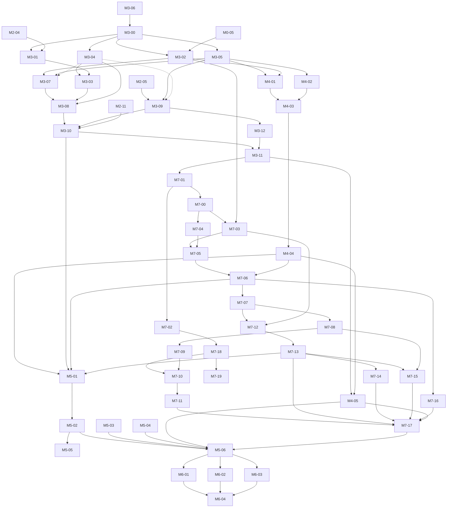

# MVP backlog (Work Breakdown Structure)

Scope and acceptance criteria (AC1 to AC14): [docs/MVP.md](../docs/MVP.md). Cells in 3D (M7, added 2026-11-06): [docs/decisions/0005-cells-in-3d.md](../docs/decisions/0005-cells-in-3d.md). Architecture and interfaces: [docs/ARCHITECTURE.md](../docs/ARCHITECTURE.md).

Hierarchy: **Milestone → Component → Task → Subtask.** One task = one focused coding session with a verifiable result. Tasks are done one at a time (CLAUDE.md); "independent" below means the order among them is free.

**Status:** Done · In progress · To do · Blocked. **Complexity:** Low · Medium · High (High tasks are split into subtasks, each about Low/Medium).

Conventions that apply to every task (not repeated below):
- Tests run in the session and reported with their real output; `ruff check` and `mypy` clean.
- Only the files listed under "Files" change, plus docs when an interface or behaviour changes.
- Any interface change is explained (consequences) before it is made.
- Tests never read the 140 real files; the only real-data test is the optional sample-slide test.

---

## Summary

| ID | Task | Component | Cx | Status | Depends on |
|---|---|---|---|---|---|
| M0-01 | Repository and GitHub remote | project | Low | Done | none |
| M0-02 | Python environment and OpenSlide | project | Low | Done | none |
| M0-03 | Package skeleton and `pyproject.toml` | project | Low | Done | M0-02 |
| M0-04 | Lint, type-check and lock file | project | Low | Done | M0-03 |
| M0-05 | Fake slide test helper | tests | Low | Done | M0-03 |
| M0-06 | Continuous integration (GitHub Actions) | project | Low | To do | M0-04 |
| M1-01 | Characterisation script | scripts | Low | Done | M0-02 |
| M1-02 | Header survey script (all slides) | scripts | Low | To do | M0-02 |
| M1-03 | Record measured facts | docs | Low | Done | M1-01 |
| M2-01 | `SlideReader` | slides | Low | Done | M0-03 |
| M2-02 | `Catalog.scan` | catalog | Low | Done | M0-03 |
| M2-03 | `ProjectConfig` | catalog | Low | Done | M0-03 |
| M2-04 | `WorkDir` and `Manifest` | store | Low | Done | M0-03 |
| M2-05 | Unregistered volume builder | volume | High | Done | M2-01, M2-02, M2-04, M0-05 |
| M2-06 | Static data server | serve | Low | Done | M0-03 |
| M2-07 | Neuroglancer state and local viewer | serve | Medium | Done | M2-06 |
| M2-08 | Interim CLI (`volume`, `serve`) | pipeline | Low | Done | M2-03, M2-05, M2-07 |
| M2-09 | Real build, slices 1 to 10 | integration | Low | Done | M2-08 |
| M2-10 | Visual check in Neuroglancer | integration | Low | Done | M2-09 |
| M2-11 | Close M2 test gaps (config, CLI) | tests | Low | Done | M2-08 |
| M3-06 | **Real-data spike: orientation, tissue masks, feature matching (first M3 task)** | integration | Medium | Done | none |
| M3-00 | Registration contracts (C1 to C12) | docs | Low | Done (approved 2026-10-20) | M3-06 |
| M3-01 | Work-dir layout for reg, mask, transforms, qc | store | Low | Done | M2-04, M3-00 |
| M3-02 | Synthetic tissue and similarity-transform generator | tests | Medium | Done | M0-05, M3-00 |
| M3-03 | Registration image and preprocessing stage | preprocess | Medium | Done | M3-01, M3-04 |
| M3-04 | Tissue mask (defines "tissue", F12) | preprocess | Medium | Done | M3-00 |
| M3-05 | `Transform2D` (similarity) model | registration | Medium | Done | M3-00 |
| M3-07 | Feature-based pairwise registration (guided ORB, similarity, tissue only) | registration | High | Done | M3-02, M3-05 (M3-04 soft) |
| M3-08 | Chain and register a slice range | registration | Low | Done | M3-07, M3-01, M3-03, M3-04 |
| M3-09 | Volume builder with transforms, tissue only | volume | High | Done | M3-05, M2-05 (M3-04 soft) |
| M3-10 | Interim CLI: `preprocess`, `register` | pipeline | Low | Done | M3-08, M3-09, M2-11 |
| M3-12 | Transparent background in the viewer | serve | Low | Done | M3-09 |
| M3-13 | Centre-first alignment, best effort for failed pairs | registration | Medium | Done | M3-11 |
| M3-11 | Real registration, slices 1 to 10 | integration | Medium | Done | M3-10, M3-12, M2-10, M3-06 |
| M4-01 | Pair score | qc | Medium | Done | M3-05, M3-02 |
| M4-02 | Overlay image | qc | Low | Done | M3-05 |
| M4-03 | QC report and flags | qc | Low | Done | M4-01, M4-02, M3-01 |
| M4-04 | `brainrec qc` command | pipeline | Low | Done | M4-03 |
| M4-05 | Real QC review, slices 1 to 10 | integration | Medium | Done | M4-04, M3-11 |
| M4-06 | QC peak check (catches errors of 100 to 200 µm) | qc | Medium | To do | M4-05 |
| M5-01 | Stage runner with resume (incl. `detect`, `cells`) | pipeline | Medium | To do | M3-10, M4-04, M7-06, M7-13 |
| M5-02 | `brainrec run` and `brainrec status` | pipeline | Medium | To do | M5-01 |
| M5-03 | Disk-space preflight | pipeline | Low | To do | M2-04 |
| M5-04 | Source fingerprint (before/after) | scripts | Low | To do | M2-02 |
| M5-05 | End-to-end synthetic integration test | tests | Medium | To do | M5-02 |
| M5-06 | End-to-end real run and resume check | integration | Medium | To do | M5-02, M5-03, M5-04, M7-17 |
| M6-01 | Documentation consistency pass | docs | Low | To do | M5-06 |
| M6-02 | Acceptance report | docs | Low | To do | M5-06 |
| M6-03 | Scale-up plan (planning only) | docs | Low | To do | M5-06 |
| M6-04 | Owner sign-off | review | Low | To do | M6-01, M6-02, M6-03 |
| M7-01 | **Real-data spike: detection, recurrence of nuclei, viewer load (first M7 task)** | integration | High | Done | M3-11 |
| M7-02 | Labelled cells and evaluation | detect | Medium | Done | M7-01 |
| M7-18 | Appearance groups for the class list (added 2026-11-08) | detect | Medium | Done | M7-02 |
| M7-19 | Draft labels for expert correction (added 2026-11-08) | detect | Medium | Done | M7-18 |
| M7-00 | Cell contracts (C13 to C18) | docs | Low | Done | M7-01 |
| M7-03 | Synthetic nuclei and synthetic 3D cells | tests | Medium | Done | M7-00, M3-02 |
| M7-04 | Work-dir layout and cell file I/O | store | Low | Done | M7-00, M3-01 |
| M7-05 | Nucleus detection, tiled | detect | High | Done | M7-03, M7-04 |
| M7-06 | `detect` stage and `brainrec detect` | detect | Medium | Done | M7-05, M4-04 |
| M7-07 | 3D placement, cell layers and `cells` stage | cells | High | Done | M7-06 |
| M7-08 | Viewer: cell layers, sliders, tissue opacity | serve | Medium | Done | M7-07 |
| M7-09 | Real run, slices 1 to 10, one type (first 3D cells) | integration | Medium | Done | M7-08 |
| M7-10 | Detection accuracy | detect | Medium | To do | M7-02, M7-18 (+ labels), M7-09 |
| M7-11 | Cell classes by appearance | detect | High | To do | M7-10 |
| M7-12 | Local alignment at cell scale | cells | High | To do | M7-07, M7-03 |
| M7-13 | Linking profiles into 3D cells | cells | High | To do | M7-12 |
| M7-14 | Cell table and QuPath export | cells | Low | To do | M7-13 |
| M7-15 | Density maps per type | cells | Medium | To do | M7-13, M7-08 |
| M7-16 | Detection QC | qc | Medium | Done | M7-06 |
| M7-17 | Real run, slices 1 to 10, all types, linked | integration | Medium | To do | M7-11, M7-13, M7-14, M7-15, M7-16, M4-05 |
| M8-xx | Vessels, other structures, landmark-based non-rigid refinement (after the MVP) | several | n/a | To do (planned when reached) | M6-04 |
| M9-xx | Suspicious cells (after the MVP) | several | n/a | To do (planned when reached) | M7-17, Q8, Q12 |

---

## Independent and sequential work

**Independent (order is free; each can be picked up whenever its listed dependency is done):**
- Any time: M0-06 (CI), M1-02 (header survey), M2-11 (test gaps), M5-03 (disk preflight), M5-04 (source fingerprint).
- After M3-00: M3-01 (layout), M3-02 (synthetic generator) and M3-05 (transform model) do not depend on each other; M3-04 (mask) → M3-03 (registration image) can follow independently of M3-07.
- After M3-05: M3-09 (volume with transforms), M4-01 and M4-02 (QC score and overlay) can be built and tested on synthetic data while M3-07 is in progress.
- M3-12 (transparent background) needs only M3-09.
- M7 (after M7-00): M7-04 (layout) is independent of M7-03 (synthetic data); M7-08 (viewer), M7-16 (detection QC) and M7-14/M7-15 (exports, density) are off the critical path. The labelling branch M7-02 → M7-18 (class list) → owner labels → M7-10 → M7-11 runs beside M7-03 to M7-13.

**Sequential (critical path):**
M3-06 (spike) → M3-00 (contracts) → M3-05 → M3-07 → M3-08 → M3-10 → M3-11 → M4-04 → M4-05 → **M7-01 → M7-00 → M7-03 → M7-05 → M7-06 → M7-07 → M7-09 → M7-12 → M7-13 → M7-17** → M5-01 → M5-02 → M5-06 → M6-01/02/03 → M6-04 (M7 inserted on 2026-11-06, decision 0005).
M2-10 (owner's visual check, done) had to pass before M3-11, because M3-11 relies on the viewer to judge registration. M2-11 must precede M3-10, because it creates `tests/unit/test_cli.py`, which M3-10 extends. Details and session estimates: `tasks/IMPLEMENTATION_PLAN.md`.

---

## M0 Environment and project setup

### Component: project

#### M0-01 Repository and GitHub remote · Low · Done
- **Objective:** Version control with a private GitHub remote.
- **Inputs:** project folder. **Outputs:** git repo on `main`, remote `Mohammad-Aminazadeh/brain-3d-reconstruction` (private), `.gitignore` excluding data, venv, local config.
- **Depends on:** none. **Files:** `.gitignore`.
- **Acceptance:** `git remote -v` shows the remote; no `.ndpi`, `.zarr` or `.venv` tracked.
- **Tests:** `git ls-files` contains no data files.

#### M0-02 Python environment and OpenSlide · Low · Done
- **Objective:** Reproducible environment on macOS (Apple Silicon).
- **Inputs:** Python 3.13. **Outputs:** `.venv` with dependencies; OpenSlide via `openslide-bin`.
- **Depends on:** none. **Files:** none in the repo.
- **Acceptance:** `import openslide` works without environment variables; the sample slide opens (139776 x 102144, 9 levels).
- **Tests:** `tests/integration/test_reader_sample.py` (added in M2-01).

#### M0-03 Package skeleton and `pyproject.toml` · Low · Done
- **Objective:** Installable `brainrec` package with one sub-package per component.
- **Outputs:** `src/brainrec/{slides,catalog,preprocess,registration,qc,volume,serve,store,pipeline}/`, `tests/`, `config/`, `scripts/`, `docs/decisions/`; `brainrec` console script.
- **Depends on:** M0-02. **Files:** `pyproject.toml`, package `__init__.py` files.
- **Acceptance:** `pip install -e ".[dev]"` succeeds; `pytest` runs.
- **Tests:** `tests/unit/test_import.py`.

#### M0-04 Lint, type-check and lock file · Low · Done
- **Objective:** Enforce conventions and pin exact versions.
- **Outputs:** ruff and mypy configuration in `pyproject.toml`; `requirements-lock.txt`.
- **Depends on:** M0-03. **Files:** `pyproject.toml`, `requirements-lock.txt`.
- **Acceptance:** `ruff check src tests scripts` and `mypy` report no issues.
- **Tests:** the two commands themselves.

#### M0-06 Continuous integration (GitHub Actions) · Low · To do
- **Objective:** Run ruff, mypy and pytest on every push, so "tests pass" is checkable by anyone.
- **Inputs:** `requirements-lock.txt`. **Outputs:** `.github/workflows/ci.yml` (Ubuntu, Python 3.13).
- **Depends on:** M0-04. **Files:** `.github/workflows/ci.yml`, README badge line.
- **Acceptance:** the workflow runs green on GitHub; the sample-slide test is skipped there (no data in CI).
- **Tests:** the workflow run.

### Component: tests

#### M0-05 Fake slide test helper · Low · Done
- **Objective:** In-memory stand-in for `SlideReader` so components are testable without NDPI files.
- **Outputs:** `tests/synthetic/fake_slide.py` (`FakeSlide`: gray rectangle, black marker, levels 1/2/4/8; `FakeFactory`: counts reads).
- **Depends on:** M0-03. **Files:** `tests/synthetic/fake_slide.py`.
- **Acceptance:** used by the volume tests; satisfies the `SliceSource` protocol (mypy).
- **Tests:** exercised by `tests/unit/test_volume.py`.

---

## M1 Data characterisation

### Component: scripts

#### M1-01 Characterisation script · Low · Done
- **Objective:** Measure levels, pixel size, read speed and compressibility of real slides (read-only).
- **Inputs:** NDPI paths. **Outputs:** `scripts/characterize.py`; numbers in `docs/REQUIREMENTS.md` section 7.
- **Depends on:** M0-02. **Files:** `scripts/characterize.py`.
- **Acceptance:** runs on the sample and on slides from My Passport without writing anything.
- **Tests:** manual run (script, not library code).

#### M1-02 Header survey script (all slides) · Low · To do
- **Objective:** Make the all-140 header survey (run ad hoc in M1) reproducible.
- **Inputs:** data folder. **Outputs:** `scripts/survey_headers.py` printing count, gaps, size range, pixel sizes, level counts and downsample patterns.
- **Depends on:** M0-02. **Files:** `scripts/survey_headers.py`.
- **Acceptance:** reproduces the M1 numbers (140 files, width 71680 to 157696, 9/10/11 levels, 0.2205 µm/px).
- **Tests:** manual run against My Passport; output pasted into the task report.

### Component: docs

#### M1-03 Record measured facts · Low · Done
- **Objective:** Replace estimates with measurements.
- **Outputs:** `docs/REQUIREMENTS.md` section 7. **Depends on:** M1-01.
- **Acceptance:** owner chose the 4x base level from these numbers.
- **Tests:** none (documentation).

---

## M2 Unregistered vertical slice

Goal: data path and viewer proven with the least code: 10 slices stacked as they are.

### Component: slides

#### M2-01 `SlideReader` · Low · Done
- **Objective:** Read-only NDPI access in level-local coordinates.
- **Inputs:** NDPI path. **Outputs:** `levels`, `mpp`, `level_for_downsample()`, `read_region()` (RGB uint8, transparent to white), `close()`.
- **Depends on:** M0-03. **Files:** `src/brainrec/slides/reader.py`.
- **Acceptance:** levels selected by downsample factor, never by index.
- **Tests:** `tests/integration/test_reader_sample.py` (skipped when the sample is absent).

### Component: catalog

#### M2-02 `Catalog.scan` · Low · Done
- **Objective:** Discover and order slices by `N_H`; select a range.
- **Outputs:** `Catalog`, `SliceRef`. **Depends on:** M0-03. **Files:** `src/brainrec/catalog/scan.py`.
- **Acceptance:** numeric order; errors on gaps in the range, duplicates, empty folder.
- **Tests:** `tests/unit/test_catalog.py` (5 tests).

#### M2-03 `ProjectConfig` · Low · Done
- **Objective:** Validated YAML configuration.
- **Outputs:** `ProjectConfig.load()`; `config/project.example.yaml`. **Depends on:** M0-03.
- **Files:** `src/brainrec/catalog/config.py`, `config/project.example.yaml`.
- **Acceptance:** loads the example; `z_spacing_um` marked as placeholder.
- **Tests:** `tests/unit/test_config.py` (added in M2-11).

### Component: store

#### M2-04 `WorkDir` and `Manifest` · Low · Done
- **Objective:** One place for work-dir file names; JSON progress record with atomic writes.
- **Depends on:** M0-03. **Files:** `src/brainrec/store/{layout,manifest}.py`.
- **Acceptance:** manifest survives reopen; parent folders created.
- **Tests:** `tests/unit/test_manifest.py`.

### Component: volume

#### M2-05 Unregistered volume builder · High · Done
- **Objective:** Stack slices, centred, into a sharded OME-Zarr 0.5 pyramid, resumable per slice.
- **Inputs:** `Catalog`, `VolumeSpec`, `Manifest`, reader factory. **Outputs:** `volume.zarr` (axes c, z, y, x; uint8; 5 levels from the slides' own pyramid).
- **Depends on:** M2-01, M2-02, M2-04, M0-05. **Files:** `src/brainrec/volume/builder.py`.
- **Subtasks:**
  - M2-05a Header pass: dimensions per level, single pixel size enforced, canvas, aligned offsets.
  - M2-05b Array creation: Zarr v3, 512 chunks in 4096 shards, zstd, white fill; OME 0.5 metadata.
  - M2-05c Band writing aligned to the shard grid (each shard written once).
  - M2-05d Resume via manifest signature; refuse to overwrite a different volume unless `overwrite=True`.
- **Acceptance:** pixels placed exactly; all levels aligned; resume reads nothing on a finished build; existing volume protected.
- **Tests:** `tests/unit/test_volume.py` (12 tests: bands, placement, full content, level alignment, metadata, sharding, resume, interruption, overwrite guard, pixel-size check).

### Component: serve

#### M2-06 Static data server · Low · Done
- **Objective:** Serve the work directory with CORS and range requests.
- **Depends on:** M0-03. **Files:** `src/brainrec/serve/app.py`.
- **Acceptance:** cross-origin GET and range GET work.
- **Tests:** `tests/unit/test_serve.py` (CORS, range).

#### M2-07 Neuroglancer state and local viewer · Medium · Done
- **Objective:** Show the RGB volume in a locally served Neuroglancer.
- **Inputs:** volume URL, OME metadata. **Outputs:** viewer state (channel axis `c` mapped to `c^`, scales in metres); local viewer URL; public fallback link.
- **Depends on:** M2-06. **Files:** `src/brainrec/serve/app.py`; `docs/decisions/0002-local-viewer.md`.
- **Acceptance:** state has the expected source, dimensions and shader; rendering confirmed in M2-10.
- **Tests:** `tests/unit/test_serve.py` (state mapping, URL round trip, local viewer page answers 200).

### Component: pipeline

#### M2-08 Interim CLI (`volume`, `serve`) · Low · Done
- **Objective:** Run M2 from the command line until `brainrec run` exists (M5).
- **Depends on:** M2-03, M2-05, M2-07. **Files:** `src/brainrec/pipeline/cli.py`.
- **Acceptance:** `brainrec --config C volume --slices 1-10 [--overwrite]`; `brainrec --config C serve`.
- **Tests:** `tests/unit/test_cli.py` (added in M2-11).

### Component: integration

#### M2-09 Real build, slices 1 to 10 · Low · Done
- **Objective:** Build the unregistered volume from My Passport.
- **Outputs:** `/Volumes/My Passport/3D Brain Reconstruction/volume.zarr`; build time and size recorded in docs.
- **Depends on:** M2-08.
- **Acceptance:** exit code 0; manifest lists 10 done slices; size measured.
- **Tests:** run log.
- **Result (2026-10-19):** exit 0, 10 slices in 11.5 min (about 1.1 min/slice), 960 files, 19.5 GB on disk (no block waste). Server smoke test: data and viewer pages answer 200; shard range reads answer 206.

#### M2-10 Visual check in Neuroglancer · Low · Done
- **Objective:** Confirm R6: the volume opens and streams in the browser (MVP gate for M2).
- **Inputs:** `brainrec serve` link. **Outputs:** owner's confirmation, or a bug report with a screenshot.
- **Depends on:** M2-09.
- **Acceptance:** RGB colours correct; 4-panel view; zoom loads finer levels; no errors in the Neuroglancer status bar.
- **Tests:** manual (owner, Chrome).
- **First attempt (2026-10-19):** colours correct, 4-panel view shown, no status-bar errors. But loading was slow, not every area sharpened, then all panels went black and Chrome reported "WebGL not supported".
  - Evidence: three Chrome crash dumps of the **GPU process** (Chrome 154, Apple GPU, ANGLE Metal backend) at 20:29, 20:30 and 20:31; Chrome disables WebGL after repeated GPU-process crashes until it is restarted. No server errors (8,422 requests, 7,847 at full resolution). System memory normal.
  - My Passport serves about 27 random 430 KB chunks/s (median 0.5 s at 16 in parallel), so full-resolution areas fill in slowly.
  - Change: viewer now opens in a single `xy` panel with `gpuMemoryLimit` 512 MB, `systemMemoryLimit` 1 GB and 8 concurrent downloads (`brainrec serve --layout 4panel --gpu-memory-mb N` to override).
- **Second attempt (2026-10-19):** after a full Chrome restart, with hardware acceleration switched on, everything worked in the `xy` layout. The owner reports that Chrome's hardware acceleration had been **off** during the first attempt, so WebGL was probably running in software; that is the most likely cause of the slowness and the GPU-process crashes. 4-panel retest (same 512 MB limit): works. Owner noted that 3D zoom centres on the current position and only the area shown by the 2D panels becomes sharp in 3D; both are Neuroglancer behaviour (documented under README, Viewer controls).

### Component: tests

#### M2-11 Close M2 test gaps (config, CLI) · Low · Done
- **Objective:** Cover the two untested pieces of M2.
- **Depends on:** M2-08. **Files:** `tests/unit/test_config.py`, `tests/unit/test_cli.py`.
- **Acceptance:** config: loads valid YAML, rejects a missing field; CLI: `--slices 3-7` parses to (3, 7), `--slices 5` to (5, 5), and `volume` on an existing different volume exits with an error message instead of a traceback.
- **Tests:** the two new files.
- **Result (2026-10-20):**
  - **Code:** tests only, no source change.
  - **Tests:** 15 new. Config (7): valid YAML loads with defaults; values override defaults (YAML list to tuple); each of the three required fields missing is rejected; a wrong type is rejected; the shipped example loads. CLI (8, run in-process with fake slides): `--slices 3-7` selects slices 3 to 7 and `--slices 5` slice 5; malformed values are a usage error (exit 2); config values and the work dir reach the builder and the output path is printed; an existing volume with other settings stops with an `error:` message (no traceback) and is kept, `--overwrite` replaces it; `serve` on a volume without OME metadata stops with an error message.
  - **Mutation check:** four deliberate breaks of the CLI (error not caught, single slice parsed wrongly, `--overwrite` ignored, config z spacing ignored), each on a scratch copy, each fail at least one test.
  - **Gaps found, not fixed (outside the acceptance):** common user errors still end in a traceback: `serve` before a volume exists, `--slices` with missing ids or a reversed range (reported as "no slices found"), a missing or empty config file. A misspelled optional config key is silently ignored and its default used (for example `base_downsampel: 8` builds at 4x). Both added to M3-10 (owner, 2026-10-20).

---

## M3 Registration

Goal: slice-to-slice alignment with a **similarity** transform (rotation, uniform scale, translation), proven on synthetic data (AC4), then applied to slices 1 to 10. All tasks follow the contracts C1 to C12 in `docs/ARCHITECTURE.md` section 5.1. Transforms are expressed in **micrometres in each slice's level-0 frame**, so they apply unchanged at every pyramid level.

Two owner requirements shape this milestone (`docs/decisions/0003-tissue-only-feature-based-registration.md`):
- **Tissue only (F12):** the tissue mask defines what is processed. Registration and QC work inside the masks; the volume stores only tissue and is limited to the tissue extent.
- **Feature-based (F13):** boundary-based initial alignment from the masks, ORB features inside the tissue, guided two-pass matching (64x, then 32x), RANSAC similarity fit, boundary fallback (spike decisions, 2026-10-20).

### Component: integration (first)

#### M3-06 Real-data spike: orientation, tissue masks, feature matching · Medium · Done
- **Objective:** Before writing registration code, check on real slices: are some slices mirrored (R7)? Do simple masks capture the tissue without glass or debris (R9)? Do neighbouring sections give enough reliable SIFT/ORB matches inside the tissue, and is a rigid fit enough (R10, R5)?
- **Inputs:** 32x level of slices 1 to 10, read directly with `SlideReader`. **Outputs:** contact sheet with mask outlines; for 4 pairs: match and inlier counts (SIFT vs ORB), residual, rigid vs similarity fit (scale), boundary-only result, mirrored-candidate result, overlay and match picture; findings in `docs/REQUIREMENTS.md` section 7. Details in `tasks/IMPLEMENTATION_PLAN.md` section 6.
- **Depends on:** none (first task of M3). **Files:** `scripts/spike_registration.py`, `docs/REQUIREMENTS.md`.
- **Acceptance:** owner has reviewed contact sheet, overlays and match pictures; decisions recorded: mirror needed, rigid or similarity, detector, mask method adequate, 32x adequate, initial inlier and residual thresholds.
- **Tests:** manual review (throwaway script, writes only to the work dir; outputs now in `results/M3-06_registration_spike/` on the drive, copies in the repository's `results/`).
- **Result (2026-10-19):** all 9 pairs of slices 1 to 10 (more than the planned 4), plus a guided-matching variant and a 16x/32x/64x comparison on two pairs. Findings and proposed decisions in `docs/REQUIREMENTS.md` section 7 ("Spike results"); decisions are fixed in M3-00.
- **Owner decisions (2026-10-20):** similarity instead of rigid; guided two-pass ORB matching; coarse-to-fine 64x then 32x; no mirror handling; detached fragments kept as tissue; damaged margins accepted for the MVP (`docs/REQUIREMENTS.md`, confirmed decisions 11 to 15).

### Component: docs

#### M3-00 Registration contracts · Low · Done (approved 2026-10-20)
- **Objective:** Fix the cross-cutting contracts C1 to C12 (`tasks/IMPLEMENTATION_PLAN.md` section 5) with the spike's facts, before any M3 library code.
- **Inputs:** spike findings (M3-06). **Outputs:** `docs/ARCHITECTURE.md` section 5 (proposed M3/M4 entries become contracts: coordinates, transform direction and family, file formats, manifest schema, stage shape, config fields, tissue-only semantics, failure rules); spike decisions recorded in `docs/decisions/0003-tissue-only-feature-based-registration.md`.
- **Depends on:** M3-06. **Files:** `docs/ARCHITECTURE.md`, `docs/decisions/0003-tissue-only-feature-based-registration.md`, `tasks/IMPLEMENTATION_PLAN.md`.
- **Acceptance:** owner approves; every M3 and M4 task card refers only to defined contracts.
- **Tests:** none (documentation); review.
- **Result (2026-10-20):** contracts C1 to C12 in `docs/ARCHITECTURE.md` section 5.1; M3/M4 interfaces in section 5 updated (`Transform2D` similarity, `preprocess_slice`, guided matching, failure rules); task cards M3-02 to M3-09 aligned; mask before registration image (the registration image is blanked outside the mask).

### Component: store

#### M3-01 Work-dir layout for reg, mask, transforms, qc · Low · Done
- **Objective:** Define every MVP output path in one place before the stages that write them.
- **Outputs:** `WorkDir.reg_image(id)`, `.reg_meta(id)`, `.mask(id)`, `.pair_transform(id)`, `.chained_transform(id)`, `.qc_report`, `.qc_overlay(id)`.
- **Depends on:** M2-04, M3-00. **Files:** `src/brainrec/store/layout.py`, `docs/ARCHITECTURE.md` (layout section).
- **Acceptance:** all paths under `root`; names stable and documented.
- **Tests:** `tests/unit/test_layout.py` (paths, no collisions between ids).
- **Result (2026-10-20):** `WorkDir` extended with all MVP paths per C4, C5 and C10, plus directory properties and a guard that rejects non-positive or non-integer ids; 9 tests (names, all under root, no collisions over 140 ids and 6 kinds, invalid ids).

### Component: tests

#### M3-02 Synthetic tissue and similarity-transform generator · Medium · Done
- **Objective:** Ground truth for registration, mask and QC tests.
- **Outputs:** `tests/synthetic/tissue.py`:
  - `make_tissue(shape, seed)` returns an RGB image and its ground-truth mask: an irregular, pale-stained tissue blob with internal structures that give detectable features (vessel-like curves, blobs of varying size, texture), **one or two detached fragments** (decision 14), and on the glass **debris specks** below 0.2 mm² that must be excluded;
  - `apply_similarity(img, mask, angle_deg, scale, tx, ty)` returns the moved image, moved mask and true `Transform2D`;
  - `perturb(img, seed)` adds section-to-section differences (noise, slight intensity change, a few structures added or removed, a fold-like streak);
  - a `FakeSlide` variant built from a given image.
- **Depends on:** M0-05, M3-00. **Files:** `tests/synthetic/tissue.py`, `tests/synthetic/fake_slide.py` (additive).
- **Acceptance:** deterministic for a seed; applying a transform and its inverse returns the original within interpolation error; ORB finds at least 100 keypoints inside the tissue of a 1000 x 800 image.
- **Tests:** `tests/unit/test_synthetic.py`.
- **Result (2026-10-20):** `tests/synthetic/tissue.py` (`make_tissue`, `apply_similarity`, `perturb`) and `FakeSlide.from_image`; 14 tests. Differences from the card:
  - `perturb(rgb, mask, seed)` takes the mask, so changes stay inside the tissue.
  - `make_tissue(..., detail_seed)` was added: the same `seed` with a different `detail_seed` gives a **neighbouring section** (same geometry, shared vessels and stain bands, different cells), the realistic case. On it, global ORB matching collapses (3 to 7 inliers, as on the real slides), while the spike's guided matching recovers all 18 tested motions (6 seeds; up to 170° and ±8% scale).
  - Checked over 10 seeds: always 2 fragments, colours matching the real saturation levels.

### Component: preprocess

#### M3-03 Registration image and preprocessing stage · Medium · Done
- **Objective:** One read of the 32x level per slice produces the mask and the registration image (contract C4).
- **Inputs:** `SliceRef`, reader factory, `ProjectConfig`. **Outputs:** `make_reg_image(rgb, mask)` (255 minus luminance, CLAHE, 0 outside the mask); `preprocess_slice(...)` writing `reg/{id}.png`, `reg/{id}.json` and `mask/{id}.png`; `run_preprocess(...)` in the stage shape C7 with manifest resume.
- **Depends on:** M3-01, M3-04 (the registration image is blanked outside the mask). **Files:** `src/brainrec/preprocess/regimage.py`, `src/brainrec/preprocess/stage.py`; `src/brainrec/slides/` (receives the `SliceSource` protocol, moved from `volume`; `volume` re-exports it).
- **Subtasks:** M3-03a move `SliceSource` to `slides` (interface location change, no behaviour change); M3-03b `make_reg_image()`; M3-03c `preprocess_slice()` and `run_preprocess()`.
- **Acceptance:** reads one whole 32x level (no level-0 access); output sizes equal the level size; metadata per C4; zero outside the mask; second run skips done slices.
- **Tests:** `tests/unit/test_preprocess.py` with `FakeSlide` (size, inversion, zero background, metadata, reads only the requested level, resume).
- **Result (2026-10-20):**
  - **Code:** `src/brainrec/preprocess/{regimage,stage}.py`, `RegImage.load`, `store/stage.py` (`StageResult`, `StageExistsError`, `fingerprint`, atomic writes); `SliceSource` and `ReaderFactory` moved to `slides/source.py` (volume still re-exports `SliceSource`). 8 tests.
  - **Real slices 1 to 10:** 9 s for 10 slices, 30 files (66 MB); the second run skips all; `register_pair` on the loaded files works.
  - **C6 refinement:** per-slice stages keep finished slices when the range grows (ARCHITECTURE 5.1).
  - **To watch in M3-11 and QC:** with fragments now in the masks, mask IoU of pairs drops slightly (5→6: 0.851 vs 0.874; 8→9: 0.963 vs 0.977), and pair 5→6 has 54 inliers (threshold 40), because detached fragments drift independently between sections.

#### M3-04 Tissue mask · Medium · Done
- **Objective:** Define what counts as tissue for every later stage (F12): registration, QC and the volume ignore everything outside the mask.
- **Inputs:** RGB image at 32x and its µm per pixel. **Outputs:** `make_mask(rgb, um_per_px, cfg)`: uint8 {0, 255}, same shape (contract C4).
- **Method:** Otsu on blurred HSV saturation with hysteresis (`mask_hysteresis`, pale tissue connected to stained tissue is kept), close about 100 µm, open about 35 µm, fill holes, keep **every** component of at least `mask_min_component_mm2` (detached fragments kept, decision 14; debris specks dropped).
- **Depends on:** M3-00. **Files:** `src/brainrec/preprocess/mask.py`, `src/brainrec/catalog/config.py` (mask fields of C9).
- **Acceptance:** on synthetic data: Dice at least 0.95, tissue recall at least 0.99, fragments kept, specks excluded, holes filled. On real slices 1 to 10 (contact sheet, owner check): the pale fragments at the left of slices 6 to 10 are inside the mask; scan-edge streaks are not.
- **Tests:** `tests/unit/test_mask.py` (Dice, recall, fragments kept, specks dropped, holes filled, hysteresis keeps a pale region attached to stained tissue but not an isolated pale patch).
- **Result (2026-10-20):** `src/brainrec/preprocess/mask.py`; mask fields of C9 in `ProjectConfig`; 13 tests.
  - **Synthetic data (10 seeds):** Dice 0.996, recall 0.996, fragments kept, no debris, exactly 3 components each time.
  - **Real slices 1 to 10:** compared with the spike masks, the new masks only add tissue (4 to 20 mm² per slice, mostly the fragments of slices 6 to 10) and remove none. Contact sheet: `results/M3-04_tissue_masks/mask_contact_sheet.png` on My Passport (copy in the repository's `results/`).
  - **Fixed during the task:**
    - Colour is now measured as chroma instead of HSV saturation: saturation turned the black scanner edge of slice 10 into tissue.
    - The threshold never drops below 15: an image of pure glass otherwise became 100% tissue.
  - **Owner check (2026-10-20):** fragments of slices 6 to 10 correctly inside; nothing outside the tissue outlined; the pale patch next to the fold flap of slice 3 is correctly excluded. Owner decision: ripped tissue lying in overlapping layers (folds and flaps, darker than the rest) may be ignored and need not be included. The mask currently keeps such flaps when attached or larger than 0.25 mm²; this is acceptable, and explicit fold removal is not planned for the MVP.

### Component: registration

#### M3-05 `Transform2D` (similarity) model · Medium · Done
- **Objective:** The transform type every later stage uses (contracts C1 to C3).
- **Outputs:** `Transform2D` holding a 2x3 matrix in µm (slice → reference), family `similarity` (or `rigid`); `identity()`, `similarity()`, `from_matrix()`, `matrix`, `inverse()`, `compose()`, `apply(points)`, `angle_deg`, `scale`, `to_pixels(src_downsample, dst_downsample, mpp)`, `save()`/`load()` (`brainrec.transform/1`); the pixel↔µm helpers of C1.
- **Depends on:** M3-00 (conventions C1 to C3). **Files:** `src/brainrec/registration/transform.py`, `docs/ARCHITECTURE.md` (interface).
- **Acceptance:** level-independent: the same transform gives consistent pixel matrices at 4x, 32x and 64x; `from_matrix` rejects a non-similarity matrix and reflections.
- **Tests:** `tests/unit/test_transform.py` (identity, inverse round trip, composition order, JSON round trip, pixel conversion at three levels including the half-pixel convention, family validation).
- **Result (2026-10-20):** `src/brainrec/registration/transform.py`; also `from_pixels()` (inverse of `to_pixels`, for converting OpenCV's pixel-space RANSAC result in M3-07, as C1 requires all conversion in this module). 33 tests in `tests/unit/test_transform.py`, including a 140-transform chain that stays a valid similarity.

#### M3-07 Feature-based pairwise registration (guided ORB, similarity, tissue only) · High · Done
- **Objective:** Estimate the similarity transform aligning slice k to slice k-1 by detecting features in both images and matching them (F13), using only the tissue (F12), as validated in the spike.
- **Inputs:** two `RegImage`s (image, mask, metadata). **Outputs:** `PairResult` (contract C2/C12): `Transform2D` (moving → fixed, µm), status (`features`, `boundary` or `failed`), matches, inliers, residual (µm), mask IoU.
- **Depends on:** M3-02, M3-05; M3-04 soft (tests use synthetic ground-truth masks; the mask contract C4 is fixed). **Files:** `src/brainrec/registration/{boundary,features,pairwise}.py`, `src/brainrec/catalog/config.py` (registration fields of C9).
- **Subtasks:**
  - M3-07a **Boundary-based initial alignment** from the masks: centroid and principal axes; both 180° candidates, the better mask IoU wins. Test: translation within 2 px; rotations of 45° and 170° within 10°.
  - M3-07b **ORB features inside the tissue** (mask as detection region, up to `reg_max_features`). Test: keypoints only inside the mask; debris yields none.
  - M3-07c **Guided matching and RANSAC similarity fit, coarse-to-fine:** pass 1 at 64x within `reg_window_um[0]` of the boundary estimate, pass 2 at 32x within `reg_window_um[1]` of the pass-1 fit; ratio test among the candidates inside the window; `estimateAffinePartial2D` with `reg_ransac_px`. Test: **AC4** (1 px, 0.5°, 0.3% scale) on 5 seeded synthetic pairs with `perturb` and scale changes up to ±10%; 30% injected false matches do not change the result.
  - M3-07d **Boundary fallback** (C12): iterative closest point on the two tissue outlines with a similarity fit, starting from M3-07a, when pass 2 misses `reg_min_inliers` or `reg_max_rms_um`. Test: a texture-free pair aligns within 3 px and is reported as `boundary`.
  - M3-07e **Result conversion** to micrometres per C1/C2 (direction moving → fixed) and status per C12. Test: consistent with M3-05 at 32x and 64x; an unrelated pair is reported `failed`.
  - M3-07g Intensity refinement inside the masks (SimpleITK), **only if** M3-07c misses AC4. Test: AC4.
  - (M3-07f, mirrored candidate, dropped: no mirrored slices, decision 12.)
- **Acceptance:** AC4 passes; an unrelated pair is reported as failed (no silent wrong transform); results identical with and without background debris; about 5 s per pair at 32x on the real data (spike timing).
- **Tests:** `tests/unit/test_boundary.py`, `tests/unit/test_features.py`, `tests/unit/test_pairwise.py`.
- **Note from M3-02 (2026-10-20), agreed by the owner:** AC4 (1 px, 0.5°, 0.3%) is specified on *perturbed copies of the same section*, where matching is easy. On realistic *neighbouring sections* (different cells), the spike-quality method reaches 0.5 to 4.4 px, ≤ 0.54° and ≤ 0.92%. M3-07 needs a refinement step for precision. Decision: keep AC4 as specified, and add a robustness test on neighbouring sections with a tolerance taken from the real-data residual (about 17 µm ≈ 2.5 px).
- **Result (2026-10-20):** `src/brainrec/registration/{types,geometry,boundary,features,pairwise}.py`; registration settings of C9 in `ProjectConfig`; 31 tests (boundary 9, features 7, pairwise 15).
  - **AC4** (5 seeded same-section pairs, up to 170° and ±10% scale): ≤ 0.011° angle, ≤ 0.011% scale, ≤ 0.46 px maximum displacement. **Passed.**
  - **Neighbouring sections** (agreed robustness test): mean ≤ 2.08 px, residual 17 to 19 µm (real data: 16 to 19 µm). **Passed.**
  - **Real slices 1 to 10** (read-only check, spike loader): all 9 pairs `features`, 67 to 899 inliers, residual 16 to 19 µm, mask IoU 0.838 to 0.977, about 7 s per pair. Overlays of the damaged pairs 3→4 and 5→6 show internal structures aligned; remaining differences are tears and folds.
  - **Findings fixed while implementing:**
    - ORB keypoints on coarser pyramid levels are offset by half a pixel times (scale − 1); this is now corrected, which halved the bias seen at 180° rotations.
    - The C12 plausibility rule was added (mask IoU); see ARCHITECTURE section 5.1.
    - C4 now sets the background before CLAHE.
    - Degenerate fits are rejected.
    - Outline ICP needed 150 iterations, not 40, on roundish outlines.
  - **Subtask decisions:** M3-07g (intensity refinement) is not needed; AC4 passes without it. M3-07f (mirror) was dropped, decision 12.

#### M3-08 Chain and register a slice range · Low · Done
- **Objective:** Pairwise transforms for consecutive slices, composed to the reference slice's frame (C5), as the `register` stage (C7).
- **Inputs:** catalog range, work dir. **Outputs:** `transforms/pair_{id}.json` (transform + match quality: method, matches, inliers, residual), `transforms/chained_{id}.json` (slice 1 = identity).
- **Depends on:** M3-07, M3-01, M3-03, M3-04. **Files:** `src/brainrec/registration/chain.py`.
- **Acceptance:** chained = composition of pairs in the documented order (C2); per-pair resume via manifest (C6); a `failed` pair stops the run and is reported, with no chained transform written past it (C12).
- **Tests:** `tests/unit/test_chain.py` (known synthetic chain of 4 transforms; resume skips done pairs).
- **Result (2026-10-20):**
  - **Code:** `src/brainrec/registration/chain.py` (`chain`, `run_register`, `RegistrationFailedError`); 8 tests: composition order, pairs and chain against known truth, resume, extending the range, a new reference without re-registration, upstream change redoing only affected pairs, settings needing overwrite, failure stopping the chain (stale chained files removed), missing preprocessing.
  - **Real slices 1 to 10:** 9 pairs in 86 s, all `features`, residual 16 to 19 µm; the second run skips all. Chained scale 1.02 to 0.97, consistent with the tissue sizes of slices 1 to 5 vs 6 to 10.
  - **Problem found and fixed (changes M3-07 behaviour, see ARCHITECTURE C12):** with the final masks, pair 4→5 drifted to a precise fit of one region (−12.7°; correlation worse than the outline estimate) and passed C12. Fixes: pass-1 window 1 mm instead of 2.5 mm, pass 1 run twice, and the new C12 correlation rule (`reg_ncc_tolerance`). Pair 4→5 is now +3.3°.
  - **Robustness criterion (approved by the owner, 2026-10-20):** on synthetic neighbouring sections the feature path averages about 1.3 px but 1 to 2 of 15 cases reach 2.5 to 3.2 px (up to 22 µm), whichever settings are used. The test `test_neighbouring_sections_feature_path_precision` requires every case below 2.5 px and fails for one case (3.13 px). Decision: the agreed tolerance is statistical over 15 cases (average below 2.5 px, every case below 3.5 px, about 25 µm = `reg_max_rms_um`); the test was changed accordingly and passes.

### Component: volume

#### M3-09 Volume builder with transforms, tissue only · High · Done
- **Objective:** Resample slices through their chained transforms into the pyramid, keeping only tissue (F12).
- **Inputs:** `Catalog`, chained transforms, tissue masks, `VolumeSpec`. **Outputs:** `volume.zarr` as in M2, registered, tissue only.
- **Interface change:** `build_volume(..., transforms: dict[int, Transform2D] | None = None, masks: dict[int, Path] | None = None)`; `None` keeps M2 behaviour (centred, whole scan). Consequence: the manifest signature includes hashes of the transforms and masks, so changes trigger the overwrite guard.
- **Depends on:** M3-05, M2-05 (mask files from M3-04 for real runs; tests use synthetic masks). **Files:** `src/brainrec/volume/builder.py`, `src/brainrec/volume/warp.py` (new), `docs/ARCHITECTURE.md`.
- **Subtasks:**
  - M3-09a Canvas from the bounding box of all **transformed tissue masks** (µm) plus the safety margin, not of the scanned area; aligned offsets. Test: known transforms and masks give the expected canvas; glass-only areas outside it.
  - M3-09b Output tiles equal to shards (4096 x 4096): for each tile, the inverse-mapped source bounding box, clipped to the slice. Test: rotated tile maps to the expected source box; memory bounded (box at most about 5800 px square).
  - M3-09c Warp one tile: read the source box, `cv2.warpAffine` (bilinear, white border), write the tile. Test: integer translation reproduces pixels exactly; 90 degree rotation moves the marker to the expected place.
  - M3-09d Apply per level using the same `Transform2D`. Test: the marker is at the same physical position at all 5 levels.
  - M3-09e Signature and resume with transforms and masks. Test: unchanged inputs resume; changed ones are refused without overwrite.
  - M3-09f **Tissue masking:** warp each mask with the slice's transform to the tile, enlarge by `volume_mask_margin_um` (50 µm, approved), set voxels outside to the fill value (255, 255, 255) before writing, so all-background chunks are not stored. Tissue voxels that are exactly (255, 255, 255) are stored as (254, 254, 254), so pure white means background unambiguously (C11; needed for the transparent display, M3-12). Test: no non-background voxel outside the enlarged mask; every tissue voxel kept and never pure white; background-only tiles write no chunk.
- **Acceptance:** with synthetic slices moved by known transforms, the inverse transforms put all markers on one (x, y) across z within 1 px at the base level; AC9 holds on synthetic data (tissue only, nothing cut off).
- **Tests:** `tests/unit/test_volume_warp.py`; existing `tests/unit/test_volume.py` still passes unchanged.
- **Result (2026-10-20):**
  - **Code:** `src/brainrec/volume/warp.py` (new, pure geometry), registered mode in `builder.py` (centred M2 mode unchanged; array creation and resume moved into shared helpers), `VolumeSpec.mask_margin_um`, `ProjectConfig.volume_mask_margin_um`.
  - **Tests:** 10 new; the 12 M2 tests pass unchanged. Covered: canvas = tissue extent; source box rotated, clipped and bounded; exact pixels under integer translation; markers back in place after 90° and −25° rotations; markers of three moved slices on one (x, y) within 1 px and at the same physical position on all levels (acceptance); tissue only (nothing beyond mask + margin, every tissue voxel kept, pure-white tissue stored as 254, background tiles not stored: AC9 on synthetic data); resume and changed transform or mask needing overwrite; empty mask; invalid inputs.
  - **Real smoke test** (slices 1 to 10, real chained transforms and masks, base 16x instead of 4x, scratchpad, deleted afterwards): 38 s, 61 shard files (628 MB), about 40% of the canvas background (not stored). A side cut through the central vessel lumens shows them as continuous columns through the slices, no jumps. Estimate for the real 4x build: about 15 to 25 min for slices 1 to 10.
  - **Consequence:** `VolumeSpec` has a new field, so the existing unregistered M2 volume on the drive no longer resumes. It will be replaced by the registered volume in M3-11 (with overwrite).

### Component: pipeline

#### M3-10 Interim CLI: `preprocess`, `register` · Low · Done
- **Objective:** Run M3 stages on real data before the M5 runner exists.
- **Outputs:** `brainrec preprocess --slices A-B`, `brainrec register --slices A-B`; `brainrec volume` uses chained transforms when they exist (`--unregistered` to force M2 mode).
- **Also (gaps found in M2-11; owner, 2026-10-20):**
  - **User errors:** known user errors end with a one-line `error: <message>` (exit status 1) instead of a traceback: missing or empty config file, invalid config, slice range with missing ids or reversed, `serve` before a volume exists, existing volume or stage output from other settings, failed registration. Programming errors still show the traceback.
  - **Strict config (interface change):** `ProjectConfig` rejects unknown keys, so a misspelled setting stops with an error naming it instead of silently using the default. Consequence: config files may contain only known keys (the example and the owner's current `config/project.yaml` do).
- **Depends on:** M3-08, M3-09, M2-11 (creates `tests/unit/test_cli.py`). **Files:** `src/brainrec/pipeline/cli.py`, `src/brainrec/catalog/config.py`, README usage, `docs/ARCHITECTURE.md` (C9).
- **Acceptance:** each command runs on a synthetic temp work dir; each listed user error gives an `error:` message and no traceback; a config with an unknown key is rejected, naming the key.
- **Tests:** `tests/unit/test_cli.py` and `tests/unit/test_config.py` (extended).
- **Result (2026-10-20):**
  - **Code:** `cli.py` rewritten around one function per command; `ProjectConfig` with `extra="forbid"` and a clear error for a file without settings; new `load_chained(work, ids)` in `registration/chain.py`.
  - **Design choice (beyond the task text):** `volume` builds the registered volume by default and stops with an error, naming `register` and `--unregistered`, if the slices are not registered. It does not silently fall back to the unregistered M2 volume.
  - **Found and fixed:** a register run chains its range to the range's first slice, and the chained files do not record that slice. Registering 1 to 10 and later 5 to 15 would have let `volume --slices 1-15` mix transforms to slice 1 and to slice 5 without any error. `load_chained` checks chained[k] = chained[prev] ∘ pair[k] (exact within one run) and refuses anything else, without changing any file format (C5 refinement).
  - **Tests:** 28 new (CLI 19, config 4, `load_chained` 5); the 8 CLI tests of M2-11 now pass `--unregistered` where they test the M2 path. CLI: every command on a synthetic work dir (preprocess, register and registered volume end to end, then a second run that skips everything; `serve` with the viewer and data server stubbed); each listed user error ends in one `error:` line (missing, empty, invalid or misspelled config, invalid YAML, data folder missing, missing or reversed slice range, register before preprocess, volume before register, transforms of separate runs, other settings without `--overwrite`, failed registration, `serve` without a volume); one check through the real console script that the user sees exactly one line and exit status 1; bugs still raise. Config: unknown setting, file without settings. `load_chained`: parts of one run accepted, unregistered slices named, three kinds of separate runs refused.
  - **Mutation check:** seven deliberate breaks in a scratch copy (chain check skipped, unknown keys allowed, OSError not a user error, reversed range accepted, silent fallback to unregistered, mask margin from config ignored, data folder check removed) each fail at least one test.
  - **Real data (read-only):** `load_chained` accepts the real transforms of slices 1 to 10 from M3-08 (angles 0 to −5.13°, unchanged). `brainrec volume --slices 1-10` on the real work dir stops at the guard with one line (the unregistered M2 volume exists; M3-11 needs `--overwrite`), and the manifest is unchanged.

### Component: serve

#### M3-13 Centre-first alignment, best effort for failed pairs · Medium · Done
- **Objective:** A failed pair must not stop the run; the tissue centre must align best, errors may grow towards the edge but are minimised everywhere (owner, 2026-11-04). Decision: `docs/decisions/0004-centre-first-best-effort-registration.md`.
- **Inputs:** registration images, masks. **Outputs:** pair results with best-effort transforms; all slices chained.
- **Depends on:** M3-11. **Files:** `registration/{geometry,features,pairwise,chain}.py`, `qc/{metrics,report}.py`, `catalog/config.py`, `pipeline/cli.py`.
- **Acceptance:** on a synthetic section deformed at the edge, the centre aligns better than with an unweighted fit; a failed pair keeps the best centre match among all candidates and the run continues; a retry with a wider window rescues a far-off start; QC flags failed pairs; no real pair of slices 1 to 10 gets worse by the centre-weighted correlation.
- **Tests:** `test_geometry.py` (new), `test_pairwise.py`, `test_chain.py`, `test_cli.py`, `test_qc_report.py`.
- **Result (2026-11-04):**
  - **Code:**
    - `depth_weights` (edge `reg_edge_weight`, Proposed 0.2, rising linearly to 1 at the deepest point);
    - weighted `umeyama_similarity` / `fit_similarity`;
    - `masked_ncc(..., edge_weight)`;
    - pass 2 run with and without centre weights, best centre-weighted correlation wins;
    - retry with `reg_retry_window_um` (2500 µm);
    - best-effort candidate choice (feature fits, outline alignment, outline estimate);
    - `run_register` no longer stops, warns per failed pair; `RegistrationFailedError` removed;
    - CLI prints `warning: pairs ... failed` and exits 0;
    - `score_pair` takes the edge weight; QC always flags failed pairs;
    - register stage version 2 (existing results need `register --overwrite`).
  - **Tests:** 12 new (6 geometry, 3 centre priority on deformed sections, retry, best candidate, failed always flagged); the stop-at-failure tests of `test_chain.py` and `test_cli.py` rewritten for the new rule; all other tests unchanged. Mutation check: 8 deliberate faults (weights ignored in the fit, in the correlation or in `fit_similarity`, last instead of best fit, outline instead of best candidate, no retry, resume stopping at a failure, failed pair not flagged) each caught.
  - **Synthetic:** on sections turned more and more towards the edge (centre fixed, up to 6°), the centre error is 0.95 px against 1.11 to 1.18 px unweighted; even edge weight 0 leaves about 0.8 px, which is deformation a similarity cannot follow.
  - **Real slices 1 to 10 (in memory, before `register --overwrite`):** all 9 pairs stay `features`. Centre-weighted correlation never drops: unchanged on 1→2, 3→4, 8→9, 9→10 (same transform), up to +0.005 elsewhere; the centre moves by 2 to 35 µm (5→6: 35 µm, 0.372 → 0.377). Weighting alone (without the choice) moved weak pair 3→4 by 192 µm to a worse centre match (0.450 → 0.430, right ventricle doubled), hence the choice. Time per pair 15 s instead of 9 s.

#### M3-12 Transparent background in the viewer · Low · Done
- **Objective:** Show everything outside the tissue as transparent, so empty space contrasts with the tissue (owner decision, 2026-10-19).
- **Inputs:** a volume in which background voxels are exactly (255, 255, 255) and tissue voxels never are (C11, M3-09f). **Outputs:** Neuroglancer shader: transparent where all three channels are 255, RGB colour elsewhere; dark panel background for contrast.
- **Depends on:** M3-09. **Files:** `src/brainrec/serve/app.py`, `tests/unit/test_serve.py`, README (viewer controls).
- **Acceptance:** in the registered volume, glass areas are transparent in the 2D and 3D panels; tissue colours unchanged.
- **Tests:** state contains the transparent branch; Neuroglancer's own parser accepts the state; owner check in M3-11.
- **Result (2026-11-03):**
  - **Code:** `serve/app.py`: the shader compares the raw channel values with 255 (`toRaw`, exact integers) and calls `emitTransparent()` only where all three are 255; elsewhere `emitRGB` with the same colours as before. `crossSectionBackgroundColor` and `projectionBackgroundColor` are black.
  - **Tests:** 2 new (transparent branch and black panels in the state; Neuroglancer's Python parser accepts the state).
  - **Shader review:** checked against the installed Neuroglancer client: user shaders compile as GLSL ES 3.00 with `precision highp int`; `getDataValue(i)` returns `uint8_t` for this data, `toRaw(uint8_t)` returns `uint`, `emitTransparent()` exists.
  - **Not verified automatically:** headless Chrome on this Mac does not render Neuroglancer's WebGL canvas (black even with the M2 shader that works in a normal window, with software and with GPU rendering), so the picture itself is checked by the owner in M3-11. If the layer shows a shader error there, this task is reopened.
  - **Owner check (M3-11, 2026-11-03):** background transparent, tissue colours correct. It needed one fix: the default panel showed the side view (see M3-11, viewer fix).

### Component: integration

#### M3-11 Real registration, slices 1 to 10 · Medium · Done
- **Objective:** Resolve risk R5 on real data.
- **Inputs:** My Passport slices 1 to 10. **Outputs:** transforms, registered volume, metric per pair, run times.
- **Depends on:** M3-10, M3-12, M2-10, M3-06.
- **Acceptance:** in Neuroglancer, scrolling through z shows tissue staying in place (owner's judgement); any pair that fails is listed with its match quality; the volume shows only tissue (no debris, no tissue cut off at the edges; a rim of up to about 50 µm is accepted), with the background transparent; volume size compared with the unregistered M2 volume.
- **Tests:** run log; owner review.
- **Run (2026-11-03):**
  - **Commands** (config `config/project.yaml`, all exit 0): `preprocess --slices 1-10` and `register --slices 1-10` resumed (0 done, 10 and 9 up to date, under 1 s each; their first runs took 9 s and 86 s, see M3-03 and M3-08). `volume --slices 1-10 --overwrite` replaced the unregistered M2 volume: 723 s (12 min), peak memory 2.8 GB, 48 to 49 of 54 base-level tiles per slice written.
  - **Outputs:** 10 masks, 9 pair results and 10 chained transforms (reference slice 1); `load_chained` accepts them as one run. Volume canvas 36016 × 24192 px at 4x (M2: 37632 × 26880), 732 files (none left over from M2), 15.4 GB on disk (M2: 19 GB, `du`).
  - **Match quality per pair** (all `features`, none failed):

    | Pair | Matches | Inliers | Residual (µm) | Mask IoU | Pair rotation | Chained rotation, scale |
    |---|---|---|---|---|---|---|
    | 1→2 | 3495 | 361 | 18.5 | 0.963 | −3.64° | −3.64°, 1.001 |
    | 2→3 | 3079 | 366 | 16.6 | 0.931 | −3.26° | −6.90°, 0.997 |
    | 3→4 | 1935 | 80 | 18.5 | 0.894 | −0.25° | −7.16°, 1.019 |
    | 4→5 | 2393 | 148 | 17.9 | 0.825 | +3.26° | −3.90°, 1.019 |
    | 5→6 | 1655 | 53 | 18.5 | 0.848 | +9.94° | +6.04°, 0.972 |
    | 6→7 | 3493 | 919 | 16.5 | 0.955 | −5.00° | +1.04°, 0.975 |
    | 7→8 | 2567 | 322 | 17.4 | 0.952 | −1.38° | −0.34°, 0.969 |
    | 8→9 | 3484 | 925 | 16.3 | 0.963 | −0.67° | −1.01°, 0.967 |
    | 9→10 | 3194 | 704 | 17.2 | 0.961 | −4.11° | −5.13°, 0.971 |

  - **Sources unchanged:** size and modification time of slices 1 to 10 identical before and after the run.
  - **Figures** from the finished volume at 64x: `results/M3-11_registered_volume/` (see `results/README.md`). Internal structures (ventricles, central boundary, vessels) line up in every pair; the remaining differences are torn, folded or missing tissue at the margins. Pairs to look at first in the viewer: 5→6 (fewest inliers, largest rotation, +9.9°) and 4→5 (small offset at the left ventricle, lowest mask IoU).
  - **Viewer fix (2026-11-03):** in the first review the default `xy` panel showed the stack from the side (z-y), so the transparent background could not be judged. Cause: the volume's axes are stored z, y, x and Neuroglancer forms the panel from the first two; the M2 volume had the same default. Fix: the viewer state sets `displayDimensions` to x, y, z (`serve/app.py`, 2 test assertions). The owner found everything else correct in the first review.
  - **Owner review (2026-11-03):** passed. Tissue stays in place through z, only tissue is visible, the background is transparent over the black panel (confirms M3-12 on real data). R5, R7, R9 and R10 updated in `docs/MVP.md`; M3 gate met.

---

## M4 Quality control

### Component: qc

#### M4-01 Pair score · Medium · Done
- **Objective:** Numbers per pair that separate good from bad alignment, computed inside the tissue only (F12).
- **Inputs:** two registration images, masks, `PairResult`. **Outputs:** `PairScore(n_inliers, rms_um, ncc, dice)`: feature inliers and residual from registration, normalised cross-correlation inside the mask overlap, and Dice of the warped masks.
- **Depends on:** M3-05, M3-02. **Files:** `src/brainrec/qc/metrics.py`.
- **Acceptance:** identical images score 1.0; a 10-pixel misalignment scores clearly lower; unrelated images score lowest.
- **Tests:** `tests/unit/test_qc_metrics.py`.
- **Result (2026-11-03):**
  - **Code:** `src/brainrec/qc/metrics.py`: `PairScore(n_inliers, rms_um, ncc, dice)`, `score_pair(fixed, moving, result)` and `mask_dice`. NCC reuses registration's `masked_ncc` (blurred, where both tissues overlap), so QC and the C12 rule measure the same thing; NCC and Dice rounded to 4 digits. Raises `ValueError` if the images are not the pair of the result or differ in level.
  - **Tests:** 25 (synthetic, 4 seeds each where it matters): identical images score 1.0; 10 px off scores clearly lower (NCC 0.54 to 0.59 instead of above 0.99, Dice 0.96); a moved, rotated, scaled section scores high with its true transform; neighbouring sections rank aligned (NCC about 0.7) > 10 px off (about 0.5) > unrelated (below 0.11); unrelated scores lowest; debris on the glass changes nothing (F12); Dice known values; wrong pair and wrong level rejected. Mutation check: 6 deliberate faults (Dice as IoU, transform ignored by NCC or Dice, no pair check, no level check, residual dropped) each caught.
  - **Real slices 1 to 10 (read only):**

    | Pair | 1→2 | 2→3 | 3→4 | 4→5 | 5→6 | 6→7 | 7→8 | 8→9 | 9→10 |
    |---|---|---|---|---|---|---|---|---|---|
    | NCC | 0.460 | 0.501 | 0.403 | 0.305 | 0.314 | 0.679 | 0.659 | 0.745 | 0.695 |
    | Dice | 0.981 | 0.965 | 0.944 | 0.904 | 0.918 | 0.977 | 0.976 | 0.981 | 0.980 |

    The damaged pairs 4→5 and 5→6 score lowest on both numbers. **Input for M4-03/M4-05:** with the M3-04 masks (fragments kept) the proposed `qc_min_dice` 0.90 flags none of them (4→5 is 0.904); the spike value came from the earlier masks. Thresholds are calibrated in M4-05.

#### M4-02 Overlay image · Low · Done
- **Objective:** Visual check per pair.
- **Outputs:** `qc/overlay_{id}.png`: fixed slice in green, warped moving slice in magenta (aligned tissue looks gray/white), both tissue outlines drawn. (Inlier feature positions dropped, owner 2026-11-03: see Result.)
- **Depends on:** M3-05. **Files:** `src/brainrec/qc/overlay.py`.
- **Acceptance:** correct size; channels assigned as documented.
- **Tests:** `tests/unit/test_qc_overlay.py`.
- **Result (2026-11-03):**
  - **Code:** `src/brainrec/qc/overlay.py`: `overlay_rgb(fixed, moving, t)` and `render_overlay(fixed, moving, t, out)` (signature as in ARCHITECTURE). Moving image and mask warped into the fixed frame; fixed in green, moving in red and blue (magenta), grey where they agree, background black (registration images are 0 outside the mask, C4); outlines 3 px in green and magenta; PNG written atomically.
  - **Tests:** 9 (colour code per channel, outline colours, transform applied, aligned synthetic tissue grey, output size = fixed frame, PNG equals the array and leaves no temporary file, mismatched levels rejected, background black). Mutation check: 6 deliberate faults (channels swapped, transform ignored, moving outline not warped, no outlines, wrong outline colour, non-atomic write) each caught; the outline-colour fault first slipped through because the test compared against the module's own constant, so the test now uses the literal colours.
  - **Real pairs 5→6 and 8→9** (scratch, not in the work dir): 0.6 s each, 4368 × 3192 px, about 20 MB per PNG. 8→9 is grey with coinciding outlines; 5→6 shows the damaged margins in green and magenta.
  - **Inlier positions not marked (owner decision, 2026-11-03):** registration keeps only the inlier count (neither `Fit` nor the pair file C5 stores positions), and the ARCHITECTURE signature takes none. Storing them would change the pair file format, recomputing them in QC would not reproduce registration's inliers; the overlay shows the alignment, and the count goes into the QC report (M4-03).

#### M4-03 QC report and flags · Low · Done
- **Objective:** One report listing every pair, its scores and a flag.
- **Inputs:** scores; thresholds `qc_min_ncc`, `qc_min_dice` in `ProjectConfig`. **Outputs:** `qc/report.json`.
- **Depends on:** M4-01, M4-02, M3-01. **Files:** `src/brainrec/qc/report.py`, `src/brainrec/catalog/config.py` (two fields).
- **Acceptance:** every consecutive pair present; flag set exactly when a score is below its threshold.
- **Tests:** `tests/unit/test_qc_report.py`.
- **Result (2026-11-03):**
  - **Code:** `src/brainrec/qc/report.py`: `build_report(work, ids, pairs, cfg)` returns the C10 report (pairs keyed by moving id, in slice order, overlay paths relative to the work dir); `is_flagged(score, min_ncc, min_dice)`; `write_report(work, report)` writes `qc/report.json` atomically. `ValueError` if a consecutive pair is missing, belongs to another neighbour (another register run) or lies outside the range. Config: `qc_min_ncc` (default None = not checked) and `qc_min_dice` (default 0.90), both may be set to null.
  - **Tests:** 17 report tests (pairs complete and ordered, C10 fields, thresholds recorded, flag truth table including values at the threshold and switched-off thresholds, only the weak pair flagged, status reported, single slice, missing / extra / wrong-neighbour pairs, JSON round trip without temporary file) and 1 config test. Mutation check: 9 deliberate faults each caught.
  - **Real slices 1 to 10 (built in memory, not written):** all 9 pairs present; with the current thresholds (NCC not checked, Dice 0.90) no pair is flagged, as expected from M4-01. Choosing the thresholds is M4-05.
  - **Changed by M3-13:** a `failed` pair is always flagged (its transform is a best effort); registration no longer stops at a failed pair, so every pair of the range is in the report.

### Component: pipeline

#### M4-04 `brainrec qc` command · Low · Done
- **Objective:** Produce scores, overlays and report for a slice range; print a summary table.
- **Depends on:** M4-03. **Files:** `src/brainrec/pipeline/cli.py`, `src/brainrec/qc/stage.py` (added: the stage function in the C7 shape, so M5-01 can wrap it like the other stages, and resume per pair as every stage must).
- **Acceptance:** runs on a synthetic temp work dir; exit code 0; summary lists flagged pairs.
- **Tests:** `tests/unit/test_cli.py` (extended), `tests/unit/test_qc_stage.py`.
- **Result (2026-11-06):**
  - **Code:**
    - `run_qc(catalog, work, cfg, manifest, reader_factory, overwrite) -> StageResult` in `src/brainrec/qc/stage.py`: scores every consecutive pair (`score_pair`, centre-weighted with `reg_edge_weight`), draws its overlay and writes `qc/report.json`.
    - **Resume per pair** (manifest key `qc`): a pair is redone only when its pair file or one of its two registration images, masks or metadata changed (SHA-256 of the files). Scores are kept in the manifest.
    - **Thresholds** are not part of the signature: changing them re-evaluates the flags without recomputing anything. Another `reg_edge_weight` needs `--overwrite`.
    - **Missing pairs** end with `error: pairs 1<-2, ... are not registered; run register first`.
    - **CLI:** `brainrec qc --slices A-B [--overwrite]` prints one row per pair (status, inliers, residual, NCC, Dice, `FLAGGED`), the thresholds, the stage summary and the flagged pairs (or `none`). Exit status 0, also with flagged pairs.
  - **Tests:**
    - 12 stage tests: scores equal `score_pair`; overlays at the fixed frame's size; a wrong transform and a failed pair are flagged; a second run reads and writes nothing; a new pair result or registration image redoes exactly the affected pairs; a deleted overlay is redrawn; extending the range scores only the new pair; new thresholds change flags without recomputing; another edge weight needs overwrite; unregistered pairs are named; a single slice gives an empty report.
    - 2 CLI tests: table, thresholds, summary and flags, also after stricter thresholds; qc before register.
    - Full suite: 277 passed.
    - **Mutation check:** 8 deliberate faults each caught: key ignored on resume, registration images not hashed, thresholds in the signature, overlay existence not checked, fixed edge weight, no overlay drawn, stale score reused, missing pairs not checked.
  - **Real slices 1 to 10:**
    - all 9 pairs `features`, NCC 0.346 to 0.754, Dice 0.904 to 0.981;
    - with the current thresholds (NCC not checked, Dice 0.90) none is flagged;
    - 9 s for the first run, 0.4 s for the second; 177 MB of overlays in `qc/`.
    - The weakest pairs are again 4→5 (NCC 0.346) and 5→6 (0.377). Choosing the thresholds is M4-05.

### Component: integration

#### M4-05 Real QC review, slices 1 to 10 · Medium · Done
- **Objective:** AC5 on real data; calibrate thresholds.
- **Outputs:** QC report for 9 pairs; chosen thresholds in the example config; owner's verdict per flagged pair.
- **Depends on:** M4-04, M3-11.
- **Acceptance:** owner confirms the overlays of unflagged pairs look aligned.
- **Tests:** owner review.
- **Work (2026-11-07):**
  - **Calibration** (read only, `docs/REQUIREMENTS.md` section 7):
    - every real pair was re-scored with its transform deliberately shifted (25 to 400 µm) or rotated (0.5° to 5°);
    - NCC falls smoothly with the error, but differs more between pairs (0.35 to 0.75) than a 200 µm error changes it;
    - Dice hardly reacts (−0.01 to −0.03 at 400 µm) and mainly shows damaged margins.
  - **Thresholds (Proposed):**
    - `qc_min_ncc` 0.40 and `qc_min_dice` 0.93, as defaults in `catalog/config.py` and listed in `config/project.example.yaml`;
    - both lie in the gap between the damaged pairs and the rest;
    - together they catch a 5° rotation in every pair and a 400 µm shift in pairs 1 to 5, not errors of 100 to 200 µm.
  - **Tests** whose expected values were the old defaults were updated (`test_config`, `test_qc_report`); the CLI qc test now sets its thresholds explicitly. Full suite afterwards: 277 passed; ruff and mypy clean.
  - **Real run:** `brainrec qc --slices 1-10` (thresholds re-evaluated, 0 pairs recomputed). Flagged: **4→5** (NCC 0.346, Dice 0.904) and **5→6** (NCC 0.377, Dice 0.919). The other 7 pairs pass.
  - **Visual check:**
    - all 9 overlays are grey in the interior: ventricles, central boundary and curved band line up;
    - the coloured areas are torn, folded or missing tissue at the margins, largest in 4→5 (left and top margins) and 5→6 (top margin);
    - figure: `results/M4-05_qc_review/contact_sheet.jpg`.
  - **Owner review (2026-11-07): passed (AC5).**
    - Results acceptable; the 7 unflagged pairs look aligned.
    - Flagged pairs 4→5 and 5→6 accepted: their interiors align; the damaged margins are left to the non-rigid refinement (M8).
    - Thresholds 0.40 and 0.93 approved for now.
    - The owner asked for the peak check (new task M4-06).

### Component: qc (added 2026-11-07)

#### M4-06 QC peak check · Medium · To do
- **Objective:** flag pairs whose alignment is off by 100 to 200 µm, which absolute thresholds cannot see (M4-05 calibration).
- **Method:**
  - re-score each pair with its transform shifted by about 100 µm (4 directions) and rotated by about 1° each way about the tissue centre;
  - flag the pair if a neighbouring alignment scores clearly better than the registered one (margin Proposed 0.02; damaged pairs reach +0.012).
- **Outputs:**
  - per pair: the best neighbouring NCC and its offset;
  - a new field in the QC report (C10 change, explained before it is made);
  - a new threshold field in the config.
- **Depends on:** M4-05. **Files:** `src/brainrec/qc/metrics.py`, `report.py`, `stage.py`, `src/brainrec/catalog/config.py`.
- **Acceptance:**
  - synthetic: a pair misaligned by 100 µm is flagged, a correct one is not;
  - real slices 1 to 10: no pair flagged by the peak check alone (all reviewed as aligned).
- **Tests:** `tests/unit/test_qc_metrics.py`, `test_qc_report.py`, `test_qc_stage.py`.
- **Order:** owner's request (2026-11-07); after M7-01, as a fill-in while M7 waits for owner decisions.

---

## M5 Integration

### Component: pipeline

#### M5-01 Stage runner with resume · Medium · To do
- **Objective:** Run stages in order (preprocess → register → qc → volume → detect → cells), each resumable, from one call. (Changed 2026-11-06: `detect` and `cells` added, decision 0005.)
- **Outputs:** `pipeline/runner.py`: `Stage` protocol (`name`, `run(range, ctx)`, `status(range, ctx)`); `run_pipeline(range, stages, ctx)`; injected reader factory for tests.
- **Depends on:** M3-10, M4-04, M7-06, M7-13. **Files:** `src/brainrec/pipeline/runner.py`, `src/brainrec/pipeline/stages.py`.
- **Subtasks:** M5-01a stage protocol and context; M5-01b wrap the six stages; M5-01c runner with stop-on-error and status.
- **Acceptance:** a failure in one stage stops later stages and leaves earlier results valid.
- **Tests:** `tests/unit/test_runner.py` (order, skip done, stop on error, using fakes).

#### M5-02 `brainrec run` and `brainrec status` · Medium · To do
- **Objective:** The MVP command line.
- **Outputs:** `run --slices A-B [--stage S] [--overwrite]`, `status`, `qc`, `serve`. The interim `preprocess`, `register`, `volume`, `detect` and `cells` commands are removed (documented in README and ARCHITECTURE). `status` includes the cell stages (changed 2026-11-06).
- **Depends on:** M5-01. **Files:** `src/brainrec/pipeline/cli.py`, README, `docs/ARCHITECTURE.md`.
- **Acceptance:** `status` shows per-stage progress per slice.
- **Tests:** `tests/unit/test_cli.py` (rewritten for the final commands).

#### M5-03 Disk-space preflight · Low · To do
- **Objective:** Refuse to start a volume build that cannot fit (CLAUDE.md data-safety rule).
- **Outputs:** `estimate_volume_bytes(spec, dims)` (about 2 GB per slice at 4x, from M2 measurements) and a check against free space with a 10% margin; the estimate also counts the cell outputs (cell files, layers, QuPath exports, density maps; sizes measured in M7-09). (Changed 2026-11-06.)
- **Depends on:** M2-04. **Files:** `src/brainrec/store/space.py`.
- **Acceptance:** clear error message with needed and free space.
- **Tests:** `tests/unit/test_space.py` (free space mocked).

### Component: scripts

#### M5-04 Source fingerprint (before/after) · Low · To do
- **Objective:** Evidence for AC2 (sources unchanged).
- **Outputs:** `scripts/fingerprint.py`: size and mtime for all slides, SHA-256 for a given range; `compare` mode.
- **Depends on:** M2-02. **Files:** `scripts/fingerprint.py`.
- **Acceptance:** `compare` reports zero differences after a run.
- **Tests:** `tests/unit/test_fingerprint.py` (temp files; detects a changed byte).

### Component: tests

#### M5-05 End-to-end synthetic integration test · Medium · To do
- **Objective:** The whole pipeline in one automated test.
- **Inputs:** 4 synthetic slides moved by known rigid transforms, with synthetic nuclei of known 3D cells (M7-03). **Outputs:** `tests/integration/test_end_to_end.py`.
- **Depends on:** M5-02.
- **Acceptance:** after `run`, markers align across z within 1 px at the base level; QC flags none; the blobs lie on the nuclei and each synthetic cell gives one blob; second run reads no pixels. (Changed 2026-11-06.)
- **Tests:** the test itself.

### Component: integration

#### M5-06 End-to-end real run and resume check · Medium · To do
- **Objective:** AC1, AC2, AC3, AC6 on real data.
- **Steps:** fingerprint; clean work dir; `run --slices 1-10` (including detection and cells; run time per stage recorded); re-run (must skip); fingerprint compare; `du` of outputs; `serve` and owner check.
- **Depends on:** M5-02, M5-03, M5-04, M4-05, M7-17. (Changed 2026-11-06.)
- **Acceptance:** all four criteria met, evidence recorded in M6-02.
- **Tests:** logs and owner review.

---

## M6 MVP review

### Component: docs

#### M6-01 Documentation consistency pass · Low · To do
- **Objective:** AC8: docs match code; measured numbers replace estimates.
- **Files:** README, `docs/REQUIREMENTS.md`, `docs/ARCHITECTURE.md`, `docs/MVP.md`, this backlog.
- **Acceptance:** every interface in ARCHITECTURE exists with that signature; statuses current.
- **Tests:** review; `pytest`, `ruff`, `mypy` clean.

#### M6-02 Acceptance report · Low · To do
- **Objective:** One page of evidence per acceptance criterion.
- **Outputs:** `docs/MVP_REPORT.md` (AC1 to AC14: command, result, date, open issues). (Changed 2026-11-06.)
- **Acceptance:** owner can verify each criterion from the report.

#### M6-03 Scale-up plan (planning only) · Low · To do
- **Objective:** Plan the step from the MVP to 140 slices; no implementation.
- **Outputs:** `docs/SCALE_UP.md`: run time and storage for 140 slices (from measured numbers, including the detection days), and the order of the postponed features with their risks, including M8 (vessels, structures, non-rigid refinement) and M9 (suspicious cells). (Changed 2026-11-06.)
- **Acceptance:** owner can choose the next milestone from it.

### Component: review

#### M6-04 Owner sign-off · Low · To do
- **Objective:** Formal MVP acceptance.
- **Depends on:** M6-01, M6-02, M6-03.
- **Acceptance:** owner approves or lists required changes.

---

## M7 Cells in 3D

Added 2026-11-06 (owner, decision 0005). Requirements F16 to F21; gate AC10 to AC14. Contracts C13 to C18 are drafts in `docs/ARCHITECTURE.md` section 5.2 until M7-00.

**Order:**
1. **A: decisions and labelled cells** (M7-01, M7-02, M7-00).
2. **B: first 3D cells, one type, unlinked** (M7-03 to M7-09).
3. **C: one cell, one blob across sections** (M7-12, M7-13).
4. **D: accuracy, types and outputs** (M7-10, M7-11, M7-14, M7-15, M7-16).
5. **Final real run** (M7-17).

The owner's labelling (after M7-02) runs in parallel with B and C.

**Effort (rough):**
- 40 to 50 sessions;
- plus a few hours of labelling;
- plus the answers to the supervisor questions (`docs/REQUIREMENTS.md` section 6.2).

### Component: integration (first)

#### M7-01 Real-data spike: detection, recurrence of nuclei, viewer load · High · Done
- **Objective:** before any library code, learn from real slices:
  - (a) which detector works on this stain, at which level (1x, 2x, 4x), and how fast;
  - (b) whether a nucleolus is visible, and whether the radius rule (equivalent-area circle) is stable;
  - (c) stain and focus across the block (slices 1, 5, 70, 140);
  - (d) **whether nuclei recur in the next section once the sections are aligned at cell scale.** This repeats the 2026-11-05 check with a local alignment from the nuclei themselves and answers R15 and R16 from the data;
  - (e) viewer load: 2 to 4 million test ellipsoids over the real volume (2D and 3D smoothness, toggles, click).
- **Component:** scripts (throwaway, no library code).
- **Inputs:** crops of slices 1, 2, 5, 6, 7, 70 and 140, read only.
- **Outputs:**
  - figures and numbers in the work dir `spike/M7-01/`;
  - findings in `docs/REQUIREMENTS.md` section 7.
- **Subtasks:**
  - **M7-01a** detection comparison and nucleolus: baseline first; pretrained deep-learning detectors only after the owner's permission (Q19);
  - **M7-01b** recurrence after cell-scale local alignment (pairs 1→2, 6→7, 8→9 and one pair near slice 70);
  - **M7-01c** viewer load test with a prototype annotation writer.
- **Depends on:** M3-11. **Files:** `scripts/spike_cells.py`, `docs/REQUIREMENTS.md`.
- **Acceptance:** the owner has seen the figures, and these decisions are recorded:
  - detector and level;
  - radius rule;
  - whether linking is needed, from the measured recurrence;
  - method and reachable accuracy of the local alignment;
  - viewer limits (cells per layer, level of detail).
- **Out of scope:** library code, unit tests, interface changes.
- **Work (2026-11-07):**
  - **Installed** (owner's permission): torch 2.15.0, cellpose 4.2.1.1, instanseg-torch 0.1.2, tensorflow 2.21.0, stardist 0.9.2. The .venv is 2.9 GB; numpy and OpenCV are unchanged; 277 tests still pass. Not yet in `pyproject.toml` or `requirements-lock.txt`: the chosen detector goes there in M7-00/M7-05.
  - **Script:** `scripts/spike_cells.py` with the parts `detect`, `recur` and `viewer` (`viewer --write` writes the test layers, `viewer` serves them).
  - **Findings:** `docs/REQUIREMENTS.md` section 7, "Cell spike".
  - **Decisions (approved by the owner, 2026-11-07):**
    1. **Detector:** no final choice before the labels. InstanSeg at 2x is the working detector (fast, best on pale crops). StarDist stays as the second candidate (finds pale neuron nuclei InstanSeg misses). In M7-10 both are measured on the labelled test crops, fine-tuned on the training crops, and possibly combined. Cellpose 4 is dropped for speed.
    2. **Level:** detect at 2x. Read 1x patches only around larger nuclei, for the nucleolus flag and exact size.
    3. **Radius:** equivalent-area circle (consistent between detectors).
    4. **Blur:** a sharpness score per tile; blurred tiles are flagged, and their cells marked as uncertain.
    5. **Linking is needed:** the data supports adjacent sections. M7-12 needs a smooth local field with larger context, not one correlation per window.
    6. **Viewer:** 4.19 million test ellipsoids in 3 sharded layers (6 index levels, 8 files per layer) work in the browser: smooth 2D and 3D, toggling, colours, the confidence slider, clicking a cell, and fading the tissue to opacity 0. No problems seen (owner, 2026-11-07). The prototype writer is the starting point of M7-07b.
  - **Owner review (2026-11-07):** passed; all proposals approved.

#### M7-02 Labelled cells and evaluation · Medium · Done
- **Objective:** ground truth to measure detection and classification accuracy (AC10).
- **Outputs:**
  - 20 crops of 250 × 250 µm from 10 slices across the block, sharp and deep inside the tissue, with a fixed split into training and test crops by crop (test crops spread over the block);
  - the crop rectangles as QuPath annotations per slide, so labelling happens on the original slide at full resolution;
  - a labelling guide `docs/LABELLING.md`:
    - QuPath: a point per cell inside each rectangle with its appearance class (changed 2026-11-08, decision 0006: neuron, astrocyte-like, oligodendrocyte-like, microglia-like, vessel-wall cell, other; the labeller always picks the most likely class);
    - an outline on about 10 nuclei per class, for the size;
    - extra points for rare classes may be placed outside the rectangles (classification only);
  - `detect/labels.py` (crop choice, split, QuPath rectangles, QuPath import) and `detect/evaluate.py`:
    - matches detections to labels one-to-one within max(3 µm, half the detected radius);
    - reports precision, recall, F1, centre and radius error, and a confusion table per class, per split.
- **Subtasks:** M7-02a crops and labelling guide; M7-02b QuPath import; M7-02c matching and scores.
- **Depends on:** M7-01 (crop size, level). Q16 and Q17 refine who labels and how; Q9 may change the class list (M7-18 first).
- **Files:** `scripts/make_label_crops.py`, `src/brainrec/detect/__init__.py`, `labels.py`, `evaluate.py`, `docs/LABELLING.md`.
- **Acceptance:**
  - evaluation gives the known scores on synthetic label sets;
  - the owner has the crops and the guide.
- **Tests:** `tests/unit/test_labels.py`, `tests/unit/test_evaluate.py`, covering perfect detections, shifted, missing and extra detections, class confusion, the border rule, the QuPath import and the crop choice.
- **Result (2026-11-08):**
  - **Code:**
    - `src/brainrec/detect/labels.py`: `Crop`, `Labels`, `CLASSES` (the six appearance classes), `candidate_centres`, `far_enough`, `assign_split`, `crops_geojson`, `save_crops`/`load_crops` (`brainrec.labelcrops/1`), `read_qupath`, `load_labels`.
    - **QuPath import:** points, multipoints and outlines are read in µm (QuPath pixel × level-0 pixel size, C1). Outlines give the equivalent-area radius. Crop squares are skipped. Class names are matched ignoring case. Points outside every crop are kept as extra examples (crop −1).
    - **Labelling slips are errors, never dropped silently:** unknown classes (named, with counts), points without a class, unsupported geometries.
    - `src/brainrec/detect/evaluate.py`: `match`, the one-to-one Hungarian assignment within max(3 µm, 0.5 × detected radius); `Detections`; `evaluate`, with scores per split and per crop.
    - **Border rule:** unmatched labels or detections within 3 µm of the crop edge don't count.
    - **Class scores:** confusion table (rows labelled, columns detected), accuracy, macro F1, and precision/recall/F1 per class.
  - **Script:** `scripts/make_label_crops.py` chose 20 sharp crops (focus 111 to 350) on slices 1, 15, 30, 45, 60, 75, 90, 105, 120 and 140, 2 per slice, at least 0.3 mm inside the tissue and 1 mm apart.
    - **Split:** 6 test crops, one each on slices 1, 30, 60, 75, 105 and 140; the split is hidden from the labeller.
    - **Output:** `labels/crops.json`, one rectangle file per slide in `labels/qupath/`, `labels/crops_overview.jpg`, and an empty `labels/annotations/` (work dir).
    - **Safety:** it refuses to replace an existing crop set, since labels may refer to it.
    - **The crops cover** grey matter with pyramidal neurons, pale fibre-rich areas, vacuolated tissue and cell-dense areas.
  - **Guide:** `docs/LABELLING.md` (classes with their appearance in this stain, rules, QuPath steps, export names). Labelling starts after M7-18 has confirmed the class list.
  - **Tests:** 24 (12 + 12); full suite 301 passed; ruff and mypy clean.
    - **Corrections during the task:** one code bug fixed (F1 was undefined instead of 0 when nothing matched). Two errors in my own test data fixed: the half-pixel offset of pixel centres, and a class list that did not hold the swap it described.
    - **Mutation check:** 13 deliberate faults. 12 were caught at once. A transposed confusion table first slipped through because the test case was symmetric; the test is now asymmetric and catches it.

#### M7-18 Appearance groups for the class list · Medium · Done
- **Objective:** let the cells' measured looks propose the classes before anyone labels (owner, 2026-11-08, decision 0006).
- **Method:**
  - detect nuclei (InstanSeg, 2x) on the label crops and on further crops across the block;
  - measure each cell's looks (nucleus size, shape, darkness and texture; nucleolus; stained cell body around the nucleus; halo; position next to a vessel);
  - group the cells automatically (clustering on the standardised measurements, number of groups chosen by a stability criterion);
  - show a gallery of example cells per group, with its typical measurements.
- **Outputs:** a gallery and a short report in the work dir `spike/M7-18/`.
- **Decision:** the owner (and the supervisor, Q9) confirms or adjusts the class list in `docs/LABELLING.md`; only then the labelling starts.
- **Depends on:** M7-02. **Files:** `scripts/appearance_groups.py` (throwaway), `docs/LABELLING.md` (class list).
- **Acceptance:** the owner has seen the galleries and fixed the class list.
- **Note:** needs scikit-learn for clustering. Installed 2026-11-08 (1.9.1), as announced to the owner under the permission for detection tools.
- **Work (2026-11-08):**
  - **Run:** `scripts/appearance_groups.py` grouped 2795 nuclei from 40 crops (9 features, k-means; 8 groups, the most stable at 0.92). The groups are weakly separated (silhouette 0.13 to 0.16): a continuum.
  - **Galleries:** `spike/M7-18/group_0.jpg` to `group_7.jpg`. Findings in `docs/REQUIREMENTS.md` section 7, "Appearance groups".
  - **Proposal:** keep the six classes. Clarify in the guide:
    - (a) neurons may show either a large nucleus with a nucleolus or a nucleus inside a stained cell body;
    - (b) oligodendrocyte-like nuclei often, but not always, have a halo;
    - (c) tell microglia-like from vessel-wall cells by the surroundings: a vessel wall next to the nucleus means vessel-wall;
    - (d) the gallery images serve as reference pictures for the labeller.
  - **Owner decision (2026-11-08):** the six classes and the clarifications (a) to (d) are approved; `docs/LABELLING.md` updated. Q9 may still change the list.

#### M7-19 Draft labels for expert correction · Medium · Done
- **Objective (owner, 2026-11-08):** label the 20 crops provisionally now, so that the pipeline can be built and tested, and so that the supervisor corrects drafts instead of labelling from an empty square. When the expert labels arrive, they replace the drafts.
- **Rule:** drafts are **not ground truth**. They come from the detectors and measurements they would test, so scores against them are circular. They are never used for accuracy figures (AC10, M7-10, M7-11 test results); they live in `labels/draft/`, separate from the expert labels in `labels/annotations/`, and every draft point is marked `"source": "draft"`.
- **Method:**
  - positions: union of InstanSeg and StarDist (level 0) inside each crop, duplicates within 3 µm merged;
  - classes: the appearance groups of M7-18 (same features, standardisation and grouping), mapped to the six classes by fixed rules; "Other" is left to the expert;
  - the rules are spot-checked on a gallery per class.
- **Outputs:**
  - per slide `labels/draft/<slide file>.geojson`, with the crop squares plus one point set per class, ready to open in QuPath and correct;
  - counts, and a gallery per class.
- **Depends on:** M7-18. **Files:** `scripts/draft_labels.py`, `src/brainrec/detect/labels.py` (`points_geojson`), `tests/unit/test_labels.py`, `docs/LABELLING.md` (correcting drafts).
- **Acceptance:**
  - the drafts load through the same reader as expert labels;
  - the owner has seen the class galleries;
  - the guide explains how to correct the drafts.
- **Result (2026-11-08):**
  - **Code:**
    - `points_geojson(labels, crops, mpp, source)` in `detect/labels.py`: the slide's crop squares plus one MultiPoint set per crop and class, with `"source"`. It refuses labels of several slides.
    - 2 tests: a round trip through `read_qupath` is unchanged, and labels of several slides are refused.
    - Full suite afterwards: 303 passed; ruff and mypy clean.
  - **Script:** `scripts/draft_labels.py` (2 min).
    - **Counts:** 1603 draft labels in the 20 crops (1101 train, 502 test): Neuron 326, Astrocyte-like 391, Oligodendrocyte-like 705, Microglia-like 130, Vessel-wall 51, Other 0.
    - **Rules:** in `labels/draft/counts.json`.
    - **Check:** the drafts load through `load_labels`, the expert-label reader.
  - **Spot check by eye** (galleries `labels/draft/gallery_<class>.jpg`):
    - **Neuron:** mostly plausible (large textured nuclei, nucleolus, cell body), with a few small glia-like nuclei.
    - **Vessel-wall:** the first rule (any bright gap of 3 µm² or more) gave 149, mostly elongated nuclei next to the many small tissue holes. It was tightened to a lumen of at least 15 µm² and an elongation of at least 1.8, giving 51, mostly along real gaps.
    - **Astrocyte-like:** the weakest class. It includes faint smudges that may not be nuclei, and some neuron nuclei in faint cell bodies.
    - These typical errors are listed in `docs/LABELLING.md` for the expert.
  - **Pipeline check (circular, not an accuracy figure):** InstanSeg alone against the drafts gives F1 0.88 (train) and 0.90 (test). This mostly measures what StarDist adds to the drafts.
  - **Guide:** `docs/LABELLING.md` explains how to correct the drafts in QuPath instead of labelling from empty squares.
  - **For M7-10:** report the share of expert labels identical to a draft, as a check that the drafts were really reviewed.

### Component: docs

#### M7-00 Cell contracts · Low · Done
- **Objective:** fix C13 to C18 and the C6 and C9 extensions (`docs/ARCHITECTURE.md` section 5.2) with the spike's facts and the answers to Q9, Q10, Q26 and Q27.
- **Depends on:** M7-01. **Files:** `docs/ARCHITECTURE.md`.
- **Acceptance:** owner approval.
- **Result (2026-11-08, approved by the owner):** C13 to C18 and the C6/C9 extensions fixed in `docs/ARCHITECTURE.md` section 5.2. The main choices:
  - **Detection (C13):** InstanSeg at 2x in 1024 px tiles with 40 µm overlap; 1x patches for nuclei of 8 µm or more (nucleolus, exact size); a sharpness flag per tile.
  - **Cell file (C13):** the 9 appearance features of M7-18 per profile, all class probabilities and the confidence; the classifier is the M7-19 rules (`rules-v1`) until M7-11.
  - **Type table (C14):** six classes with stable ids 1 to 6 (0 reserved, no "unclassified"), Okabe-Ito colours, spheres.
  - **Pair file (C15):** a field on a 100 µm grid plus the links; linking within max(1.5 µm, half the smaller radius), one-to-one, at most 8 sections, no neuron–oligodendrocyte links unless both are uncertain. The alignment method is chosen in M7-12.
  - **3D cell (C16):** class by summed probabilities over the chain.
  - **Layers (C17):** the M7-01 prototype format (sharded by-id index and multi-level spatial index, limit 4000, properties largest first).
  - **Exports (C18):** the table columns, QuPath on request, `density.zarr` per class, the unit switching with the thickness.
  - **Assumptions still open (Q9, Q10, Q26, Q27), until the supervisor answers:** nucleus not cell body, spheres, and the Okabe-Ito colours.

### Component: tests

#### M7-03 Synthetic nuclei and synthetic 3D cells · Medium · Done
- **Objective:** test data with known truth for detection, placement and linking.
- **Outputs:** `tests/synthetic/nuclei.py` with two generators:
  - (a) RGB tiles with hematoxylin-like nuclei of known centre, radius and type. They include touching nuclei, nucleoli, pale neuron nuclei, cells on tile borders, and a mask;
  - (b) a 3D field of spheres and ellipsoids cut into consecutive sections of known thickness. Each section gets a known similarity transform plus a smooth local deformation. The result is profile tables with the true cell id of every profile.
- **Depends on:** M7-00, M3-02. **Files:** `tests/synthetic/nuclei.py`.
- **Acceptance:** generated truth is self-consistent: profile radii follow the cut height, and cells on tile borders are listed once.
- **Tests:** `tests/unit/test_synthetic_nuclei.py`.
- **Result (2026-11-08):**
  - **(a) `make_nuclei`:** a 2x image (0.441 µm/px) with 8 nuclei of each of the six classes in their M7-18 looks:
    - neuron: a pale nucleus with a dark nucleolus in a stained cell body;
    - astrocyte-like: pale, oval;
    - oligodendrocyte-like: small, dark, round, with a halo;
    - microglia-like: dark, elongated;
    - vessel-wall: elongated, along a lumen;
    - other.

    It also has 3 touching pairs, nuclei crossing tile borders, and a glass strip with dark debris outside the tissue mask. The truth per nucleus is its centre (C1), equivalent-area radius, axis ratio, angle, class, nucleolus, pair and border flag.
  - **(b) `make_cell_field` + `cut_sections`:**
    - non-overlapping spheres cut into consecutive sections of known thickness;
    - each section gets a known similarity transform (slice → reference, C2) and a smooth deformation (two sine waves per axis, amplitude up to 10 µm);
    - profiles are in the slice frame, with the largest cut radius within the section and the true cell id;
    - `SectionStack.to_slice` maps reference points into a section.
  - **Correction during the task:** the first image drew the neuron nucleus in nearly the colour of its cell body; it is now paler, as on the real slides.
  - **Tests:** 11, all passing:
    - every class with its look;
    - deterministic for the seed;
    - nuclei in the tissue and darker than the neuropil;
    - the truth radius equals the drawn nucleus' equivalent radius within 10%;
    - touching pairs touch;
    - border nuclei cross a tile line and are listed once;
    - debris only on the glass;
    - profile radius = sqrt(R² − dz²) and never below 1.6 µm;
    - cells span consecutive sections without gaps;
    - slice positions map back to the deformed reference;
    - sections are moved differently.

### Component: store

#### M7-04 Work-dir layout and cell file I/O · Low · Done
- **Objective:** paths and formats of C13 to C18 in one place.
- **Outputs:**
  - `WorkDir` paths for cell files, pair files, layers, table, QuPath exports and density maps;
  - a `Profiles` table with atomic save and load (npz plus json);
  - manifest keys `detect` and `cells`.
- **Depends on:** M7-00, M3-01. **Files:** `src/brainrec/store/layout.py`, `src/brainrec/store/cells.py`.
- **Acceptance:** round trip exact; ids validated as for the other paths.
- **Tests:** `tests/unit/test_store_cells.py`.
- **Result (2026-11-08):**
  - **Layout:** `WorkDir` gets `cells_dir`, `cell_profiles`, `cell_meta`, `cell_pair`, `cell_pair_meta`, `cell_layer` (lower-case class name; empty names, `/` and leading dots refused), `cell_table`, `qupath`, `density`, `labels_dir`.
  - **Cell file:** `src/brainrec/store/cells.py`: `Profiles` (C13 fields and dtypes), `encode_outlines` (at most 32 vertices, int16 in 0.1 µm relative to the centre), `save_profiles` and `load_profiles`.
    - Features are stored by name; the npz is written first and the json last, both atomically.
    - **Validation** on save and load: array shapes; class ids 1..n (no unclassified); class = most probable; confidence = top probability; outline index; vertex limit; count against the metadata; schema.
  - **Manifest keys** `detect` and `cells` are left to the stages that write them (M7-06, M7-07), as for the existing stages.
  - **Tests:** 15 cell-file tests and 6 more layout tests; full suite 334 passed; ruff and mypy clean.
  - **Mutation check:** 10 deliberate faults.
    - 9 were caught at once.
    - "Metadata written before the data" was missed, because the test only simulated a crash after a full save; a test of a failing data write now catches it.
    - A second fault (positions stored as float32) at first showed as missed only because Python reused a cached compiled file. Rerun without the cache, it is caught. Mutation checks now run with `-B`.

### Component: detect

#### M7-05 Nucleus detection, tiled · High · Done
- **Objective:** all nuclei of a slice, measured in µm (F16, C13).
- **Subtasks:**
  - **M7-05a** tiles over the mask with overlap;
  - **M7-05b** detector behind one function (method from the spike);
  - **M7-05c** centre rule at tile borders, nothing outside the mask;
  - **M7-05d** measurements (shape, staining, texture, nucleolus) and outlines in µm.
- **Depends on:** M7-03, M7-04. **Files:** `src/brainrec/detect/tiles.py`, `nuclei.py`, `measure.py`.
- **Acceptance (synthetic):**
  - centres within 0.5 µm and radii within 10%;
  - border cells counted once, nothing outside the mask;
  - nucleolus flag correct on at least 90% of the synthetic nuclei.
- **Tests:** `tests/unit/test_detect.py`.
- **Result (2026-11-08):**
  - **Code:**
    - `detect/tiles.py`: cores that partition the 2x level, windows with 45 px (20 µm) margins, tiles without tissue skipped, `Tile.owns` (centre rule), `in_mask`.
    - `detect/nuclei.py`: `load_detector("instanseg" | "stardist")`, `detect_slice(reader, mask, mask_downsample, cfg, detector) -> Nuclei` (C13 without the class columns). Objects cut by a window edge are left to the neighbouring tile; centres off the tissue are dropped.
    - `detect/measure.py`: the 9 features at 2x, level-0 patches for nuclei of 8 µm or more (outline, size, nucleolus), sharpness per tile.
    - Config: the C9 `detect_*` fields. `pyproject.toml`: `instanseg-torch`, and `stardist` as an optional extra; `requirements-lock.txt` regenerated. It also lists packages that are installed only for the spike, such as Cellpose.
  - **Synthetic acceptance**, measured with a colour-based stand-in detector in `tests/synthetic/nuclei.py`:
    - all 54 nuclei found once, none extra, including the 9 across tile borders;
    - centres within 0.1 µm, radii within 6% (limits 0.5 µm and 10%);
    - nothing on the glass: the stand-in does find the debris there, and the mask removes it;
    - nucleolus flag 100% correct;
    - one tile and many tiles give identical nuclei.
  - **Real model on synthetic data:** InstanSeg finds every synthetic glial and "other" nucleus, but not the synthetic neuron (a pale nucleus drawn inside a darker body). On the real slides it finds neuron nuclei.
  - **Real check** on 1 mm squares around the label crops of slices 1, 60 and 140 (6 mm², results in `<work>/spike/M7-05/`):
    - 1100 to 1730 nuclei per mm²; median radius 3.1 to 3.3 µm.
    - Against the M7-19 draft points (not ground truth): 90 to 95% of the detections are draft points, at a median distance of 0.2 to 0.3 µm. Of the draft points, 77 to 97% are found; the drafts also contain StarDist and level-0 detections.
    - 220 to 490 level-0 patches per slice region, and 86 to 99% of them refined.
  - **Nucleolus:**
    - The first rule took chromatin clumps for nucleoli. Recalibrated by eye on 343 real nuclei, the rule now asks for one compact interior spot, much darker than the nucleus.
    - The flag is set on 4 to 15% of the large nuclei, and the examples shown are mostly real nucleoli.
    - It is strict, so it misses some. Proposed until expert labels.
  - **Sharpness:** level-0 value = 0.18 × 2x value (60 real windows, quartiles 0.17 and 0.19).
    - The default limit of 100 flags 9 of 21 tiles around a label crop of slice 60, with values of 54 to 113; 1 of 28 tiles on slice 1; none on slice 140.
    - Values from 85 to 100 lie between sharp and clearly blurred. M7-16 reviews the flagged tiles.
  - **Speed:**
    - 6 to 8 s per mm² of tissue in these small regions, with many partial tiles and cold reads from the drive.
    - From a profile of full tiles (InstanSeg about 0.18 s per tile, measurements about 0.1 s, patch reads about 0.1 s), about 2.5 s/mm² is expected on whole slices.
    - M7-09 measures it.
  - **Tests:** 23 detection tests plus 1 config test; full suite 358 passed; ruff and mypy clean.
  - **Mutation check:** 16 deliberate faults, all caught. They covered:
    - tile ownership, the window margin and cut objects;
    - the mask filter and pixel conventions, including a half-pixel shift in the level-0 conversion (a tighter test was added for it);
    - the blur and nucleolus flags, the halo sign, the border and clump rules;
    - the inverted refinement, sharpness over glass and the lumen limit.
  - **Consequences for M7-06 (Proposed):**
    - The features are now measured at 2x, while M7-18 and the M7-19 rules used level 0. The `rules-v1` classifier that M7-06 needs (C13: every profile classified) must therefore take its reference groups from 2x features, for example by measuring the M7-18 cells again at 2x.
    - `det_conf` is NaN with InstanSeg, which gives no confidence per nucleus.

#### M7-06 `detect` stage and `brainrec detect` · Medium · Done
- **Objective:** run detection per slice, resumable (C6, C7).
- **Outputs:**
  - `run_detect` (one 2x pass per slide, resume per slice, overwrite guard, counts and time per slice);
  - the interim command `brainrec detect --slices A-B [--overwrite]`.
- **Depends on:** M7-05, M4-04 (shared CLI file). **Files:** `src/brainrec/detect/stage.py`, `src/brainrec/pipeline/cli.py`.
- **Acceptance:** a second run reads no pixels; changed settings need `--overwrite`.
- **Tests:** `tests/unit/test_detect_stage.py`, `tests/unit/test_cli.py` (extended).
- **Result (2026-11-08):**
  - **Stage** (`detect/stage.py`): per slice, the mask of preprocess, `detect_slice`, classification, the radius limits of C14, then `save_profiles`.
    - The manifest records per slice the source fingerprint, the mask hash, the cell-file fingerprint, and the counts and seconds.
    - A slice is redone when one of these changed.
    - The settings signature covers the C9 detection fields, the detector and its version, the classifier and the hash of its reference, and the type table.
    - Other settings raise an error that names the changed fields, unless `--overwrite`.
  - **Command:** `brainrec detect --slices A-B [--overwrite]` prints one row per slice: nuclei, dropped, blurred tiles, seconds. Without a mask it says to run preprocess first; a type table without the six classes is refused.
  - **Type table:** `cell_types` (C14) in the config, validated: ids 1..n in order, unique names, radius limits.
  - **Interim classifier rules-v1** (`detect/classify.py`, added to this task because C13 needs a class for every profile):
    - the M7-19 rules on the 8 M7-18 groups, with soft group membership: probability of a class = summed weight of the groups whose rule gives it;
    - nuclei of 10.5 µm or more are neurons; "Other" is never given.
    - **Reference:** `scripts/rules_v1_reference.py` measures the M7-18 cells again at 2x, the way the detection does. It wrote `src/brainrec/detect/rules_v1.json` (2 KB, shipped with the code like a calibrated constant; its hash is in the stage signature).
    - 2381 of 2795 M7-18 cells matched within 1.5 µm. The 2x reference puts 74% of them back into their own group: the groups overlap, as M7-18 showed.
    - Against the M7-19 draft classes: the same class for 84% of 1360 draft points. Both are automatic, so this is consistency, not accuracy.
    - Median confidence 0.78 (quartiles 0.62 and 0.91). The confidence is not calibrated (Proposed until M7-11).
    - A first run of the script put the two extra crops of a slice into one box; the script now splits them, and the reference was rebuilt with it (same 2381 cells, group centres within 0.08).
  - **Real run, slice 1** (`brainrec detect --slices 1`, end to end with InstanSeg and the shipped reference):
    - 436,334 nuclei on 397 mm² of tissue (1099 per mm²); 4763 (1.1%) dropped by the radius limits;
    - 990 s, that is 2.5 s per mm² as estimated in M7-05, so about 16 min per slice and about 39 h for 140 slices;
    - cell file 48 MB; peak memory 4.1 GB.
    - Classes: Neuron 19%, Astrocyte-like 34%, Oligodendrocyte-like 34%, Microglia-like 7%, Vessel-wall 6%. Median confidence 0.81.
    - **Blur:** 664 of 2519 tiles (26%) are below the sharpness limit, holding 21% of the nuclei. The map (`<work>/spike/M7-06/sharpness_slice1.jpg`) shows compact patches with a very blurred core: real loss of focus in the scan, not noise around the limit. For review in M7-16.
  - **Asking before each next slice** (owner, 2026-11-08, added after the first report):
    - `run_detect` takes a `proceed` question that is asked after each finished slice while others remain; on "no" it stops, and `result.left` lists the slices not started.
    - The command shows the finished slice's count and time, an estimate for the rest, and `Start slice N? [y/N]`. No answer (no terminal) means no; the same command later continues; `--no-ask` runs all.
    - Slices already up to date are skipped without a question.
  - **Tests:** 11 stage tests, 8 classifier tests, 6 CLI tests, 1 config test; full suite 383 passed; ruff and mypy clean.
  - **Mutation check:** 17 deliberate faults, covering the classifier rules, the signature fields, resume, overwrite, radius limits, outline re-indexing, the manifest and the CLI check.
    - 16 were caught at once.
    - "Overwrite keeps the old per-slice state" was missed: the test helper rewrote the slide files, so every slice looked changed and was redone for the wrong reason. The helper now writes them once, and the fault is caught.
    - 6 more faults in the asking logic, all caught: answer inverted, stopped slices not listed, a question after the last slice, no terminal taken as yes, any answer taken as yes, `--no-ask` ignored.

### Component: cells

#### M7-07 3D placement, cell layers and `cells` stage · High · Done
- **Objective:** the first blobs in 3D. Each profile is placed as its own cell until M7-13.
- **Subtasks:**
  - **M7-07a** placement in the volume frame (C16: chained transform, scale, z as in the volume);
  - **M7-07b** sharded Neuroglancer ellipsoid layer writer per type, and a reader for the tests (C17);
  - **M7-07c** `run_cells` and `brainrec cells --slices A-B [--overwrite]`.
- **Depends on:** M7-06. **Files:** `src/brainrec/cells/place.py`, `layers.py`, `stage.py`, `src/brainrec/pipeline/cli.py`.
- **Acceptance:** AC12 on synthetic data; at most about 20 files per layer.
- **Tests:** `tests/unit/test_cells_place.py`, `test_cell_layers.py`, `test_cli.py`.
- **Result (2026-11-08):**
  - **Placement** (`cells/place.py`):
    - the frame is read from the volume's metadata (C11): slice ids, canvas origin, z spacing and the transforms the volume was built with. The cells stage therefore needs `brainrec volume` for the range first, and checks that the slices were not registered again since then;
    - every profile is its own cell; cell id = slice × 2³² + profile index.
  - **Layers** (`cells/layers.py`): the M7-01 prototype, rewritten vectorised for tens of millions of cells, plus a reader that looks a cell up the way the viewer does.
  - **Stage and command:** `brainrec cells --slices A-B [--overwrite]` prints the cells per class and the layer paths.
    - Up to date: nothing is done. Layers of other inputs (range, cell files, volume, type table) need `--overwrite`.
    - Clear one-line errors for a missing volume or cell files, a range outside the volume, a volume built before a new registration, another z spacing, or other classes.
  - **AC12 passed on synthetic data:** detected nuclei placed through a known similarity transform lie within 0.88 µm of the transformed true centres (all of them, once), radii within 10%, no centre outside the mask.
  - **Real check, slice 1:** 436,334 cells in 6 layers in 8 s with 380 MB of memory; 3 to 6 files and 12 to 28 MB per layer; all cells inside the volume's extent in x and y. The layers are not yet in the viewer: that is M7-08.
  - **Tests:** 6 placement, 11 layer, 3 stage and 2 CLI tests; full suite 404 passed; ruff and mypy clean.
  - **Mutation check:** 18 deliberate faults; 15 were caught at once. The 3 missed ones showed gaps in the tests, now closed:
    - chunks filed under the wrong minishard (the test reader scanned every minishard, unlike the viewer; it now looks only in the id's minishard and checks each key's place);
    - cells dropped on the deepest level (a test with a dense cluster now reaches it);
    - a coarse level that is not a random sample (the test cells were already in random order; they are now sorted by position first).

#### M7-12 Local alignment at cell scale · High · To do
- **Objective:** per pair, a displacement field k → k−1 accurate to 1 to 2 µm, computed from the nuclei on top of the pair transform (C15, R16).
- **Subtasks:**
  - **M7-12a** coarse offset per window, by correlating nuclei maps drawn from the profile tables (no slide reads);
  - **M7-12b** fine robust fit of the nuclei centres per window;
  - **M7-12c** smooth field with confidences, unreliable windows filled from their neighbours;
  - **M7-12d** stored in `cells/pair_{k}.npz`, with resume per pair.
- **Depends on:** M7-07, M7-03; method from M7-01b. **Files:** `src/brainrec/cells/align.py`.
- **Acceptance:**
  - synthetic: a known local deformation is recovered within 1 µm at 90% of the grid nodes;
  - real: the share of recurring nuclei per pair is reported.
- **Tests:** `tests/unit/test_cells_align.py`.

#### M7-13 Linking profiles into 3D cells · High · To do
- **Objective:** one cell, one blob (F19).
- **Subtasks:**
  - **M7-13a** link rule (C15);
  - **M7-13b** chains, representative profile and cell id (C16);
  - **M7-13c** the `cells` stage places chains instead of single profiles, and flags over-long chains;
  - **M7-13d** 3D size from the chain once `section_thickness_um` is set.
- **Depends on:** M7-12. **Files:** `src/brainrec/cells/link.py`, `stage.py`.
- **Acceptance:** AC13 on synthetic data. The same code on sections with gaps leaves every profile its own cell.
- **Tests:** `tests/unit/test_cells_link.py`.

#### M7-14 Cell table and QuPath export · Low · To do
- **Objective:** the cell table as the main result (F18, F20, C18).
- **Outputs:**
  - `cells/table.csv`;
  - `cells/qupath/{id}.geojson` for the requested slices (GeoJSON is large; the size is measured in M7-09).
- **Depends on:** M7-13. **Files:** `src/brainrec/cells/export.py`.
- **Acceptance:** every cell in the table; the export of one real slice opens in QuPath on the original slide with the detections in place (owner).
- **Tests:** `tests/unit/test_cells_export.py`.

#### M7-15 Density maps per type · Medium · To do
- **Objective:** 3D density per type (F21, C18).
- **Outputs:** `density.zarr` and a viewer layer with a colour map, also rendered in 3D. Units are per mm² of section until the thickness is known, then per mm³ (Abercrombie where profiles are counted).
- **Depends on:** M7-13, M7-08. **Files:** `src/brainrec/cells/density.py`, `src/brainrec/serve/app.py`.
- **Acceptance:**
  - synthetic: a known density is recovered within 5%;
  - the correction is applied only when the thickness is set.
- **Tests:** `tests/unit/test_cells_density.py`.

### Component: serve

#### M7-08 Viewer: cell layers, sliders, tissue opacity · Medium · Done
- **Objective:** F17 in the browser.
- **Outputs:** `neuroglancer_state(..., cell_layers=None, density_layers=None)`; existing calls keep working. The new arguments add:
  - one annotation layer per type (colour, size and confidence sliders in the layer panel);
  - an opacity control for the tissue layer down to fully transparent;
  - a 3D layout.
- **Depends on:** M7-07. **Files:** `src/brainrec/serve/app.py`, `src/brainrec/pipeline/cli.py` (serve finds the layers).
- **Acceptance:** the state is accepted by Neuroglancer's parser; the layers and controls are present.
- **Tests:** `tests/unit/test_serve.py` (extended).
- **Result (2026-11-08):**
  - **State:** `neuroglancer_state(..., cell_layers=[CellLayer(name, url, colour)], tissue_opacity=None)`; without them the state is unchanged.
    - One annotation layer per class after the tissue.
    - Controls in each layer's panel: colour (class colour of C14 as default), opacity, `min_confidence` slider, `hide_blurred` checkbox.
    - The shader's property types were checked against the Neuroglancer source shipped with the package (2.41.2): `float32` gives `float`, `uint8` gives `uint`. The checkbox control exists there.
  - **Not done as planned:**
    - **No size slider.** Neuroglancer draws ellipsoids at their stored radii, and its annotation shaders have no size setting for them. Opacity and the blur switch were added instead.
    - **`density_layers`** moves to M7-15, when density maps exist.
  - **Tissue:** fades with its own Opacity slider down to 0; `--tissue-opacity` sets the start value; new layout `xy-3d`.
  - **Command:** `brainrec serve` adds every `cells/layer_<name>` that exists and lists them.
  - **Live check (server side):** `brainrec serve` on the real work directory found the 6 layers of slice 1 and served their info and shard files (partial reads) and the viewer page.
    - Whether Chrome compiles the shader and draws the cells can only be seen in the browser: the owner checks it in M7-09.
  - **Tests:** 7 viewer tests and 1 CLI test, plus 5 regression tests after the owner check; full suite 416 passed; ruff and mypy clean.
  - **Mutation check:** 6 deliberate faults, all caught (blur switch, tissue opacity, source prefix, layout check, layers not found, layers not passed).
  - **Owner check, two faults found and fixed (2026-11-08):**
    1. **The blobs did not sit on the nuclei.**
       - Cause: the volume's OME metadata put voxel centres half a voxel off (C11), so Neuroglancer drew each plane half a section deep. Slice 1's cells appeared on slice 2's image.
       - My first answer to the owner was wrong: I had checked the positions against the volume data, not in the viewer.
       - Found with headless-Chrome screenshots of the viewer, matched against the volume data: at the cells' depth the viewer showed plane 2 (match 0.89 against 0.12 for plane 1).
       - Fix (owner's choice): the builder writes a half-voxel translation per level, a resumed build repairs older volumes, and the volume of slices 1 to 10 was patched (metadata only, backup kept).
       - After the fix, the view at that depth matches plane 1 (0.76) and the blobs sit on the nuclei.
       - Chrome had kept the old metadata in its cache, so the data server now sends `Cache-Control: no-cache`.
    2. **No blobs in the 2D panel.**
       - Cause: the viewer took its units from the cell layers (1 µm), so one wheel step moved 1 µm, while the cells reach only about 3 µm around the middle of their 5 µm section.
       - Fix: the state uses the volume's voxel size as units (one wheel step = one section) and starts on the first slice with cells.
       - Checked in screenshots of the exact serve state: blobs on the nuclei at the start, none one section deeper while only slice 1 has cells.
    - Regression tests: the metadata translation per level, its repair on resume, cells against voxel centres (C16 against C11), voxel units and start position, revalidation header. The first two catch a planted copy of fault 1.

### Component: qc

#### M7-16 Detection QC · Medium · Done
- **Objective:** see where detection is doubtful.
- **Outputs:** `qc/cells_report.json` with:
  - counts and density per slice and type;
  - flags: outliers against the neighbouring slices, blurred tiles (sharpness score), folds;
  - review crops with the detected outlines.
- **Depends on:** M7-06. **Files:** `src/brainrec/qc/cells.py`.
- **Acceptance:** a synthetic blurred or empty slice is flagged.
- **Tests:** `tests/unit/test_qc_cells.py`.
- **Result (2026-11-09; design, fold rule and thresholds approved by the owner before the code):**
  - **Command:** `brainrec qc-cells --slices A-B [--overwrite]`; report `qc/cells_report.json` (C10b, schema `brainrec.cellsqc/1`), one review sheet `qc/cells_{id}.jpg` per slice, manifest key `qc_cells`. Resumable per slice; the flag thresholds are re-evaluated on every run.
  - **Folds:** found on the slide's 32x level, since the registration images are contrast-equalised (CLAHE), which hides folds. Rule: optical density at least 2× the slice's median tissue density, regions of at least 0.05 mm².
  - **Config (C9):** `qc_cells_density_ratio` 1.33, `qc_cells_class_ratio` 1.5, `qc_cells_max_blurred_share` 0.5, `qc_fold_od_ratio` 2.0, `qc_fold_min_area_mm2` 0.05, `qc_fold_max_share` 0.01.
  - **Real slices 1 to 10** (34 s in total, 3.4 s per slice, peak memory 2.5 GB; report 14 KB, sheets 0.4 to 0.5 MB each):

    | slice | per mm² | ratio | blurred tiles | folds | cells in folds | flags |
    |---|---|---|---|---|---|---|
    | 1 | 1099 | 0.98 | 26% | 1.1% | 6,352 | folds |
    | 2 | 1140 | 1.04 | 25% | 0.8% | 5,223 | |
    | 3 | 1098 | 0.97 | 28% | 1.1% | 4,765 | folds |
    | 4 | 1121 | 1.00 | 28% | 0.9% | 4,792 | |
    | 5 | 1147 | 1.03 | 37% | 2.0% | 9,905 | folds |
    | 6 | 1063 | 0.94 | 30% | 0.1% | 201 | |
    | 7 | 1133 | 1.07 | 33% | 0.2% | 651 | |
    | 8 | 1046 | 1.00 | 20% | 0.0% | 77 | |
    | 9 | 1027 | 0.98 | 40% | 0.0% | 179 | |
    | 10 | 1031 | 0.99 | 23% | 0.1% | 251 | |

    - No density, class or blur flags: class share ratios 0.83 to 1.10.
  - **Seen in the review sheets:**
    - The outlines sit on the nuclei.
    - The blurred crops show real loss of focus.
    - The fold crops show a dark double-thickness band and a folded flap at the tissue edge.
    - Inside folds the interim classifier calls many nuclei Neuron (darker staining): input for M7-11.
    - On slice 9 a second, paler band beside the marked fold stays below the rule.
    - On slice 5 a vessel with blood content holds many detections, possibly false ones: input for M7-10.
  - **Tests:** 10 in `tests/unit/test_qc_cells.py` and 1 CLI test; full suite 427 passed; ruff and mypy clean.
  - **Mutation check:** 17 deliberate faults, all caught. Three were missed at first (crop centre with x and y swapped, outline a quarter pixel off, sparsest blur cluster picked); the tests were tightened, and outlines are now drawn at 1/16 pixel.

### Component: detect (accuracy and types)

#### M7-10 Detection accuracy · Medium · To do
- **Objective:** AC10 for detection.
- **Method:** tune the detector on the training crops; report on the test crops only once.
- **Depends on:** M7-02 and the owner's labels, M7-09. **Files:** `src/brainrec/detect/nuclei.py` (parameters), the evaluation report in `docs/REQUIREMENTS.md` section 7.
- **Acceptance:** F1 and radius error at or above the agreed gates, or the gap reported plainly with its causes.

#### M7-11 Cell classes by appearance · High · To do
- **Objective:** every cell gets an appearance class and a confidence (F16; changed 2026-11-08, decision 0006: no "unclassified").
- **Subtasks:**
  - **M7-11a** features per profile (the measurements of M7-18, plus image patches if a learned classifier is better);
  - **M7-11b** classifier trained on the labels (measurement-based, and a patch-based network for comparison);
  - **M7-11c** class probabilities for all classes and the confidence (top probability) per cell; low-confidence cells listed for review;
  - **M7-11d** colours and proportions per class in the layers; a confidence slider per layer;
  - **M7-11e** confusion table on the test crops.
- **Depends on:** M7-10. **Files:** `src/brainrec/detect/classify.py`.
- **Acceptance:** AC10 for types (targets set after M7-01).
- **Tests:** `tests/unit/test_classify.py`.

### Component: integration

#### M7-09 Real run, slices 1 to 10, one type (first 3D cells) · Medium · Done
- **Objective:** first blobs on real data.
- **Steps:**
  - `detect` and `cells` on slices 1 to 10, every profile its own cell, one type;
  - run time and output size recorded;
  - owner review in the browser.
- **Depends on:** M7-08.
- **Acceptance:** the blobs sit on the nuclei; the viewer stays usable; run time and size are recorded.
- **Result (2026-11-09, accepted by the owner):**
  - **Run:** `brainrec detect --slices 1-10` (slices 1 and 2 one at a time with the question between slices, slices 3 to 10 with `--no-ask`), then `brainrec cells --slices 1-10 --overwrite`. All six classes of rules-v1 instead of one type, since the interim classifier already existed (M7-06).
  - **Detection** (InstanSeg at 2x on MPS, reading included), no errors:

    | slice | nuclei | dropped (radius limits) | blurred tiles | seconds |
    |---|---|---|---|---|
    | 1 | 436,334 | 4,763 | 664 / 2,519 | 990 |
    | 2 | 455,168 | 4,050 | 623 / 2,517 | 989 |
    | 3 | 438,448 | 4,831 | 711 / 2,549 | 1,007 |
    | 4 | 447,691 | 4,741 | 706 / 2,551 | 1,329 |
    | 5 | 435,185 | 5,005 | 910 / 2,433 | 1,523 |
    | 6 | 475,097 | 5,227 | 865 / 2,841 | 1,470 |
    | 7 | 486,797 | 5,598 | 895 / 2,741 | 1,716 |
    | 8 | 465,171 | 6,715 | 550 / 2,820 | 1,740 |
    | 9 | 457,765 | 7,840 | 1,128 / 2,848 | 1,632 |
    | 10 | 456,694 | 6,449 | 631 / 2,801 | 1,576 |

    - 3.9 h in total, 23 min per slice on average; 140 slices would take about 54 h (2.3 days), run in batches.
    - Slices 4 to 10 took about 1.6 times as long per tile as slices 1 to 3 in the same overnight run; the cause was not examined (likely the laptop throttling).
    - 20 to 40% of the tiles are blurred, in compact patches: input for M7-16.
  - **Layers:** 4,554,350 cells (every profile its own cell) in 26 s, peak memory 1.5 GB. Neuron 836,929 (18%), Astrocyte-like 1,659,109 (36%), Oligodendrocyte-like 1,469,039 (32%), Microglia-like 287,490 (6%), Vessel-wall 301,783 (7%), Other 0.
  - **Size:** cell files 488 MB (about 49 MB per slice, so about 6.8 GB for 140 slices, inside the 10 GB of decision 0005); layers 595 MB in 42 files (about 8 GB for 140 slices while unlinked).
  - **Checks:** headless-Chrome screenshots of slices 1, 5 and 10, zoomed in: the blobs sit on the nuclei; some pale nuclei have no blob (known detector weakness, M7-10).
  - **Owner review (2026-11-09):** the blobs sit on the nuclei across the slices; the viewer stayed usable, section and 3D panels both worked.

#### M7-17 Real run, slices 1 to 10, all types, linked · Medium · To do
- **Objective:** close M7 on real data.
- **Steps:**
  - full `detect` and `cells` run;
  - evaluation on the test crops;
  - linking report per pair;
  - cell table and QuPath check;
  - density maps;
  - owner review.
- **Depends on:** M7-11, M7-13, M7-14, M7-15, M7-16, M4-05.
- **Acceptance:** AC10 to AC14.

---

## M8 Vessels, other structures and non-rigid refinement (after the MVP)

Planned in detail when reached (decision 0005, F22). Candidate tasks:
- **M8-01 Spike:**
  - vessel detection: lumens, red blood cells, endothelial nuclei;
  - continuity of vessels across sections;
  - 3D representation: linked profiles drawn as tubes, or a label volume with meshes;
  - which other structures to show (Q14, Q15).
- **M8-02** Vessel detection per section.
- **M8-03** Vessel linking into a 3D network, with a viewer layer.
- **M8-04** Landmark-based local refinement:
  - vessels and the cell-scale fields of M7-12;
  - chained over the range;
  - applied to the cells.
- **M8-05** Non-rigid volume: the volume builder warps with the refined fields. This is an interface change of `build_volume`, explained before it is made.
- **M8-06** Other structures as agreed with the supervisor: cortical layers, grey/white-matter boundary, pial surface, lesion outline.

## M9 Suspicious cells (after the MVP)

Planned in detail when reached (F23). Candidate tasks:
- **M9-01** Criteria from the supervisor (Q8, Q12), turned into rules or an outlier model on the stored measurements, without a second detection.
- **M9-02** Suspicious-cell layer and review list, exported to QuPath.
- **M9-03** Review by a pathologist; accuracy of the flags.
