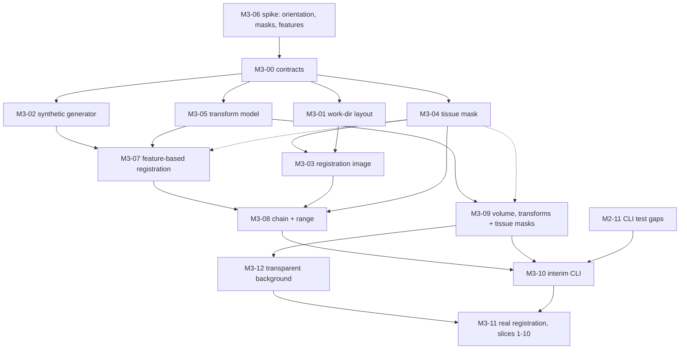

# Implementation plan (MVP, from M3 onwards)

Status: **section 8 approved and applied** (2026-10-19). **Step 1 (spike, M3-06) done; step 2 (contracts, M3-00) done and approved** (2026-10-20); the fixed contracts are in `docs/ARCHITECTURE.md` section 5.1. Updated on 2026-10-19 for two owner requirements: **tissue only (F12)** and **feature-based alignment (F13)**, see `docs/decisions/0003-tissue-only-feature-based-registration.md`. **Changed on 2026-11-06: cells in 3D (milestone M7, decision 0005), order in section 10.** Sources: [docs/MVP.md](../docs/MVP.md), [tasks/BACKLOG.md](BACKLOG.md), [docs/ARCHITECTURE.md](../docs/ARCHITECTURE.md), [docs/REQUIREMENTS.md](../docs/REQUIREMENTS.md), [CLAUDE.md](../CLAUDE.md).

## 0. Where we are

**Now (2026-11-06):**
- **Done:**
  - M0 (except CI), M1, M2, M3;
  - M4-01 to M4-04 (pair score, overlay, QC report, `brainrec qc`; M4-04 done 2026-11-06).
- **M4-05 done (2026-11-07):** owner accepted the QC; M4 closed. Peak check added as M4-06.
- **M7-01 done (2026-11-07):** InstanSeg at 2x as the working detector, StarDist second; linking needed (adjacent sections supported); viewer handles 4 million blobs. Next: M7-02 (labelled cells), then M7-00 (contracts).
- **M7-02 done (2026-11-08):** 20 label crops, QuPath files, labelling guide, evaluation code. Classification rules changed by the owner (decision 0006): every cell classified by appearance with a confidence; new task M7-18 (appearance groups) before the labelling. Next: M7-18.
- **M7-18, M7-19, M7-00, M7-03, M7-04 and M7-05 done (2026-11-08):** class list confirmed, draft labels for the expert, cell contracts fixed, synthetic test data, cell file, nucleus detection over a whole slice.
- **M7-06 done (2026-11-08):** `detect` stage and `brainrec detect`, with the interim classifier rules-v1 (reference rebuilt from 2x measurements); it asks before each next slice.
- **M7-07 done (2026-11-08):** cells placed in the volume frame, one layer per class, `brainrec cells`; AC12 passed.
- **M7-08 done (2026-11-08):** cell layers in `brainrec serve` with colour, opacity, confidence and blur controls; tissue opacity.
- **M7-09 done (2026-11-09):** first 3D cells on real data: slices 1 to 10, 4.55 million cells, 23 min of detection per slice, accepted by the owner.
- **M7-16 done (2026-11-09):** detection QC, `brainrec qc-cells`: densities, blur, folds, flags and review crops per slice; on slices 1 to 10 only folds are flagged (slices 1, 3, 5). 
- **M7-12 done (2026-11-09):** local alignment at cell scale by votes of nucleus offsets (decision 0007); 5 of 9 pairs of slices 1 to 10 align (9 to 20% of nuclei recur, chance 0.8%), 4 show no recurrence (probably missing sections; the owner assumes none for now and asks the lab). 
- **M7-13 done (2026-11-09; review crops accepted by the owner, AC13 passed):** profiles linked into 3D cells, one blob per cell; slices 1 to 10: 4.55 million profiles → 4.19 million cells; AC13 passed on synthetic data. 
- **M7-14 done (2026-11-09; QuPath export checked by the owner):** cell table (`cells/table.csv`, 4.19 million rows, 915 MB) and QuPath export per requested slice (`brainrec cells --qupath`). 
- **M7-15 done (2026-11-09; checked by the owner in the viewer):** density maps per class (`density.zarr`, profiles per mm² until the thickness is known), shown in the viewer as colour maps and in 3D. Next: M7-10 and M7-11 when the expert labels arrive, then M7-17; meanwhile M4-06 or M5.
- **New goal (owner, 2026-11-05/06):** cells (later vessels and other structures) as 3D objects inside a volume that can be made transparent. This adds milestone M7 before M5 (section 10).
- **Prerequisites:** none of the new tasks is needed before M4-04 or M4-05, and no done task has to be redone.
- **Open inputs:** section thickness (the owner will supply it) and the supervisor's answers (`docs/REQUIREMENTS.md` section 6.2).
  - Neither blocks M4.
  - M7-01 can start with the baseline detector; the comparison with deep-learning detectors needs permission (Q19).

**At the start of M3 (2026-10-19):**
- **Done:** M0 (except CI), M1, M2. NDPI → unregistered OME-Zarr volume of slices 1 to 10 → Neuroglancer works end to end (26 tests, ruff and mypy clean).
- **New requirements:**
  - **F12, tissue only:** the empty glass is ignored. Registration works inside the tissue masks, and the volume stores only tissue, limited to the tissue extent.
  - **F13, feature-based:** the tissue boundary gives the initial alignment; features inside the tissue are matched between neighbours and fitted with RANSAC.
- **Open MVP risks:**
  - R5: does the registration align real neighbouring slices?
  - R7: are some slices mirrored?
  - R9: do the tissue masks keep all tissue and no glass?
  - R10: do real sections give enough reliable feature matches?
  - R8: Z spacing is unknown; it's a placeholder in the config and doesn't block anything.
- **Next milestone:** M3 Registration. Its goal is the **first working end-to-end registered feature**: slices 1 to 10, aligned by tissue features, tissue only, shown in Neuroglancer.

---

## 1. Dependency analysis

The backlog's dependency graph was checked task by task against the interfaces each task consumes. Findings:

| # | Finding | Consequence | Proposed change |
|---|---|---|---|
| D1 | **M3-07 does not need M3-04 to be implemented.** Its tests use the synthetic generator's ground-truth masks; the real mask algorithm matters from M3-08 on. | M3-07 can start right after M3-02 and M3-05; preprocessing leaves the critical path. | M3-07's dependency on M3-04 becomes soft (the mask *file contract* C4 is needed, not the algorithm). |
| D2 | **M3-08 needs M3-03 and M3-04**, not just M3-01: it reads registration images and masks from the work dir. | Missing edge in the backlog. | Add M3-03, M3-04 → M3-08. |
| D3 | **M3-06 (spike) does not need M3-03.** `SlideReader` can read the 32x level directly. | The spike can run first, before any M3 code. | Re-scope M3-06 to a script using `SlideReader` directly (section 6). |
| D4 | **R5, R9 and R10 are checked too late.** In the backlog, real data meets registration and masks only in M3-11, after about 13 sessions (including two High tasks). | If masks or feature matching fail on real slices, M3-04/M3-05/M3-07/M3-09 need rework. | Pull a real-data feasibility check to the front (section 6). |
| D5 | **Spike results can change contracts:** mirrored slices need a reflection in the transform model; differential shrinkage needs uniform scale (similarity); the detector choice (SIFT or ORB) and the mask method follow from real images. | M3-04, M3-05 and M3-07 contracts must not be fixed before the spike. | Order: spike → contracts (M3-00) → implementation. |
| D6 | **CLI test file:** M3-10, M4-04 and M5-02 all extend `tests/unit/test_cli.py`, which M2-11 creates. | Merge friction if M2-11 comes late. | Do M2-11 before M3-10. |
| D7 | **ARCHITECTURE and BACKLOG used to disagree on `build_volume`'s transform parameter**; F12 adds a `masks` parameter. | Two contracts for one interface. | Both now say `transforms: dict[int, Rigid2D]`, `masks: dict[int, Path]` (proposed); fixed in M3-00 (C8). |
| D8 | Stale status: summary row M2-07 still says "Done (unverified in browser)"; it was verified in M2-10. | Cosmetic. | Update with the next backlog edit. |
| D9 | **M3-09 (volume) now consumes masks** (F12) as well as transforms. | Real volume runs need M3-04 outputs; tests use synthetic masks. | Soft dependency M3-04 → M3-09; hard for M3-10/M3-11. |

Corrected dependency graph for M3 (solid = hard dependency, dotted = soft):

---

## 2. Critical path to the first working end-to-end feature

**Target feature:** `brainrec preprocess`, `register`, `volume` on slices 1 to 10 produce a registered, tissue-only volume that the owner judges aligned in Neuroglancer (end of M3-11).

Weighting tasks by sessions (Low ≈ 1, Medium ≈ 2, High ≈ 4 to 5; rough), the chains into M3-11 are:

| Chain | Sessions (rough) |
|---|---|
| **Spike → M3-00 → M3-05 → M3-07 → M3-08 → M3-10 → M3-11** | 2 + 1 + 2 + 5 + 1 + 1 + 2 = **14** (critical) |
| Spike → M3-00 → M3-05 → M3-09 → M3-10 → M3-11 | 2 + 1 + 2 + 4 + 1 + 2 = 12 |
| Spike → M3-00 → M3-01 → M3-03 → M3-04 → M3-08 → … | 2 + 1 + 1 + 2 + 2 + 1 + 1 + 2 = 12 |

The **critical path runs through the transform model and the feature-based registration**. Anything that slows M3-05 or M3-07 delays the first registered volume. Preprocessing (masks) and the volume warp have about two sessions of slack each.

Tasks are implemented one at a time (CLAUDE.md), so "critical path" here mostly decides **what must not wait**. Work on the critical chain first whenever there is a choice, and fill owner-review waiting time with off-path tasks.

---

## 3. Recommended order of implementation

| Step | Task | Why at this point | Gate |
|---|---|---|---|
| 1 | **M3-06 Real-data spike** (done 2026-10-19/20) | Resolved R7, R9, R10 and answered R5 (similarity needed); owner decisions 11 to 15. | Done |
| 2 | **M3-00 Registration contracts** (done 2026-10-20) | Contracts C1 to C12 fixed in ARCHITECTURE section 5.1 with the spike's facts. | Approved 2026-10-20 |
| 3 | M3-05 Transform model | Centre of the critical path; unblocks M3-07, M3-09, M4-01, M4-02. | Tests |
| 4 | M3-02 Synthetic generator (tissue with features, debris on the glass) | Needed by M3-07 tests. | Tests |
| 5 | M3-07a+b Boundary-based initial alignment; ORB features inside the tissue | First half of the High task. | Tests |
| 6 | M3-07c+e Guided two-pass matching (64x, 32x), RANSAC similarity fit, conversion to µm, status | **AC4** on synthetic data. | **AC4 passes** |
| 7 | M3-07d (+g only if AC4 is missed) Boundary fallback (outline ICP); intensity refinement only if needed | Robustness for feature-poor pairs. | Tests |
| 8 | M3-01 Work-dir layout | Cheap; needed by M3-03 and M3-08. | Tests |
| 9 | M3-04 Tissue mask (fragments kept, hysteresis) | Defines "tissue"; the registration image needs it. | Tests; owner checks the contact sheet |
| 10 | M3-03 Registration image and preprocessing stage (incl. `SliceSource` move) | Off-path, needed by M3-08. | Tests |
| 11 | M3-08 Chain and register a range | Joins registration and preprocessing. | Tests |
| 12 | M3-09a+b Canvas from the tissue extent; tile mapping | Volume warp, first half. | Tests |
| 13 | M3-09c+d+e+f Warp, levels, resume, tissue masking | Volume warp, second half; AC9 on synthetic data. | Tests; existing volume tests unchanged |
| 14 | M2-11 CLI and config test gaps | Creates `test_cli.py` before M3-10 extends it (D6). | Tests |
| 15 | M3-10 Interim CLI | Makes the real run possible. | Tests |
| 15b | M3-12 Transparent background in the viewer | Owner decision; needed for the M3-11 review. | Tests |
| 16 | M3-11 Real registration, slices 1 to 10 | **First working end-to-end registered, tissue-only feature.** | **M3 gate (section 7)** |
| 17 | M4-01, M4-02, M4-03, M4-04, M4-05 | QC inside the tissue, on top of real transforms. | AC5 |
| 17b | **M7 Cells in 3D** (added 2026-11-06; order in section 10) | New goal: cells as 3D objects; `run` (M5) must cover the cell stages. | AC10 to AC14 |
| 18 | M5-03, M5-04 (any time before M5-06) | Small safety tools. | Tests |
| 19 | M5-01, M5-02, M5-05, M5-06 | Final pipeline and end-to-end run. | AC1, AC2, AC3, AC6 |
| 20 | M6-01 to M6-04 | Review and sign-off. | AC7, AC8, AC9, sign-off |

Fill-in tasks while waiting for owner reviews: M0-06 (CI), M1-02 (header survey), M5-03, M5-04.

---

## 4. Independent tasks (order-free)

Tasks within a group do not depend on each other and touch disjoint files, so they could even be developed in separate sessions or git worktrees. The default remains one task at a time.

| Group | Tasks | Available after |
|---|---|---|
| A: any time | M0-06 CI · M1-02 header survey · M5-03 disk preflight · M5-04 fingerprint | now |
| B: after contracts | M3-01 layout · M3-02 synthetic generator · M3-05 transform model | M3-00 |
| C: after M3-05 | M3-09 volume warp and masking · M4-02 overlay · M4-01 score (also needs M3-02) | M3-05 |
| D: after M3-01 | M3-03 registration image → M3-04 tissue mask (a chain, but independent of M3-07) | M3-01 |

**File conflicts (never in parallel):**

| Shared file | Tasks |
|---|---|
| `src/brainrec/pipeline/cli.py`, `tests/unit/test_cli.py` | M2-11, M3-10, M4-04, M5-02 |
| `src/brainrec/catalog/config.py` | M3-03, M3-07 (registration fields), M3-09 (mask margin), M4-03 (QC fields). Fields are defined once in M3-00. |
| `src/brainrec/volume/builder.py`, `volume/__init__.py` | M3-03a (re-export), M3-09 |
| `tests/synthetic/` | M3-02 (creates the tissue generator); later tasks only use it |
| `docs/ARCHITECTURE.md` | most tasks (small edits, sequential) |

---

## 5. Missing interface contracts

**Superseded:** these contracts were fixed in task M3-00 (2026-10-20) and now live in `docs/ARCHITECTURE.md` section 5.1, which is authoritative. The table below is kept as the proposal history. Main changes from it: C2 uses `Transform2D` (similarity) instead of `Rigid2D`; C3 is similarity without reflection; C4 uses PNG and derives the mask from colour saturation, with detached fragments kept and the mask computed before the registration image; C9 and C12 carry the thresholds measured in the spike (ORB, windows 2.5 mm and 0.3 mm, 40 inliers, 25 µm, IoU 0.80, Dice 0.90).

| ID | Contract | Why it matters | Proposed definition |
|---|---|---|---|
| C1 | **Pixel and physical coordinate convention** | Registration runs at 32x, the volume at 4x. Mixing pixel-corner and pixel-centre conventions shifts slices by 0.5 x (32 - 4) x 0.22 µm ≈ 3 µm ≈ **3.5 base pixels**, enough to blur cells. | Per-slice frame in µm, origin at the top-left **corner** of level-0 pixel (0, 0), x right, y down. Level pixel (i, j) at downsample d covers [i·d·mpp, (i+1)·d·mpp); its centre is at (i + 0.5)·d·mpp. Keypoint coordinates from OpenCV (pixel centres at integer positions) are converted with the same helper. |
| C2 | **Transform direction, composition and pair result** | Matching gives point pairs; which side is "from" and which is "to" is easy to invert. Composition order is easy to get backwards. | `Rigid2D` maps **slice → reference** (µm): p' = R(θ)(p - c) + c + t, θ in radians in y-down coordinates (positive = clockwise on screen). `a.compose(b)` = a∘b (b applied first). `register_pair(fixed, moving) -> PairResult` with the transform mapping **moving → fixed**, `method` (`features` or `boundary`), `n_matches`, `n_inliers`, `rms_um`. Chain: T(k → 1) = T(2→1) ∘ … ∘ T(k→k-1). |
| C3 | **Transform family** | Mirrored sections need a reflection; differential shrinkage needs uniform scale. A scale error of 0.2% already moves the tissue edge by about 30 µm (several cells) on a 30 mm section. | Rigid by default; optional `mirror` flag and optional uniform `scale` (RANSAC similarity fit), **each only if the spike shows it is needed** (owner decision in M3-00). JSON schema `brainrec.transform/1`. |
| C4 | **Registration image and tissue mask files** | The mask now decides what counts as tissue everywhere (F12). | `reg/{id}.tif`: uint8, tissue bright (255 minus luminance), background near 0. `reg/{id}.json`: `{schema, slice_id, source, downsample, mpp_um: [x, y], width, height}`. `mask/{id}.png`: uint8 {0, 255}, same shape, **mandatory**; 255 = tissue. Debris and label components removed; holes inside tissue filled. |
| C5 | **Pair identity and reference slice** | Needed for file names, manifest and QC. | A pair is keyed by the moving slice k; fixed = previous slice in catalog order. `transforms/pair_{k}.json` holds the `PairResult` (k → k-1); `transforms/chained_{k}.json` maps k → reference. Reference = first slice of the run range (slice 1 for 1 to 10) and is part of the signature. |
| C6 | **Manifest schema per stage** | Resume (AC1) and safe re-runs depend on it; today only `volume` is defined. | Keys `preprocess`, `register`, `qc`, `volume`, each `{signature, done: [ids]}`. A stage's signature includes its parameters, its id list and a hash of its upstream stage's signature, so changed inputs (for example a new mask) invalidate downstream work instead of silently reusing it. |
| C7 | **Stage function shape** | M5-01 must wrap the M3/M4 stages without rewriting them. | `run_<stage>(catalog, work: WorkDir, cfg: ProjectConfig, manifest: Manifest, reader_factory=SlideReader.open, overwrite=False) -> StageResult(done, skipped)`. Idempotent per item; raises on error. |
| C8 | **`build_volume` inputs** | Transforms and masks (F12) must be passed consistently. | `transforms: dict[int, Rigid2D] | None`, `masks: dict[int, Path] | None` (by slice id; `None` = M2 mode). Volume attrs add `reference_slice`, `canvas_origin_um`, `mask_margin_um` and per-slice hashes of transform and mask. |
| C9 | **Config fields for registration, masks and QC** | Several tasks would otherwise edit `config.py` independently. | Flat optional fields with defaults, so existing configs keep working: `reg_downsample: 32`, `reg_detector: "sift"`, `reg_ratio_test: 0.75`, `reg_min_inliers: 20`, `mask_min_component_fraction: 0.01`, `volume_mask_margin_um: 50` (accepted by the owner), `qc_min_ncc`, `qc_min_dice` (thresholds calibrated in M4-05). |
| C10 | **QC report schema** | Read by `brainrec qc`, the owner and M6-02. | `qc/report.json`: `{schema: "brainrec.qc/1", thresholds, pairs: [{fixed, moving, method, n_inliers, rms_um, ncc, dice, flagged, overlay}]}`. |
| C11 | **Tissue-only volume semantics (F12)** | "Only tissue" must mean the same thing in the builder, the tests and the viewer. | A voxel is tissue if it lies inside its slice's mask, warped by the slice's transform and enlarged by `volume_mask_margin_um`. All other voxels are exactly 255 (the fill value), so all-background chunks are not stored. The canvas is the bounding box of all warped, enlarged masks, aligned to the pyramid grid. Tissue voxels that are exactly pure white are stored as 254 per channel, so pure white means background unambiguously; the viewer shows it transparent (owner decision, M3-12). The 50 µm rim is accepted for the MVP. |
| C12 | **Feature and failure rules (F13)** | A wrong transform must never be accepted silently. | Features are detected only where the mask is 255. A pair is `features` if inliers ≥ `reg_min_inliers` and rms below a threshold set from the spike; otherwise `boundary` (fallback). If the fallback also fails, the pair is marked **failed**; downstream stages stop for that pair and report it. |

Also to tidy in ARCHITECTURE section 5 during M3-00: the M3/M4 entries are marked "proposed" there until this table is approved.

---

## 6. First task (done): M3-06 Real-data spike: orientation, tissue masks, feature matching

Done on 2026-10-19/20; results in `docs/REQUIREMENTS.md` section 7, decisions 11 to 15. After M3-00 is approved, the next task is **M3-05 `Transform2D` (similarity) model** (step 3). The original task description follows.

- **Objective:** Before writing registration code, learn from real slices:
  - (a) whether any slices are mirrored (R7);
  - (b) whether a simple mask captures all tissue and no glass, debris or labels (R9);
  - (c) whether neighbouring sections give enough reliable feature matches inside the tissue, and which detector does better, SIFT or ORB (R10);
  - (d) whether a rigid fit is enough or uniform scale is needed (R5, C3);
  - (e) whether 32x suits registration, and how long it takes.
- **Component:** scripts (throwaway; not part of the package). **Complexity:** Medium.
- **Inputs:** slices 1 to 10 on My Passport, 32x level only (about 4400 x 3200 px each), read-only.
- **Outputs**, all in the work dir `spike/` (about 25 files):
  - `contact_sheet.png`: slices 1 to 10 side by side, each with its tissue outline drawn (checks orientation and masks).
  - For pairs 1→2, 2→3, 3→4 and 9→10:
    - boundary-only alignment (centroid and principal axes);
    - SIFT and ORB keypoints inside the mask: counts, matches after the ratio test, RANSAC inliers, residual in µm;
    - rigid fit compared with a similarity fit (scale factor);
    - match quality against the mirrored image;
    - run time;
    - a green/magenta overlay with the tissue outlines, and a match picture with the inlier lines.
  - Findings appended to `docs/REQUIREMENTS.md` section 7.
- **Method (spike quality, no tests):**
  - images: inverted grayscale with CLAHE;
  - masks: Otsu, morphology, hole filling, small components removed;
  - initial alignment: centroid and principal axes;
  - matching: OpenCV SIFT and ORB with the mask, ratio test, then `estimateAffinePartial2D` (RANSAC), plus a rigid fit on the inliers.
- **Depends on:** nothing new (`SlideReader` and OpenCV exist). **Files:** `scripts/spike_registration.py`, `docs/REQUIREMENTS.md`.
- **Acceptance:**
  1. Runs read-only on the sources and writes only to `spike/`.
  2. Owner has looked at the contact sheet, the four overlays and the four match pictures.
  3. Recorded decisions:
     - **Mirror needed?**
     - **Rigid or similarity?** Rule of thumb: if the measured scale implies more than about 10 µm (about one cell) of edge displacement, propose similarity.
     - **Which detector?**
     - **Is the mask method adequate?** No tissue cut off, no debris kept.
     - **Is 32x adequate?**
     - **Initial inlier and residual thresholds** for C12.
- **Out of scope:** library code, unit tests, CLI changes, changes to existing interfaces.

---

## 7. How we verify the first milestone (M3) works

M3 is done when all of the following hold, each actually executed and its output reported:

**Automated (pytest, ruff, mypy):**
1. All 26 existing tests still pass unchanged.
2. Transform model: identity, inverse round trip, composition order, JSON round trip, and consistent pixel matrices at 4x and 32x (C1, C2).
3. **AC4:**
   - On at least 5 seeded synthetic pairs, including rotations of about 45° and 170° and section-to-section perturbations, the feature-based registration recovers rotation within 0.5° and translation within 1 px at registration resolution.
   - Results are identical with and without debris on the glass.
   - 30% injected false matches don't change the result.
4. Failure handling (C12):
   - An unrelated pair is reported as failed, never returned as a confident transform.
   - A texture-free pair falls back to boundary alignment, within 3 px.
5. Tissue mask: Dice at least 0.95 and recall at least 0.99 against synthetic ground truth; debris and the label are removed.
6. Volume warp:
   - Synthetic slices moved by known transforms come out with all markers on the same (x, y) across z, within 1 px at the base level and at every pyramid level.
   - Identity transforms reproduce pixels exactly.
7. **AC9 (synthetic):**
   - No non-background voxel lies outside the warped, enlarged masks.
   - Every tissue voxel is kept.
   - The canvas equals the bounding box of the tissue.
   - Background-only tiles write no chunk.
   - No tissue voxel is stored as pure white; the viewer state's shader has the transparent branch and is accepted by Neuroglancer's parser.
8. Resume: a second `register` and `volume` run on a temp work dir reads no pixels; changed transforms or masks trigger the overwrite guard.

**Real data (slices 1 to 10, My Passport):**
9. `brainrec preprocess --slices 1-10`, `register --slices 1-10` and `volume --slices 1-10 --overwrite` all exit 0, with these results:
   - 10 masks, 9 pair results and 10 chained transforms written;
   - match quality per pair printed (method, inliers, residual);
   - no failed pair, or each failed pair named;
   - run times recorded.
10. Sources unchanged: size and modification time of slices 1 to 10 identical before and after. The full fingerprint tool comes in M5-04.
11. Outputs only inside `/Volumes/My Passport/3D Brain Reconstruction/`. Volume size is recorded and compared with the unregistered M2 volume (19.5 GB); it should be smaller, since there are no glass chunks.

**Owner review (Neuroglancer, Chrome with hardware acceleration):**
12. Scrolling through z at three or more positions (centre and two edges), tissue outlines and internal structures stay in place between neighbouring slices. Any pair that jumps is named, with its match quality.
13. **AC9 (real):** only tissue is visible. There are no glass areas, labels or debris, and no tissue is cut off at the edges. A rim of up to about 50 µm is accepted (owner, 2026-10-19). The background is shown transparent.
14. R5, R7, R9 and R10 are marked resolved (or not) in `docs/MVP.md`, with the evidence.

**Documentation:** ARCHITECTURE section 5 matches the implemented signatures; README status and BACKLOG statuses updated.

---

## 8. Backlog changes (approved and applied, 2026-10-19)

The content changes for F12 and F13 were applied to BACKLOG, MVP, ARCHITECTURE, REQUIREMENTS, README and CLAUDE.md. The following were approved by the owner and applied to the backlog; in addition, task M3-12 (transparent background) was added:

1. Re-scope **M3-06** as in section 6 and move it to the front; remove its dependency on M3-03.
2. Add **M3-00 Registration contracts** (docs only, Low): sections C1 to C12 into ARCHITECTURE section 5, with owner approval as the gate.
3. Dependencies:
   - M3-07 no longer hard-depends on M3-04 (D1).
   - M3-08 depends on M3-03 and M3-04 (D2).
   - M3-09 depends softly on M3-04 (D9).
   - M3-10 depends on M2-11 (D6).
4. Critical path line updated to section 2; M2-07 summary status set to Done (D8).

## 9. Definition of done (every task)

- Tests for the new behaviour written and **executed**, with the real output quoted.
- `ruff check` and `mypy` clean.
- Only the task's files changed.
- Docs updated in the same task when an interface or behaviour changes.
- BACKLOG status updated.
- Owner review where the task says so.
- Commit and push only with permission.

---

## 10. Change of direction (2026-11-06): cells in 3D

Approved by the owner on 2026-11-06 (decision 0005; CLAUDE.md "Changes of direction"). Plan history:
- **v1:** structures in a see-through volume (superseded);
- **v2:** cells as blobs;
- **v3:** v2 plus the accepted ideas, and linking across sections because all sections are scanned.

### 10.1 What changes

- **Goal and requirements:**
  - F16 to F23 added;
  - AC10 to AC14 added;
  - risks R11 to R18 added, R8 extended.
- **Architecture:**
  - new components `detect` and `cells`;
  - draft contracts C13 to C18;
  - extensions of C6 and C9;
  - `neuroglancer_state()` gets optional cell and density layers.
- **Unchanged:** volume, transforms, masks and registration.
- **Done tasks:** all stay valid.
- **To-do tasks:**
  - **unchanged:** M0-06, M1-02, M4-04, M4-05, M5-04, M6-01, M6-04;
  - **changed:** M5-01, M5-02, M5-03, M5-05, M5-06, M6-02, M6-03 (they now include the cell stages).
- **New tasks:** M7-00 to M7-17; placeholders for M8 (vessels, structures, non-rigid refinement) and M9 (suspicious cells) after the MVP.

### 10.2 Order

| Step | Task | Gate |
|---|---|---|
| 1 | **M4-04** `brainrec qc` command (done 2026-11-06) | Tests |
| 2 | **M4-05** Real QC review, slices 1 to 10 (done 2026-11-07, closes M4) | Owner |
| 3 | **M7-01** Real-data spike: detector, nucleolus, recurrence after cell-scale alignment, viewer load (done 2026-11-07) | Owner decisions |
| 3b | M4-06 QC peak check (owner's request, 2026-11-07; fill-in while M7 waits for decisions) | Tests |
| 4 | **M7-02** Labelled cells and evaluation (done 2026-11-08; the owner labels after M7-18) | Crops and guide delivered |
| 4b | **M7-18** Appearance groups for the class list (added 2026-11-08; before the owner labels) | Owner fixes the class list |
| 5 | **M7-00** Cell contracts C13 to C18 (done and approved 2026-11-08) | Owner approval |
| 6 | M7-03 synthetic nuclei and 3D cells; M7-04 layout and cell files (both done 2026-11-08) | Tests |
| 7 | M7-05 nucleus detection (done 2026-11-08) | Tests |
| 8 | M7-06 `detect` stage (done 2026-11-08) | Tests |
| 9 | M7-07 placement, layers, `cells` stage (done 2026-11-08, AC12 passed) | **AC12** |
| 10 | M7-08 viewer (done 2026-11-08; the owner's look follows in M7-09) | Tests, owner |
| 11 | **M7-09** real run, one type: **first 3D cells** (done 2026-11-09, accepted by the owner) | Owner review |
| 12 | M7-16 detection QC (done 2026-11-09) | Tests |
| 13 | M7-12 local alignment at cell scale (done 2026-11-09) | Tests, recurrence report |
| 14 | M7-13 linking (done 2026-11-09, AC13 passed) | **AC13** |
| 15 | M7-10 detection accuracy; M7-11 cell types (need the labels) | **AC10** |
| 16 | M7-14 cell table and QuPath export; M7-15 density maps (both done 2026-11-09) | **AC14** |
| 17 | **M7-17** real run, all types, linked (closes M7) | **AC10 to AC14**, owner |
| 18 | M5 (adapted), then M6 | AC1 to AC9 |
| later | M8, M9 (planned in detail when reached) | |

### 10.3 Critical path and parallel work

- **Critical path:** M4-04 → M4-05 → M7-01 → M7-00 → M7-03 → M7-05 → M7-06 → M7-07 → M7-09 → M7-12 → M7-13 → M7-17 → M5-01 → M5-02 → M5-06 → M6.
- **Parallel branch:** labelling, M7-02 → M7-18 (class list) → owner labels → M7-10 → M7-11. It joins at M7-17.
- **Off the path:** M7-04, M7-08, M7-14, M7-15 and M7-16. They fill waiting time during owner reviews and labelling.
- **Answers that gate tasks:**
  - Q19 (dependencies) for the detector comparison in M7-01 and for M7-11;
  - Q9, Q10 and Q26 for M7-00;
  - Q16 and Q17 for M7-02.
- **Section thickness (Q1) gates nothing.** Detection, alignment and linking do not use it; z proportions, 3D sizes and densities per mm³ are recomputed once it is set.

### 10.4 Risks to watch

- **R15 and R16 (are sections adjacent; can nuclei be aligned to 1 to 2 µm):** measured first, in M7-01. If linking finds few partners, M7-12 and M7-13 still run but matter less; the decision is the owner's after the spike.
- **R11 (accuracy):** measured in M7-10 and M7-11 against held-out crops.
- **R13 (viewer with millions of blobs):** tested in M7-01 before the layer writer is built.
